# Elius — Documento de levantamiento de información y reglas de negocio

Versión 0.5 · actualizado el 26 de noviembre de 2026 · exportado del documento de trabajo del equipo

## 1. Información general

Este documento recoge el levantamiento de información de Elius: contexto, decisiones de arquitectura, datos, reglas de negocio, roles y lo que se espera entregar. Es la base para construir el modelo entidad-relación, el diccionario de datos y el código de la base de datos.

| Campo | Detalle |
| --- | --- |
| Proyecto | Elius: base de datos multi-tenant (SaaS) para Eli, agente de inteligencia artificial |
| Motor | PostgreSQL sobre Supabase |
| Modelo multi-tenant | Pool: una base de datos, tablas compartidas, columna `tenant_id` y Row Level Security (RLS) |
| Verticales piloto | Veterinaria, aerolínea y restaurante |
| Versión | 0.2, incluye la entrevista a Potrillos Terraza |

Los puntos marcados como **por validar** son hipótesis propuestas a partir de los tableros. Deben confirmarse con entrevistas u observación antes de cerrar el modelo.

## 2. Contexto del proyecto

Elius es la plataforma que centraliza los datos de Eli, el agente de inteligencia artificial que atiende a los clientes de cada negocio. Eli conversa por WhatsApp, web y una extensión de Chrome. Agenda citas, toma pedidos, responde preguntas y deja todo registrado en Elius.

**Problema.** Cada negocio tiene la información de sus clientes dispersa en chats, hojas de cálculo, agendas y sistemas propios. Eli necesita un único lugar, confiable y aislado por negocio, donde leer y escribir esos datos.

**Solución.** Una base de datos SaaS multi-usuario donde cada negocio (tenant) ve solo sus datos. Un núcleo común cubre lo que comparten todos los negocios: contactos, conversaciones, reservas, órdenes y catálogo. Las particularidades de cada industria se agregan como plugins.

**Objetivos**

1. Aislar los datos de cada tenant en una sola base de datos, con seguridad aplicada en el propio motor (RLS).
2. Ofrecer un núcleo de datos común y reutilizable por cualquier vertical.
3. Extender el sistema por verticales mediante plugins, sin modificar el núcleo.
4. Controlar el acceso con roles y permisos, a nivel de aplicación y de base de datos.
5. Auditar todo cambio relevante: quién, qué, cuándo, valor anterior y valor nuevo.
6. Exponer los datos a Eli y a las integraciones mediante la API de Supabase, funciones RPC, Edge Functions y flujos en n8n.

## 3. Alcance

El proyecto entrega la base de datos completa de Elius para tres verticales piloto. La interfaz de usuario y la lógica conversacional de Eli quedan fuera.

| Incluye | No incluye |
| --- | --- |
| Esquema de plataforma: tenants, planes, usuarios por tenant, roles, permisos, plugins | Interfaz web o móvil de Elius |
| Núcleo de negocio: contactos, conversaciones, mensajes, reservas, órdenes, catálogo, base de conocimiento | Entrenamiento o ajuste de modelos de lenguaje |
| Plugins de veterinaria, aerolínea y restaurante | Pasarelas de pago reales (solo se registra la transacción) |
| Datos de la extensión de Chrome: conversaciones capturadas, patrones, embeddings | Facturación electrónica ante entes de control |
| Seguridad: RLS, roles, permisos, usuarios de base de datos sin superusuario | Despliegue productivo y monitoreo 24/7 |
| Vistas, procedimientos almacenados, triggers y auditoría | Migración de datos históricos de clientes reales |
| Modelo E/R y diccionario de datos |  |

## 4. Metodología del levantamiento

El levantamiento combina seis técnicas y organiza lo encontrado en ocho dimensiones, tal como se definió en el tablero.

**Técnicas**

- **Entrevistas** con dueños y empleados de cada tipo de negocio.
- **Observación** de cómo atienden hoy a sus clientes: chats, llamadas, agenda.
- **Análisis documental** de formatos existentes: historias clínicas, menús, reservas, facturas.
- **Mapa de procesos** de punta a punta para cada vertical.
- **Taller con usuarios** para validar reglas y priorizar.
- **Historias de usuario** como resultado verificable de lo anterior.

**Dimensiones del análisis**

| # | Dimensión | Pregunta que responde |
| --- | --- | --- |
| 1 | Actores y roles | ¿Quién interviene y qué puede hacer? |
| 2 | Procesos reales | ¿Cómo se hace hoy el trabajo, paso a paso? |
| 3 | Reglas del negocio | ¿Qué condiciones deben cumplirse siempre? |
| 4 | Datos que manejan | ¿Qué información se crea, consulta o modifica? |
| 5 | Volúmenes | ¿Cuántos registros y con qué frecuencia? |
| 6 | Canales | ¿Por dónde llega y sale la información? |
| 7 | Datos sensibles | ¿Qué datos requieren protección especial? |
| 8 | Clientes | ¿Quiénes son los clientes finales y qué esperan? |

Cada vertical se analiza con estas ocho dimensiones. Lo que se repite en las tres va al núcleo común; lo que es propio de una sola va a su plugin.

## 5. Decisión de arquitectura multi-tenant

Se eligió el modelo **pool**: todos los tenants comparten una base de datos y las mismas tablas, y cada fila lleva su `tenant_id`. El aislamiento lo garantiza PostgreSQL con Row Level Security. Es el modelo que usan plataformas como Mercado Libre y Shopify, y el que propone la plantilla de Supabase.

**Matriz de decisión**

| Criterio | Silo (una BD por tenant) | Bridge (un esquema por tenant) | Pool (tablas compartidas + RLS) |
| --- | --- | --- | --- |
| Aislamiento | Máximo, físico | Alto, por esquema | Lógico, aplicado por RLS |
| Costo por tenant | Alto | Medio | Bajo |
| Migraciones | Una por cada BD | Una por cada esquema | Una sola vez para todos |
| Versiones del sistema | Pueden divergir | Pueden divergir | Una sola versión para todos |
| Alta de un tenant nuevo | Crear BD completa | Crear esquema completo | Insertar una fila |
| Consultas globales y analítica | Difíciles | Complejas | Directas |
| Riesgo principal | Costo y operación | Muchos esquemas que mantener | Fuga de datos si falla el filtro; rendimiento |
| Encaje con Supabase | Bajo | Medio | Alto |

Base de la matriz: [AWS SaaS Lens](https://docs.aws.amazon.com/wellarchitected/latest/saas-lens/silo-pool-and-bridge-models.html). El detalle de la decisión está en DT-01.

**Consecuencias de la decisión**

- El `tenant_id` es la columna más importante del modelo. Toda tabla de negocio la tiene, nunca es nula y forma parte de los índices principales.
- Todos los tenants corren una sola versión del esquema. Una migración actualiza a todos a la vez, lo que habilita la actualización automática en el despliegue.
- El rendimiento es el riesgo a vigilar. Se mitiga con índices que empiezan por `tenant_id` y con políticas RLS que evalúan el tenant una sola vez por consulta.
- Si en el futuro un cliente grande exige aislamiento físico, puede moverse a un silo sin cambiar el modelo de datos.

## 6. Autenticación y resolución del tenant

Elius autentica con **JSON Web Token (JWT)** en lugar de sesiones con cookie. El token viaja en cada petición, viene firmado y lleva el tenant activo del usuario.

| Aspecto | Sesión con cookie | JWT |
| --- | --- | --- |
| Dónde vive el estado | En el servidor | Dentro del token, en el cliente |
| Flujo | POST de login, el servidor crea la sesión y devuelve una cookie; cada GET la envía | Login devuelve un token; cada petición lo envía en el encabezado |
| Escala con microservicios | Requiere sesión compartida | Cada servicio valida la firma por su cuenta |
| Estándar | Depende del servidor | Estándar abierto, firma digital, sirve para autorización |

Estándar: [RFC 7519](https://www.rfc-editor.org/rfc/rfc7519). Cómo se agrega el tenant al token: DT-04.

**Cómo se sabe a qué tenant pertenece una petición**

1. El usuario inicia sesión con Supabase Auth (`auth.users`).
2. Un hook de Supabase agrega al JWT el `tenant_id` activo y el rol del usuario en ese tenant.
3. Si el usuario pertenece a varios tenants, puede indicar otro con el encabezado `X-Tenant-ID`. La base de datos solo lo acepta si el usuario es miembro activo de ese tenant.
4. Cada política RLS compara el `tenant_id` de la fila con el tenant resuelto. Si no hay tenant válido, no se devuelve ninguna fila.

Los procesos sin usuario, como los webhooks de WhatsApp, resuelven el tenant a partir del canal que recibió el mensaje y siempre filtran por ese `tenant_id`.

## 7. Organización de los datos y componentes

La base de datos separa la lógica del tenant de la lógica del negocio. Sigue una arquitectura de microkernel: un sistema principal estable y plugins que se conectan a él.

> Diagrama de arquitectura: ver [docs/02_arquitectura/00_arquitectura_general.md](../02_arquitectura/00_arquitectura_general.md).

Los canales entran por n8n, las Edge Functions o la API de Supabase. Toda petición lleva el JWT y la base aplica RLS antes de tocar el núcleo, la extensión o los plugins, que dependen del núcleo.

**Esquemas de la base de datos**

| Esquema | Tipo de lógica | Contenido |
| --- | --- | --- |
| `auth` | Identidad (Supabase) | Usuarios, sesiones, tokens |
| `platform` | Lógica del tenant | Tenants, planes, membresías (tenantUser), roles, permisos (tenantPermission), catálogo de plugins |
| `elius` | Lógica del negocio, núcleo | Contactos, conversaciones, mensajes, reservas, órdenes, catálogo, base de conocimiento, consumo de LLM |
| `ext` | Lógica del negocio | Extensión de Chrome: conversaciones capturadas, patrones, embeddings |
| `plugin_vet` | Plugin | Mascotas, historias clínicas, vacunas, citas |
| `plugin_restaurant` | Plugin | Menú, modificadores, reservas de mesa, pedidos |
| `plugin_airline` | Plugin | Aeropuertos, rutas, vuelos, tarifas, reservas (PNR), pasajeros, tiquetes |
| `audit` | Transversal | Bitácora de cambios |

**Componentes de la solución**

| Componente | Responsabilidad |
| --- | --- |
| PostgreSQL | Guarda los datos y aplica RLS, restricciones, triggers y procedimientos |
| API de Supabase | CRUD sobre las tablas respetando RLS; RPC para llamar funciones SQL |
| Edge Functions (TypeScript) | Llamadas a los modelos de lenguaje, webhooks y lógica que no cabe en SQL |
| Flujos en n8n | Integraciones con WhatsApp y Google Calendar |
| Extensión de Chrome | Captura conversaciones del navegador y las envía a `ext` |
| Factus Pay | Cobro por llave Bre-B y QR por el monto exacto; avisa por webhook cuando el cliente paga |

**Patrones de diseño**

- **Microkernel.** El sistema principal ofrece contactos, reservas, órdenes y conversaciones. Cada plugin agrega sus tablas y se conecta al núcleo mediante adaptadores y la API.
- **Factory Method.** Según la vertical del tenant, se crea el manejador del plugin correspondiente.
- **Strategy.** Cada plugin implementa a su manera las mismas operaciones, por ejemplo “agendar”: una cita veterinaria, una mesa o un vuelo.
- **Template Method.** Los procesos comunes siguen siempre los mismos pasos (validar, registrar, auditar, notificar) y cada plugin completa solo los pasos propios.

## 8. Levantamiento por dimensiones

Se analizaron cuatro frentes: la plataforma Elius y las tres verticales piloto. Los volúmenes son estimaciones iniciales **por validar** con los negocios.

### 8.0 Estado de las entrevistas

| Vertical | Fuente | Estado |
| --- | --- | --- |
| Restaurante | Entrevista a Potrillos Terraza | Validado en parte |
| Veterinaria | Hallazgos del equipo | Validado en parte |
| Aerolínea | Sin entrevista | Hipótesis |
| Plataforma y restaurante | Código existente: repositorios elius-panel y potrillos-panel | Validado contra el código |

**Hallazgo principal.** Potrillos Terraza tiene una operación estandarizada y se toma como modelo de referencia para el núcleo. La veterinaria confirma el mismo patrón: todo lo que vende sale de un catálogo.

### 8.1 Plataforma Elius

| Dimensión | Hallazgo |
| --- | --- |
| Actores y roles | Equipo interno de Elius (soporte), dueño del tenant, administrador del tenant, agente humano, empleados especializados, Eli (agente IA), integraciones (n8n, WhatsApp, Calendar) |
| Procesos reales | Registro del negocio y creación del tenant; elección de plan; instalación del plugin de su vertical; invitación de usuarios y asignación de rol; configuración de canales; conversación de Eli y paso a un humano; cambio de tenant activo; suspensión por falta de pago |
| Datos que manejan | Tenants, planes, usuarios, membresías, roles, permisos, plugins instalados, llaves de API, consumo por periodo |
| Volúmenes | 3 tenants piloto (uno por vertical); prueba inicial con los primeros 20 midiendo latencia; capacidad de referencia de 220 ejecuciones por segundo |
| Canales | Aplicación web, WhatsApp, extensión de Chrome, API |
| Datos sensibles | Credenciales de integraciones, llaves de API, tokens, correos y teléfonos de usuarios |
| Clientes | Pequeñas y medianas empresas que quieren atender a sus clientes con un agente de IA |

### 8.2 Veterinaria

| Dimensión | Hallazgo |
| --- | --- |
| Actores y roles | Dueño o administrador de la clínica, médico veterinario, recepcionista o auxiliar, propietario de la mascota, Eli |
| Procesos reales | Registro de propietario y mascota; agendamiento de cita (consulta, vacunación, cirugía, peluquería, control); atención y registro en la historia clínica; plan de vacunación y recordatorios; venta de productos y servicios, siempre desde el catálogo; seguimiento posterior a la consulta |
| Datos que manejan | Propietarios; mascotas (especie, raza, sexo, fecha de nacimiento, peso, microchip, esterilización, alergias); citas; historias clínicas (motivo, anamnesis, diagnóstico, tratamiento, signos vitales); vacunas (lote, fecha, próxima dosis); catálogo de productos y servicios con precio; pagos |
| Volúmenes | 20 a 60 citas al día por clínica; 1 a 3 mascotas por propietario; 500 a 3.000 mascotas registradas (por validar) |
| Canales | WhatsApp (principal), llamada, presencial, web |
| Datos sensibles | Datos personales del propietario, historia clínica (reserva profesional), datos de pago |
| Clientes | Propietarios con una carga emocional alta: hablan de un ser querido, a veces enfermo o en urgencia. Esperan un trato muy empático, agendar rápido, recordatorios y el historial disponible |

### 8.3 Restaurante (entrevista: Potrillos Terraza)

| Dimensión | Hallazgo |
| --- | --- |
| Actores y roles | Dueño o administrador, mesero, cajero, cocina, domiciliario, comensal, Eli |
| Procesos reales | Venta y cobro presencial, el proceso de mayor volumen; toma de pedido en mesa, para llevar o a domicilio; envío a cocina y seguimiento de estado; reserva de mesa; gestión del menú estandarizado y de productos agotados; atención de alergias |
| Datos que manejan | Menú estandarizado (categorías, platos, precios, modificadores, alérgenos, disponibilidad); mesas (capacidad, zona); reservas (fecha, hora, personas, ocasión); pedidos e ítems; pagos; direcciones de entrega |
| Volúmenes | Flujo de caja presencial muy alto y concentrado en picos (dato de la entrevista). Falta medir las ventas por hora; estimación inicial de 100 a 400 pedidos al día |
| Canales | Presencial (el principal, según la entrevista), WhatsApp, teléfono, web y apps de domicilios |
| Datos sensibles | Dirección y teléfono del cliente, datos de pago, alergias (dato de salud) |
| Clientes | Comensales que esperan atención rápida en horas pico, confirmación inmediata y un menú actualizado |

### 8.4 Aerolínea (sin entrevista: hipótesis)

No se ha entrevistado a ninguna aerolínea. Esta tabla es una hipótesis armada con el funcionamiento general del sector y debe validarse antes de construir el plugin.

| Dimensión | Hallazgo |
| --- | --- |
| Actores y roles | Administrador, agente de ventas o call center, agente de counter, operaciones (programación de vuelos), comprador, pasajero, Eli |
| Procesos reales | Programación de rutas y vuelos; consulta de disponibilidad y tarifas; reserva con uno o varios pasajeros y tramos; emisión del tiquete; cambios y cancelaciones; check-in y asignación de silla; registro de equipaje; aviso de retrasos o cancelaciones |
| Datos que manejan | Aeropuertos (código IATA), rutas, aeronaves y capacidad, vuelos (número, salida, llegada, estado, puerta), clases tarifarias, reservas con localizador, pasajeros (documento, nacionalidad, fecha de nacimiento, tipo adulto/niño/infante), tramos, tiquetes, sillas, equipaje, pagos |
| Volúmenes | Decenas a cientos de vuelos al día y miles de reservas al día: la vertical de mayor volumen |
| Canales | Web, WhatsApp, call center, counter en aeropuerto |
| Datos sensibles | Documento de identidad o pasaporte, fecha de nacimiento, datos de menores, necesidades especiales de salud, datos de pago |
| Clientes | Pasajeros que esperan confirmación inmediata, cambios sencillos y alertas sobre su vuelo |

### 8.5 Estandarización: qué va al núcleo y qué va a cada plugin

La estandarización toma como referencia a Potrillos Terraza. Las similitudes encontradas hasta ahora son:

- Todo se vende desde un catálogo: el menú en el restaurante, los productos y servicios en la veterinaria y las tarifas en la aerolínea (hipótesis).
- Toda venta es una orden con ítems de ese catálogo.
- Citas, mesas y vuelos son reservas sobre un recurso.
- Cada cliente final es un contacto que conversa con Eli.
- Entre verticales cambian el tono de Eli y las entidades propias, no la estructura del núcleo.

| Concepto | Veterinaria | Restaurante | Aerolínea | Ubicación |
| --- | --- | --- | --- | --- |
| Cliente final | Propietario | Comensal | Comprador / pasajero | Núcleo: `contactos` |
| Conversación con Eli | Sí | Sí | Sí | Núcleo: `conversaciones`, `mensajes` |
| Reserva | Cita | Reserva de mesa | Reserva (PNR) | Núcleo: `reservas` + transiciones del plugin |
| Orden o venta | Productos y servicios | Pedido | Tiquete | Núcleo: `órdenes` + transiciones del plugin |
| Catálogo | Servicios y productos | Menú | Tarifas | Núcleo: `catálogo` + transiciones del plugin |
| Recurso agendable | Veterinario o consultorio | Mesa | Silla en un vuelo | Núcleo: `recursos` |
| Entidad propia | Mascota, historia clínica, vacuna | Modificadores del menú | Vuelo, ruta, pasajero, tramo, equipaje | Plugin |

### 8.6 Lo que Elius ya hace hoy (repositorios del equipo)

El código de `elius-panel` (panel genérico) y `potrillos-panel` (panel a la medida de Potrillos Terraza) confirma el modelo. También muestra 18 funciones que ya están en producción y que el levantamiento no había recogido. Todas quedan cubiertas en el modelo nuevo.

| Función que ya existe | Repositorio | Dónde queda en el modelo |
| --- | --- | --- |
| Conversaciones en vivo: tomar la conversación y devolverla a Eli | Ambos | `conversaciones` (estado humano o pausa, asignado) |
| Pendientes: casos que Eli escala, repartidos por turnos entre trabajadores | Ambos | `escalamientos` |
| Comprobantes de pago con alertas: monto que no cuadra, comprobante repetido, destinatario raro | Ambos | `comprobantes_pago` y `pagos` |
| Pagos parciales con saldo en efectivo | potrillos-panel | `pagos` y `entregas` |
| Pedidos unificados con tipo de entrega: recoger, domicilio o en sitio | elius-panel | `ordenes` |
| Domicilios con barrio, ubicación y domiciliario | potrillos-panel | `direcciones` y `entregas` |
| Reservas con festejados, decoración, llegada, salida y urgencia | potrillos-panel | `reservas` y `celebraciones` |
| Menú del día por fecha, confirmado por el dueño | potrillos-panel | `menus_dia` y `menu_dia_items` |
| Catálogo de paquetes, adicionales, fotos y videos | Ambos | `items_catalogo`, `item_adicionales` y `medios_item` |
| Personalización de Eli: tono, bienvenida, instrucciones, horario | elius-panel | `agentes` y `horarios_atencion` |
| Ajustes del negocio y apagado de emergencia del bot | Ambos | `parametros_negocio` y `agentes` |
| Métricas y embudo de conversión | Ambos | `eventos_embudo` |
| Consumo de IA, incluidos los tokens de caché | potrillos-panel | `consumos_llm` |
| Errores del bot para el panel de soporte | Ambos | `errores_agente` |
| Notificaciones push por dispositivo y rol | Ambos | `suscripciones_push` |
| Bitácora de actividad del panel | potrillos-panel | `audit.registros_auditoria` |
| Conexión del número de WhatsApp (Embedded Signup de Meta) | Ambos | `canales` |
| Agrupar mensajes seguidos y evitar respuestas dobles | elius-panel | `mensajes` y `conversaciones` |

**Lo que cambia con este diseño**

- **De silo a pool.** Hoy cada cliente tiene su propio proyecto de Supabase y su propio despliegue. El README de `elius-panel` deja el multi-tenant real como pendiente. Este proyecto lo resuelve.
- **Seguridad.** El panel actual usa la llave `service_role` desde el navegador, y el README de Potrillos advierte que esa llave se salta toda la seguridad. Con RLS y usuarios autenticados ya no hace falta (DT-02 y DT-13).
- **Usuarios y roles.** Hoy los usuarios son fijos (trabajador 1, trabajador 2) y entran con una clave del archivo de configuración. Pasan a membresías con los roles generales. El dueño es Administrador; staff, trabajadores y domiciliarios son Operadores con su cargo; el panel de soporte corresponde a Soporte.
- **Datos en JSON.** Hoy el historial del chat y las líneas del pedido se guardan como JSON dentro de una fila. Pasan a tablas propias (`mensajes` y `orden_items`) para poder consultarlos, auditarlos y protegerlos con RLS.
- **Parámetros.** Hoy son una tabla clave-valor sin tenant. Pasan a `parametros_negocio`, uno por tenant.

## 9. Reglas de negocio

Se identificaron 73 reglas. Cada una indica cómo la va a garantizar la base de datos: restricción, trigger, procedimiento, vista o política RLS. Así se conecta este levantamiento con el código. Las marcadas **(por validar)** son supuestos.

### 9.1 Plataforma y multi-tenencia

| ID | Regla | Cómo se garantiza |
| --- | --- | --- |
| RN-P01 | Todo registro de negocio pertenece a un solo tenant. El `tenant_id` es obligatorio y no cambia. | `NOT NULL` + RLS con `WITH CHECK` |
| RN-P02 | Un usuario solo ve y modifica datos de los tenants donde es miembro activo. | RLS |
| RN-P03 | Un usuario puede pertenecer a varios tenants, con un rol distinto en cada uno. | Membresía única por (tenant, usuario) |
| RN-P04 | Cada tenant tiene al menos un Administrador. El último Administrador no puede eliminarse ni perder su rol. | Trigger |
| RN-P05 | El identificador corto (slug) de un tenant es único en toda la plataforma. | Índice único |
| RN-P06 | Un tenant suspendido o cancelado no puede operar: sus usuarios no ven datos. | Función de resolución del tenant |
| RN-P07 | Un tenant en prueba se suspende al terminar el periodo sin pago. (por validar: 14 días) | Procedimiento programado |
| RN-P08 | Al crear un tenant se instala el plugin de su vertical y se crea su agente Eli. | Procedimiento `crear_tenant` |
| RN-P09 | Las tablas de un plugin solo son accesibles si el plugin está instalado y habilitado para el tenant. | RLS |
| RN-P10 | Un tenant no puede superar los límites de su plan: usuarios, conversaciones y tokens. | Trigger + contadores de uso |
| RN-P11 | Las llaves de API y los tokens se guardan solo cifrados con hash, nunca en texto plano. | Diseño de tabla |
| RN-P12 | Una invitación vence a los 7 días y se usa una sola vez. | Restricción + procedimiento |
| RN-P13 | Los roles son generales y fijos para todos los tenants: Super Admin, Soporte, Administrador, Operador, Analista y Eli. Un tenant no crea roles; el plugin solo personaliza. | Trigger |
| RN-P14 | Los registros principales no se borran físicamente: se marcan como eliminados. | Columna `deleted_at` |
| RN-P15 | Todo cambio en tablas de negocio queda en la auditoría: usuario, fecha, valor anterior y nuevo. | Trigger de auditoría |
| RN-P16 | Soporte solo entra a un tenant si el Administrador lo autoriza. El acceso vence solo y cada acción queda auditada. | Tabla de accesos de soporte con vencimiento + RLS + trigger de auditoría |

### 9.2 Núcleo: contactos, conversaciones, reservas y órdenes

| ID | Regla | Cómo se garantiza |
| --- | --- | --- |
| RN-C01 | Un contacto se identifica por teléfono o correo, únicos dentro del tenant. El mismo teléfono puede existir en otro tenant. | Índice único (tenant, teléfono) |
| RN-C02 | Los teléfonos se guardan en formato internacional E.164 (+57…). | `CHECK` |
| RN-C03 | Se registra la autorización de tratamiento de datos del contacto antes de guardar datos sensibles (Ley 1581 de 2012). | Columna de consentimiento + procedimiento |
| RN-C04 | Toda conversación pertenece a un contacto y a un canal del mismo tenant. | Llave foránea compuesta |
| RN-C05 | Eli pasa la conversación a un humano si el cliente lo pide, si no tiene una respuesta confiable o si el tema es una queja, un pago o una emergencia. | Estado “pendiente de humano” + procedimiento |
| RN-C06 | Un mensaje nuevo en una conversación cerrada la reabre. (por validar) | Trigger |
| RN-C07 | Un recurso no puede tener dos reservas activas que se crucen en el tiempo. | Restricción de exclusión |
| RN-C08 | Una reserva no se crea en el pasado y su fin es posterior a su inicio. | `CHECK` + trigger |
| RN-C09 | Una reserva solo cambia de estado por transiciones válidas: pendiente → confirmada → completada, cancelada o no asistió. | Trigger |
| RN-C10 | El número de orden es consecutivo dentro de cada tenant. | Trigger + contador por tenant |
| RN-C11 | El total de una orden es la suma de sus ítems, menos descuentos, más impuestos. No se edita a mano. | Trigger |
| RN-C12 | Una orden pagada no se modifica; solo se anula con un reverso. | Trigger |
| RN-C13 | Cada llamada a un modelo de lenguaje registra tokens, costo y latencia. | Tabla de consumo + procedimiento |
| RN-C14 | Eli solo responde con la base de conocimiento de su propio tenant. | RLS sobre documentos y embeddings |
| RN-C15 | Toda orden se compone solo de ítems del catálogo del tenant; no hay ventas de ítems libres. Confirmado en restaurante y veterinaria. | Llave foránea compuesta al catálogo |
| RN-C16 | Eli lee cada comprobante de pago y marca alerta si el monto no coincide con el esperado, si el comprobante está repetido (mismo archivo, o misma app y referencia) o si el destinatario no es la cuenta del negocio. Un humano lo aprueba o lo rechaza; al aprobarlo se confirma la orden. | Función de comprobante repetido + trigger + procedimiento de aprobación |
| RN-C17 | Una orden puede tener varios pagos parciales. El saldo pendiente se cobra en efectivo al entregar. | Vista de saldo + columna de cobro contra entrega |
| RN-C18 | Los escalamientos se reparten por turnos entre los Operadores activos. Cuando se resuelve el último, la conversación queda sin asignar. | Trigger de asignación y de liberación |
| RN-C19 | Si un humano toma la conversación, Eli deja de responder hasta que se la devuelven. | Estado de la conversación + RLS para Eli |
| RN-C20 | El Administrador o Soporte pueden apagar a Eli de inmediato (interruptor de emergencia). | Columna activo del agente + procedimiento |
| RN-C21 | Eli agrupa los mensajes seguidos del cliente antes de responder, y cada conversación la atiende un solo proceso a la vez. | Columna procesado + bloqueo de la conversación |
| RN-C22 | Si el negocio tiene Factus Pay activo, Eli cobra con una llave Bre-B y un QR por el monto exacto. El pago se confirma solo con el webhook validado, sin intervención humana. | Función de estrategia de cobro + procedimiento del webhook + trigger que crea el pago |
| RN-C23 | Factus no acepta pagos parciales ni montos distintos, y cobra entre 1.000 y 12.100.000 COP. Cada abono es un recaudo aparte; si el monto queda fuera del rango o el negocio no usa Factus, se cobra por comprobante tradicional. | CHECK de montos + función de estrategia de cobro |
| RN-C24 | El webhook se valida comparando la clave secreta en tiempo constante. Se guarda antes de responder 2xx, es idempotente (un webhook repetido no paga dos veces) y en montos altos se confirma consultando el recaudo en la API. | Bandeja de notificaciones + procedimiento solo para el backend |
| RN-C26 | Solo un Administrador puede aprobar o rechazar un comprobante de pago. Un Operador que lo intente recibe un error claro. | Triggers `t53/t55_solo_admin_decide` sobre el veredicto del comprobante |
| RN-C27 | Cuando llega un comprobante pendiente, cada Administrador activo recibe un aviso en su celular con el cliente, el monto y un enlace para aprobar o rechazar. Si el monto no coincide, el aviso lo destaca. | Trigger `t56_aviso_celular_comprobante` (función `avisar_comprobante_celular`) + `pg_net` hacia el servicio de notificaciones y hacia ntfy |
| RN-C28 | El aviso es un respaldo del flujo, no parte de él: si el servicio de notificaciones falla, el comprobante se guarda igual y el error queda como aviso en el registro de la base. | Bloque `exception` dentro del trigger |
| RN-C29 | Cada reserva de cualquier caso puede marcarse como “llegó” o “no llegó”. Marcar “no llegó” pasa la reserva a `no_asistio` y libera el recurso. | Procedimientos `elius.marcar_llegada` y `elius.marcar_no_llegada` + trigger de transiciones (RN-C09) |
| RN-C30 | Las validaciones de dominio nuevas (teléfonos, montos positivos, fechas coherentes, estados permitidos) se agregaron como `CHECK ... NOT VALID`: protegen los datos nuevos sin romper los antiguos. | Migración 0200 de validaciones |
| RN-C31 | ~~El Operador usa la consola SQL~~ Reemplazada el 26-nov: la consola es solo del Administrador y el Super Admin; el Operador crea tickets de soporte. | Operación |
| RN-C32 | Todo lo que hace cada rol en su panel queda en la auditoría que ve el Administrador: cada cambio en las tablas del negocio (quién, rol, cargo, antes y después), cada consulta de la consola, cada intento bloqueado y cada mensaje que una persona envía a un cliente (solo datos de control, nunca el texto). Aplica igual a restaurante, veterinaria y aerolínea. | Trigger `t02_auditoria` en las tablas, `t02_auditoria_mensaje_humano`, `consola_auditar` y la vista `v_auditoria` |
| RN-C25 | Factus no permite reversos ni reembolsos, porque la transferencia va de banco a banco. Una devolución se registra como un pago negativo hecho por fuera. | CHECK de reversos en pagos |

### 9.3 Extensión de Chrome

| ID | Regla | Cómo se garantiza |
| --- | --- | --- |
| RN-E01 | Lo capturado pertenece al tenant y al usuario que lo capturó. Otros usuarios lo ven solo con permiso de supervisión. | RLS restrictiva |
| RN-E02 | Un patrón detectado queda como “sugerido” hasta que un administrador lo aprueba. Eli solo usa los aprobados. | Estado + vista de patrones aprobados |
| RN-E03 | La extensión solo captura en los sitios que el tenant autorizó. (por validar) | Configuración del tenant |

### 9.4 Veterinaria

| ID | Regla | Cómo se garantiza |
| --- | --- | --- |
| RN-V01 | Toda mascota tiene un propietario registrado como contacto. | Llave foránea compuesta |
| RN-V02 | Una cita se asocia a una mascota y a un veterinario que es miembro del tenant. | Llaves foráneas compuestas |
| RN-V03 | Solo los usuarios con el acceso especial “Historia clínica”, que el Administrador activa para los veterinarios, crean y modifican la historia clínica. Recepción no la ve. | Permiso `vet.medical` + RLS |
| RN-V04 | La historia clínica no se edita después de 24 horas; las correcciones se agregan como nota. (por validar) | Trigger |
| RN-V05 | Al registrar una vacuna se calcula la próxima dosis. Eli recuerda 7 días antes. (por validar) | Trigger + vista de vacunas por vencer |
| RN-V06 | Una mascota fallecida no recibe citas nuevas. | Trigger |
| RN-V07 | Eli atiende con un tono empático. Ante una urgencia o una situación delicada con la mascota, pasa la conversación a un humano de inmediato. | Configuración del agente por vertical + procedimiento de paso a humano |

### 9.5 Restaurante

| ID | Regla | Cómo se garantiza |
| --- | --- | --- |
| RN-R01 | El número de personas de una reserva no supera la capacidad de la mesa. | Trigger |
| RN-R02 | Las reservas solo se aceptan dentro del horario de atención. | Procedimiento |
| RN-R03 | Un plato agotado no se puede pedir. | Trigger |
| RN-R04 | Los modificadores respetan el mínimo y el máximo de su grupo; por ejemplo, el término de la carne es exactamente uno. | Procedimiento |
| RN-R05 | Un pedido a domicilio exige dirección y teléfono. | `CHECK` |
| RN-R06 | El pedido avanza: recibido → en preparación → listo → entregado. Solo se cancela antes de entrar a preparación. | Trigger |
| RN-R07 | Una reserva sin llegada después de la tolerancia configurada (hoy 20 minutos en Potrillos Terraza) se marca como “no asistió” y libera la mesa. | Procedimiento programado |
| RN-R08 | Las reservas con un número de personas igual o mayor al umbral configurado (hoy 20) se avisan al Administrador. | Parámetro del negocio + trigger que genera evento |
| RN-R09 | Para mantener la reserva debe llegar al menos el porcentaje configurado del grupo (hoy 80 %). | Parámetro del negocio + procedimiento |
| RN-R10 | Solo se reserva con la anticipación máxima configurada (hoy 120 días). | Parámetro del negocio + trigger |
| RN-R11 | Hay un solo menú del día por fecha. Eli lo ofrece solo si el dueño lo confirmó, y en el orden de posición de sus platos. | Índice único (tenant, fecha) + vista del menú vigente |
| RN-R12 | La consignación de una reserva no se reembolsa; la reserva se puede reagendar según disponibilidad. Es una política configurable por negocio. | Parámetro del negocio |

### 9.6 Aerolínea

| ID | Regla | Cómo se garantiza |
| --- | --- | --- |
| RN-A01 | Los aeropuertos son datos de referencia comunes a todos los tenants. | Tabla global sin `tenant_id` |
| RN-A02 | El origen y el destino de una ruta son distintos. | `CHECK` |
| RN-A03 | La llegada de un vuelo es posterior a su salida. | `CHECK` |
| RN-A04 | Las sillas vendidas no superan la capacidad de la aeronave en ese vuelo. | Trigger |
| RN-A05 | Cada reserva tiene un localizador de 6 caracteres, único en el tenant. | Trigger + índice único |
| RN-A06 | Todo pasajero tiene documento. En cada reserva, los infantes no superan a los adultos. | `CHECK` + trigger |
| RN-A07 | Una silla no se asigna a dos pasajeros del mismo vuelo. | Índice único |
| RN-A08 | El check-in abre 48 horas y cierra 1 hora antes de la salida. (por validar) | Procedimiento |
| RN-A09 | Si un vuelo se cancela o se retrasa, se avisa a todos sus pasajeros. | Trigger que genera evento para n8n |
| RN-A10 | Una reserva no emitida vence en su plazo de emisión y libera los cupos. | Procedimiento programado |

## 10. Roles, permisos y usuarios de base de datos

El acceso se controla en dos niveles. En la **aplicación**, cada usuario tiene un rol dentro de cada tenant. En la **base de datos**, cada conexión entra con un usuario de PostgreSQL con privilegios limitados, y ninguno es superusuario.

### 10.1 Roles generales de la aplicación

Elius usa **seis roles generales, iguales para todos los tenants y todas las verticales**. Los nombres no cambian por industria: un veterinario, un mesero o un agente de counter son Operadores. Lo propio de cada vertical lo agrega el plugin (sección 10.2).

**Por qué roles fijos.** El público objetivo son pymes sin departamento de TI. El dueño no debería diseñar roles ni permisos: solo elige uno de una lista corta y fácil de entender. Lo técnico lo resuelve el equipo de Elius.

| Rol | Nivel | Quién es en una pyme | Qué hace |
| --- | --- | --- | --- |
| Super Admin | Plataforma | Equipo de Elius | Administra la plataforma: tenants, planes, plugins disponibles y configuración técnica. No ve datos de negocio de un tenant. |
| Soporte | Plataforma | Equipo de Elius | Entra a un tenant solo cuando el Administrador lo autoriza, por tiempo limitado y con todo auditado. Hace la configuración que la pyme no puede hacer sola. |
| Administrador | Tenant | Dueño o gerente del negocio | Configura su negocio: usuarios, catálogo, horarios, canales, plugin y plan. No necesita conocimientos técnicos. |
| Operador | Tenant | Quien atiende el día a día: recepción, veterinario, mesero, cajero, cocina, ventas | Atiende lo que Eli le pasa y gestiona contactos, reservas y órdenes. |
| Analista | Tenant | Contador, socio o quien revisa resultados | Consulta reportes y métricas, y los exporta. No modifica nada. |
| Eli | Tenant (identidad de sistema) | El agente de IA | Atiende a los clientes: crea contactos, conversaciones, reservas y órdenes. No accede a usuarios, auditoría ni datos sensibles. |

**Permisos de cada rol**

| Módulo | Super Admin | Soporte | Administrador | Operador | Analista | Eli |
| --- | --- | --- | --- | --- | --- | --- |
| Plataforma: tenants, planes, plugins disponibles | Total | Lectura | — | — | — | — |
| Configuración del negocio: usuarios, canales, horarios, plugin, plan | — | Con autorización | Total | — | — | — |
| Contactos | — | Con autorización | Total | Escritura | Lectura | Escritura |
| Conversaciones | — | Con autorización | Total | Escritura | Lectura | Escritura |
| Reservas | — | Con autorización | Total | Escritura | Lectura | Escritura |
| Órdenes y pagos | — | Con autorización | Total | Escritura | Lectura | Escritura |
| Catálogo y base de conocimiento de Eli | — | Con autorización | Total | Lectura | Lectura | Lectura |
| Módulos del plugin | — | Con autorización | Total | Según el plugin | Lectura | Según el plugin |
| Datos sensibles del plugin | — | — | Total | Solo con acceso especial | — | — |
| Reportes y métricas | Solo de la plataforma | Con autorización | Lectura | — | Lectura y exportación | — |
| Auditoría | Solo de la plataforma | — | Lectura | — | — | — |

“Con autorización” significa que el Administrador abrió un acceso de soporte que vence solo y queda registrado en la auditoría.

**Ajuste del 24 de noviembre de 2026 (permisos estrictos por rol).** Después de revisar el panel con el equipo se afinó lo siguiente, y la base de datos lo hace cumplir (no solo la pantalla):

| Tema | Regla final |
| --- | --- |
| Modelo de datos, flujos, diccionario y levantamiento | Solo Administrador y Super Admin |
| Vistas | Solo Administrador y Super Admin |
| Consola SQL | Administrador, Super Admin y Operador, con las mismas reglas: solo SELECT, INSERT, UPDATE y CREATE (este último solo en el esquema `practica`); nada de DROP, DELETE, TRUNCATE ni ALTER, ni dar de baja. El Operador además no cambia catálogo, precios ni vuelos |
| Aprobar o rechazar comprobantes de pago | Solo el Administrador. El Operador ve los comprobantes pero no decide; el Analista solo mira |
| Catálogo | El Operador solo consulta; únicamente el Administrador crea o cambia ítems |
| Eli como usuario del panel | Eli no tiene pantalla: es una identidad de sistema que actúa por la API. Se quitó su panel |
| Analista | Lee reportes, métricas, reservas, órdenes, conversaciones y comprobantes; no escribe en ninguna parte |
| Marcar si el cliente llegó o no llegó a una reserva | Operador y Administrador, en los tres casos (veterinaria, restaurante, aerolínea) |

### 10.2 Personalización por plugin

El plugin no crea roles: personaliza los roles generales de tres maneras.

1. **Agrega sus módulos** (mascotas, menú, vuelos) y define qué puede hacer en ellos cada rol general por defecto.
2. **Agrega accesos especiales** que el Administrador activa por usuario con un interruptor. Así un Operador veterinario ve la historia clínica y un Operador de recepción no, sin crear un rol nuevo.
3. **Agrega cargos** (Veterinario, Mesero, Cocina, Agente de counter). Solo describen al usuario en pantalla y no cambian sus permisos.

| Plugin | Lo que el Operador puede hacer por defecto | Acceso especial que activa el Administrador |
| --- | --- | --- |
| Veterinaria | Mascotas, citas y vacunas | Historia clínica, para los veterinarios |
| Restaurante | Pedidos, mesas y estado en cocina | Reversar pedidos pagados, para el cajero o encargado |
| Aerolínea | Reservas, check-in y equipaje | Documentos de identidad y necesidades de salud de pasajeros |

### 10.3 Usuarios de PostgreSQL (conexión a la base de datos)

| Usuario | Tipo | Puede | No puede |
| --- | --- | --- | --- |
| `elius_admin` | Administrador | Crear y modificar tablas, vistas, funciones y triggers de los esquemas de Elius; otorgar permisos | Ser superusuario, crear bases de datos, leer otros esquemas del servidor |
| `elius_app` | Con privilegios | Leer, insertar, actualizar y borrar en tablas de negocio; ejecutar procedimientos. Siempre sujeto a RLS | Cambiar la estructura, desactivar RLS, leer la auditoría |
| `elius_consulta` | Consulta | Leer únicamente las vistas de reportes | Escribir datos, leer tablas directamente, ver columnas sensibles |

Además se usan los roles propios de Supabase. `anon` no tiene acceso a ningún dato. `authenticated` es el usuario que inició sesión y queda sujeto a RLS. `service_role` se usa solo en Edge Functions del servidor y nunca en el navegador.

El Super Admin de la aplicación **no es** un superusuario de PostgreSQL. Entra por la aplicación como cualquier otro rol y queda sujeto a sus permisos y a la auditoría.

## 11. Requerimientos funcionales: qué hace Eli y hasta dónde llega
Eli es el agente de IA que atiende por WhatsApp a los clientes de cada negocio. Este documento dice, función por función, **qué hace Eli por su cuenta, qué deja a una persona y qué no puede hacer**. Eli está en **etapa de aprendizaje**: en todo lo que mueve dinero o compromete al negocio, Eli prepara y avisa, y **una persona decide**.

### 11.1 Principio general: tres niveles de autonomía

| Nivel | Significado | Ejemplos |
| --- | --- | --- |
| **A. Autónomo** | Eli lo hace solo, sin pedir permiso, porque es de bajo riesgo y reversible. | Responder preguntas del catálogo, tomar un pedido, agendar una reserva dentro de las reglas. |
| **B. Propone y espera** | Eli lee, compara y avisa; **una persona aprueba o rechaza**. Hasta que no decide, no pasa nada. | Verificar un comprobante de pago. |
| **C. Prohibido** | Eli no puede hacerlo; la base de datos lo impide aunque Eli quisiera. | Aprobar un pago, ver historia clínica, borrar datos, ver otro negocio. |

Los niveles B y C no dependen de que Eli "se porte bien": los hace cumplir la base de datos (triggers, RLS y permisos). Por eso un error de Eli no puede saltarse la regla.

### 11.2 Qué hace Eli, paso a paso

#### 11.2.1 Atender al cliente por WhatsApp
- **Lo que hace (A):** responde con el catálogo, el horario, los precios y la base de conocimiento **de su propio negocio** (RN-C14). Agrupa los mensajes seguidos del cliente antes de responder (RN-C21). Usa el tono y las instrucciones que el Administrador configuró.
- **Dónde se detiene:** si no tiene una respuesta confiable, si el cliente pide hablar con una persona, o si el tema es una queja, un pago o una emergencia, **escala a un humano** (RN-C05). Mientras un humano tiene la conversación, Eli **no responde** (RN-C19). El Administrador o Soporte pueden **apagarla al instante** (RN-C20).
- **No puede:** inventar productos (solo vende lo del catálogo, RN-C15), ofrecer un plato agotado (RN-R03) ni responder con datos de otro negocio.

#### 11.2.2 Tomar pedidos
- **Lo que hace (A):** crea la orden, agrega los ítems con sus modificadores (por ejemplo, el término de la carne), pide dirección y teléfono si es domicilio, y deja los totales calculados por la base (RN-C11).
- **Dónde se detiene:** el pedido avanza por estados (recibido → en preparación → listo → entregado) y **lo mueve el equipo**, no Eli. Una orden pagada no se modifica (RN-C12). Solo se cancela antes de entrar a preparación.

#### 11.2.3 Agendar reservas
- **Lo que hace (A):** crea la reserva si hay cupo, está dentro del horario, no supera la capacidad de la mesa y respeta la anticipación máxima (RN-C07, RN-R01, RN-R02, RN-R10). Si la reserva es grande (hoy 20 personas o más) **avisa al Administrador** (RN-R08).
- **Dónde se detiene:** la reserva queda pendiente de pago/confirmación según la política del negocio. **Eli no cancela ni reembolsa**: eso es del Administrador. Si el cliente no llega, el sistema libera el recurso y un Operador marca "llegó / no llegó" (RN-C29).

#### 11.2.4 Verificar pagos (el caso más delicado)

Hoy el negocio cobra por **comprobante**: el cliente paga por Nequi, Bre-B o transferencia y envía la foto.

**Lo que hace Eli (B: propone y espera):**
1. Lee la imagen del comprobante con IA y extrae: **monto, aplicación de origen, referencia, remitente, destinatario y fecha/hora**.
2. Compara el **monto leído con el saldo que debe esa orden**.
3. Revisa si el comprobante **ya se usó**: mismo archivo (huella digital) o misma aplicación y misma referencia que otro comprobante anterior (RN-C16).
4. Revisa si el **destinatario es una cuenta del negocio**.
5. Guarda todo y deja una **alerta escrita** en el comprobante, por ejemplo: *"ALERTA: comprobante repetido; monto 50.000 distinto al esperado 60.000"*.
6. **Avisa al gerente** con una notificación en su celular: cliente, monto y un enlace para aprobar o rechazar. Si el monto no coincide, el aviso lo destaca (RN-C27).

**Dónde se detiene:** Eli **no aprueba**. El comprobante queda en *pendiente* hasta que el Administrador lo revisa en el panel y lo aprueba o rechaza. Un Operador o Analista puede verlo pero **no decidir**; si lo intenta, recibe un error (RN-C26). Solo al aprobar se crea el pago y se confirma la orden y su reserva.

**Qué comprueba la base sola y qué comprueba el gerente:**

| Comprobación | Quién | Cómo |
| --- | --- | --- |
| Monto = lo que debe la orden | Automática (alerta) | Compara `monto_leido` con `monto_esperado` |
| Comprobante ya usado | Automática (alerta) | Mismo archivo, o misma app y referencia |
| Destinatario es del negocio | Automática (alerta) | Contra las cuentas de pago configuradas |
| **Hora y nombre del remitente** | **Gerente** | Eli las lee y las muestra junto al comprobante; la base las guarda pero **no las usa para alertar** todavía |
| Que el dinero **realmente llegó** a la cuenta | **Gerente** | Mira su app o extracto del banco; Eli no tiene acceso al banco |

> **Decisión de diseño:** como Eli está aprendiendo y una foto puede ser falsa o editada, **la última palabra siempre es del dueño**. Eli reduce el trabajo (lee, compara, detecta repetidos y avisa), pero no sustituye la verificación contra el banco.

**Pagos parciales (RN-C17):** el cliente puede pagar una parte; el saldo se cobra en efectivo al entregar. **Devoluciones (RN-C12, RN-C25):** un pago aprobado no se edita; una devolución se registra como otro pago negativo hecho por el gerente.

#### 11.2.5 Avisos y automatizaciones
- **Lo que hace (A):** cuando algo pasa (pedido confirmado, comprobante recibido, reserva grande, vuelo retrasado) la base genera un **evento** y n8n avisa al equipo o al cliente, crea el evento en Calendar o envía recordatorios.
- **Dónde se detiene:** los avisos son un **respaldo**: si el servicio de notificaciones falla, el dato se guarda igual y el error queda registrado (RN-C28).

#### 11.2.6 Aprender de lo que hace el equipo (extensión de Chrome)
- **Lo que hace:** detecta preguntas frecuentes y objeciones en las conversaciones capturadas y las agrupa como **patrones sugeridos**.
- **Dónde se detiene (B):** Eli **solo usa los patrones que un Administrador aprobó** (RN-E02). Solo captura en sitios autorizados por el negocio y lo capturado lo ve quien lo capturó (RN-E01, RN-E03).

#### 11.2.7 Según el tipo de negocio
| Negocio | Qué hace Eli | Límite |
| --- | --- | --- |
| **Restaurante** | Menú del día (solo si el dueño lo confirmó), pedidos, domicilios, reservas, celebraciones | No vende agotados; reservas grandes se avisan; la consignación no se reembolsa (política) |
| **Veterinaria** | Citas con mascota y veterinario, recordatorio de vacunas 7 días antes, tono empático | **No ve la historia clínica** (solo veterinarios con permiso); ante una urgencia pasa **de inmediato** a un humano (RN-V03, RN-V07) |
| **Aerolínea** | Consulta vuelos y reservas, localizador, avisos de cambios | No asigna una silla a dos pasajeros; no supera la capacidad; los avisos de cancelación son automáticos (RN-A04, A07, A09) |

### 11.3 Qué NO hace Eli (límites duros)

| Eli no puede… | Quién lo impide |
| --- | --- |
| Aprobar o rechazar un comprobante, ni crear pagos | Trigger `solo_admin_decide` (RN-C26) |
| Ver o modificar la historia clínica | Permiso especial + RLS (RN-V03) |
| Ver usuarios, auditoría, contraseñas o datos de otro negocio | RLS y rol Eli sin accesos especiales |
| Borrar definitivamente información | Soft delete; solo el Super Admin elimina de verdad |
| Cancelar o reembolsar una reserva por su cuenta | Solo el Administrador (`cancelar_reserva`) |
| Seguir respondiendo si un humano tomó la conversación o si fue apagada | Trigger `t20_antes_de_mensaje` (RN-C19/C20) |
| Responder a dos mensajes a la vez en una misma conversación | `tomar_bloqueo` (RN-C21) |
| Cobrar con una pasarela de pagos | Hoy no hay pasarela conectada; el cobro es por comprobante |
| Confirmar contra el banco que el dinero llegó | No tiene integración bancaria |

### 11.4 Transparencia y control
- **Todo queda auditado** (RN-C32): cada cambio, quién lo hizo, con qué rol, antes y después; también cada intento bloqueado.
- **Consumo de IA registrado** (RN-C13): tokens, costo y latencia por llamada.
- **Errores de Eli** visibles para Soporte en el Centro de soporte.
- **Interruptor de emergencia:** el Administrador o Soporte apagan a Eli de inmediato.

### 11.5 Requerimientos funcionales (resumen verificable)

| ID | Requerimiento | Nivel | Regla |
| --- | --- | --- | --- |
| RF-01 | Eli responde solo con el catálogo y conocimiento de su negocio | A | RN-C14, C15 |
| RF-02 | Eli escala a un humano ante queja, pago, emergencia o falta de confianza | A | RN-C05 |
| RF-03 | Eli se calla cuando un humano toma la conversación o se la apaga | C | RN-C19, C20 |
| RF-04 | Eli crea pedidos con totales calculados por la base | A | RN-C11 |
| RF-05 | Eli agenda reservas respetando horario, capacidad y cruces | A | RN-C07, R01, R02 |
| RF-06 | Eli lee comprobantes y compara monto, repetido y destinatario | B | RN-C16 |
| RF-07 | Eli avisa al gerente de cada comprobante, destacando discrepancias | B | RN-C27 |
| RF-08 | Solo el Administrador aprueba o rechaza pagos | C | RN-C26 |
| RF-09 | Eli propone patrones; solo los aprobados se usan | B | RN-E02 |
| RF-10 | Eli en veterinaria no accede a la historia clínica | C | RN-V03 |
| RF-11 | Toda acción queda auditada y el consumo de IA registrado | — | RN-C13, C32 |

### 11.6 Limitaciones conocidas (dicho con honestidad)
1. **La lectura del comprobante es IA:** puede equivocarse con imágenes borrosas, recortadas o editadas. Por eso el gerente decide.
2. **No hay verificación bancaria automática:** hasta conectar una pasarela de pagos, alguien debe mirar su banco.
3. **Hora y nombre del remitente se muestran, no se validan automáticamente.** Es una mejora futura: alertar si la hora del comprobante es anterior al pedido o si el remitente no coincide con el contacto.
4. **Eli en aprendizaje:** el alcance del nivel A se irá ampliando a medida que el equipo confíe en sus resultados; cualquier ampliación pasa por el Administrador.
5. Reglas marcadas "por validar" en el levantamiento (RN-C06, RN-V04, RN-V05, RN-A08, RN-E03) aún necesitan confirmación con el negocio.

## 12. Requerimientos no funcionales

| ID | Atributo | Requerimiento |
| --- | --- | --- |
| RNF-01 | Rendimiento | La base de datos sostiene una referencia de 220 ejecuciones por segundo. La primera prueba mide latencia con los primeros 20. |
| RNF-02 | Rendimiento | Todo índice de tablas de negocio empieza por `tenant_id`. Las políticas RLS resuelven el tenant una sola vez por consulta. |
| RNF-03 | Seguridad | Ningún dato de un tenant es visible para otro, aunque la aplicación tenga un error: RLS activa en todas las tablas de negocio. |
| RNF-04 | Seguridad | Ninguna conexión de aplicación usa un superusuario. Cada usuario de base de datos tiene el mínimo privilegio necesario. |
| RNF-05 | Privacidad | Los datos personales se tratan según la Ley 1581 de 2012 (Habeas Data): consentimiento, finalidad y derecho a consulta y supresión. |
| RNF-06 | Auditoría | Toda inserción, actualización y borrado en tablas de negocio se registra con usuario, tenant, fecha, valor anterior y valor nuevo. |
| RNF-07 | Mantenibilidad | Una sola versión del esquema para todos los tenants, con migraciones versionadas y aplicadas en orden. |
| RNF-08 | Extensibilidad | Agregar una vertical nueva no exige modificar tablas del núcleo: se agrega un plugin. |
| RNF-09 | Disponibilidad | Respaldo diario de la base de datos y posibilidad de restaurar a un punto en el tiempo, según el plan de Supabase. |
| RNF-10 | Escalabilidad | Las tablas de alto volumen (mensajes, auditoría, consumo de LLM) quedan preparadas para particionarse por mes. |
| RNF-11 | Rendimiento en picos | Las ventas presenciales del restaurante llegan en picos. Registrar un pedido y su cobro debe seguir siendo rápido en la hora de mayor demanda. |

## 13. Entregables esperados

El trabajo se entrega en dos partes: este documento con el diseño y el código SQL probado. Cubre todo lo que pide el tablero de la entrega.

| # | Entregable | Contenido |
| --- | --- | --- |
| 1 | Contexto | Secciones 2 a 7 de este documento |
| 2 | Levantamiento y reglas de negocio | Secciones 8 y 9 |
| 3 | Modelo entidad-relación | Diagrama de todas las tablas, llaves y relaciones, por esquema |
| 4 | Diccionario de datos | Por cada tabla: columnas, tipo, nulabilidad, valor por defecto, restricciones, descripción y si es dato sensible |
| 5 | Código de tablas | Migraciones SQL de todos los esquemas, con llaves, restricciones e índices |
| 6 | Vistas | Reportes por tenant: agenda del día, vacunas por vencer, ventas del restaurante, ocupación de vuelos, métricas de Eli |
| 7 | Procedimientos | Crear tenant, invitar usuario, agendar, registrar pedido, emitir tiquete, pasar conversación a humano, entre otros |
| 8 | Triggers y auditoría | Auditoría de cambios, consecutivos, validaciones de reglas de negocio, eventos para n8n |
| 9 | Conexión con usuarios | Usuarios `elius_admin`, `elius_app` y `elius_consulta`, sin superusuario, con sus `GRANT` y `REVOKE` |
| 10 | Roles y permisos de aplicación | Catálogo de permisos, roles del sistema y de cada plugin, políticas RLS |
| 11 | Pruebas | Script que demuestra el aislamiento entre tenants, los permisos por rol y las reglas de negocio principales |

## 14. Modelo entidad-relación

El modelo tiene 87 tablas y 201 relaciones, y cumple las tres reglas obligatorias. Un script lo verifica automáticamente. El resultado: ninguna relación 1 a 1, ninguna relación muchos a muchos directa, y las 24 tablas de transición guardan datos propios.

### 14.1 Reglas del modelado

| Regla obligatoria | Cómo se cumple |
| --- | --- |
| No hay relaciones 1 a 1 | Toda llave foránea es de muchos a uno. El script revisa que ninguna llave foránea sea única por sí sola, porque eso la convertiría en 1 a 1. |
| No hay relaciones muchos a muchos directas | Cada relación muchos a muchos se resuelve con una tabla de transición y dos relaciones de uno a muchos. |
| Ninguna tabla es solo de llaves | Cada tabla de transición guarda al menos dos datos propios de la relación: cantidad, precio, fechas, estado, nivel, etc. El script rechaza cualquier tabla que solo tenga identificador, llaves y fechas de control. |

### 14.2 Cómo leer los diagramas

- **Notación pata de gallo.** `||` significa exactamente uno, `o|` cero o uno, y `o<` cero o muchos.
- **Colores.** Salmón = entidad; azul = tabla de transición; gris = catálogo de referencia global.
- **Tablas punteadas.** Pertenecen a otro esquema y se muestran solo para ubicar la relación.
- **Lo que no se dibuja.** La relación de cada tabla con `tenants` por `tenant_id` existe en todas las tablas de negocio, pero no se dibuja para no saturar. Tampoco se muestran `creado_en` ni `actualizado_en`.

### 14.3 Resumen por esquema

| Parte | Esquema | Tablas | Entidades | Transiciones | Referencia |
| --- | --- | --- | --- | --- | --- |
| Modelo general | `platform` | 18 | 6 | 6 | 6 |
| Modelo general | `audit` | 1 | 1 | 0 | 0 |
| Modelo general | `elius` | 36 | 31 | 4 | 1 |
| Modelo general | `ext` | 6 | 5 | 1 | 0 |
| **Subtotal modelo general** |  | **61** | **43** | **11** | **7** |
| Plugin | `plugin_vet` | 5 | 2 | 3 | 0 |
| Plugin | `plugin_restaurant` | 12 | 7 | 5 | 0 |
| Plugin | `plugin_airline` | 9 | 3 | 5 | 1 |
| **Subtotal plugins** |  | **26** | **12** | **13** | **1** |
| **Total** |  | **87** | **55** | **24** | **8** |

### 14.4 Tablas de transición

| Tabla | Resuelve el muchos a muchos entre | Datos útiles que guarda |
| --- | --- | --- |
| `platform.membresias` | Tenants y usuarios | Rol, estado, cargo, si es el tenant predeterminado, fecha de ingreso |
| `platform.rol_permisos` | Roles y permisos | Nivel (lectura, escritura, total) y origen (núcleo o plugin) |
| `platform.accesos_especiales` | Membresías y permisos | Quién lo otorgó, motivo y vencimiento |
| `platform.asignaciones_plataforma` | Usuarios del equipo Elius y roles de plataforma | Quién lo asignó, desde y hasta |
| `platform.tenant_plugins` | Tenants y plugins | Habilitado, configuración y versión instalada |
| `platform.accesos_soporte` | Tenants y usuarios de soporte | Quién autorizó, motivo, inicio, vencimiento y revocación |
| `elius.identidades_contacto` | Contactos y canales | Id externo (número de WhatsApp), verificado, primer y último contacto |
| `elius.asignaciones_recurso` | Reservas y recursos | Horario de uso, estado y notas (ej. mesas unidas) |
| `elius.orden_items` | Órdenes e ítems del catálogo | Cantidad, precio unitario, descuento, total de la línea y notas |
| `ext.evidencias_patron` | Patrones y mensajes capturados | Relevancia, fragmento que lo evidencia y fecha |
| `plugin_vet.propietarios_mascota` | Contactos y mascotas | Tipo (principal o secundario), si puede autorizar procedimientos y desde cuándo |
| `plugin_vet.atenciones` | Citas (reservas) y mascotas | Servicio, veterinario, motivo, estado, peso y temperatura |
| `plugin_vet.aplicaciones_vacuna` | Mascotas y vacunas del catálogo | Lote, fecha de aplicación, próxima dosis y quién la aplicó |
| `plugin_restaurant.item_alergenos` | Platos y alérgenos | Nivel (contiene o trazas) y nota |
| `plugin_restaurant.item_grupos_modificador` | Platos y grupos de opciones | Mínimo, máximo y orden |
| `plugin_restaurant.orden_item_opciones` | Líneas del pedido y opciones elegidas | Cantidad y recargo cobrado |
| `plugin_restaurant.comanda_items` | Comandas y líneas del pedido | Cantidad enviada, estado y nota para cocina |
| `plugin_airline.rutas` | Aeropuerto de origen y aeropuerto de destino | Distancia, duración y si está activa |
| `plugin_airline.tarifas_vuelo` | Vuelos y tarifas del catálogo | Precio, cupos totales y cupos vendidos |
| `plugin_airline.reserva_pasajeros` | Reservas y contactos (pasajeros) | Tipo de pasajero y necesidades especiales |
| `plugin_airline.tramos_reserva` | Reservas y tarifas de vuelo | Orden del tramo y estado |
| `plugin_airline.tiquetes` | Pasajeros de la reserva y tramos | Número de tiquete, silla, estado y hora de check-in |
| elius.item\_adicionales | Productos o paquetes y sus adicionales (ambos son ítems del catálogo) | Precio especial, cantidad máxima y orden |
| plugin\_restaurant.menu\_dia\_items | Menús del día y platos | Sección, posición y si sigue disponible ese día |

### 14.5 Cambios hechos para cumplir las reglas

- **Detalles 1 a 1 de los plugins.** Se eliminaron las tablas de detalle de cita, reserva de mesa, reserva aérea y plato. Ahora cada plugin se conecta al núcleo con transiciones: `atenciones` (cita y mascota), `reserva_pasajeros` y `tramos_reserva` (reserva, pasajeros y vuelos), y `item_alergenos` e `item_grupos_modificador` (plato, alérgenos y opciones).
- **Perfil de usuario 1 a 1.** Se eliminó. Los datos del usuario quedan en Supabase Auth, y el tenant predeterminado pasa a la membresía (`es_predeterminada`).
- **Tarifas aéreas.** Son ítems del catálogo, y `tarifas_vuelo` une vuelo y tarifa con su precio y cupos. Así la aerolínea también sigue el estándar de catálogo (DT-11).
- **Infantes.** Ya no se modelan con una referencia de pasajero a pasajero, que habría sido 1 a 1. Ahora es una regla: en cada reserva los infantes no superan a los adultos (RN-A06).
- **Reservas y recursos.** Una reserva puede ocupar varios recursos, por ejemplo mesas unidas. `asignaciones_recurso` guarda el horario de cada uno, y sobre ella se aplica la restricción que impide cruces (DT-08).

**Revisión contra el código existente.** Al comparar con `elius-panel` y `potrillos-panel` se agregaron 12 tablas: `comprobantes_pago`, `entregas`, `item_adicionales`, `medios_item`, `escalamientos`, `eventos_embudo`, `errores_agente`, `parametros_negocio`, `suscripciones_push`, `menus_dia`, `menu_dia_items` y `celebraciones`. También se agregaron columnas a `conversaciones`, `mensajes`, `reservas`, `ordenes`, `direcciones` y `consumos_llm`. El bloqueo que hoy vive en la tabla `elius_user_locks` pasa a una columna de `conversaciones`: una tabla con una sola fila por conversación habría sido una relación 1 a 1.

### 14.6 Modelo general

El modelo general es la base que comparten todos los negocios, sin importar su industria. Tiene 55 tablas en cuatro esquemas, y por sí solo ya sirve a cualquier negocio que venda por catálogo y atienda por WhatsApp con Eli. Los plugins (sección 14.7) solo agregan lo propio de cada industria.

| Esquema | Tablas | Qué resuelve |
| --- | --- | --- |
| `platform` | 15 | El SaaS: tenants, planes, usuarios, membresías, roles, permisos, plugins instalados y soporte |
| `elius` | 33 | El negocio: contactos, conversaciones con Eli, catálogo, reservas, órdenes, pagos, comprobantes, cobro con Factus Pay, entregas y métricas |
| `ext` | 6 | La extensión de Chrome: conversaciones capturadas, patrones y su evidencia |
| `audit` | 1 | La bitácora de cambios de todas las tablas |

**Vista general del modelo general**

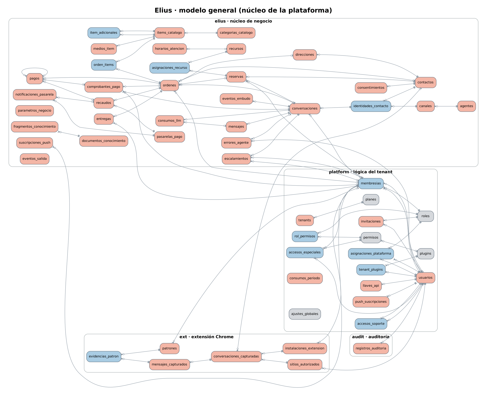

**platform: lógica del tenant y auditoría**

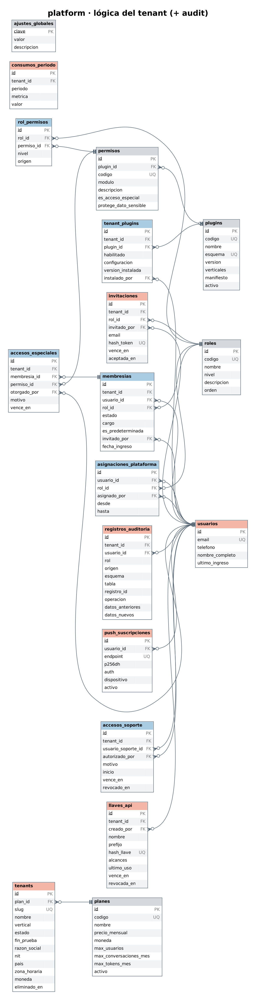

**elius: contactos, canales y conversaciones con Eli**

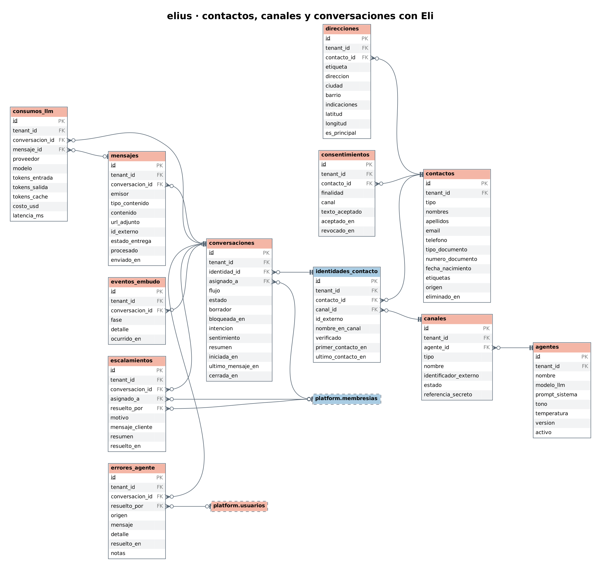

**elius: catálogo y reservas**

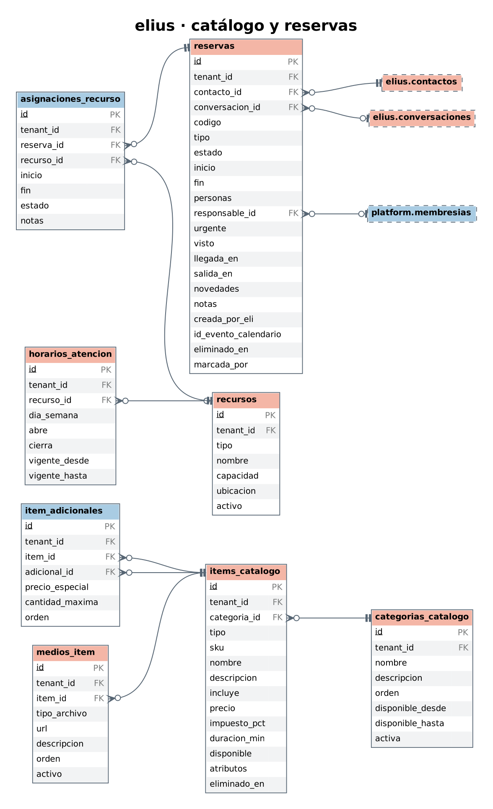

**elius: órdenes, pagos, comprobantes y entregas**

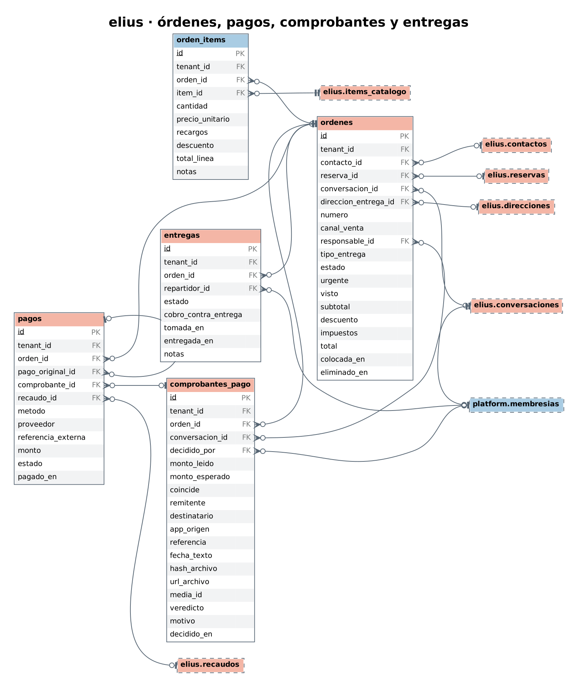

**elius: cobro por llave Bre-B con Factus Pay**

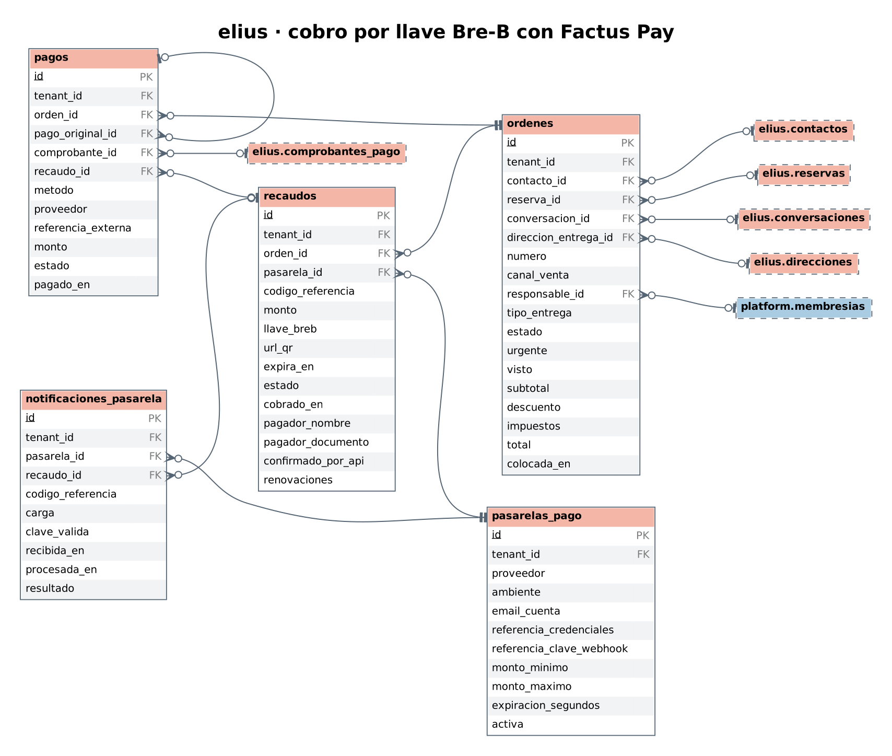

**elius: conocimiento de Eli, configuración y eventos**

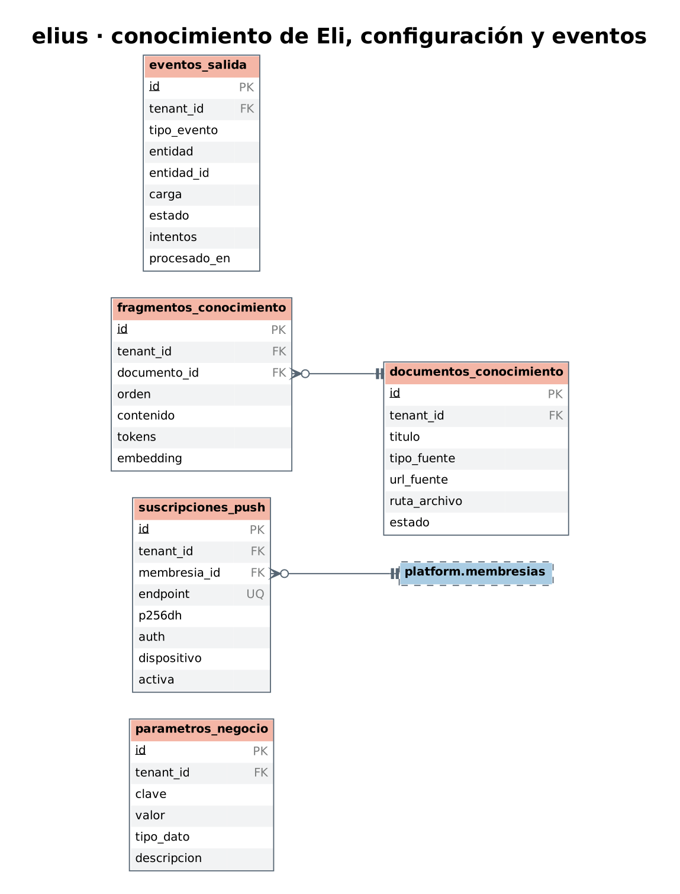

**ext: extensión de Chrome**

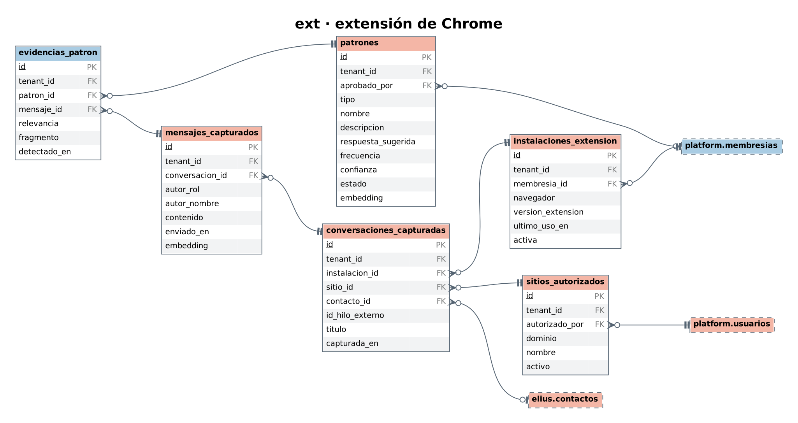

### 14.7 Plugins

Cada plugin es un esquema aparte que se instala por tenant. Se conecta al modelo general solo con llaves foráneas que apuntan hacia el núcleo. El modelo general nunca apunta a un plugin, y los plugins no se referencian entre sí; el script de validación lo verifica. Por eso un plugin se puede instalar, quitar o agregar sin tocar el núcleo. Sus tablas también llevan `tenant_id`, y RLS solo las muestra si el plugin está habilitado para el tenant (RN-P09).

| Plugin | Tablas | Qué agrega | Tablas del modelo general que usa | Sus tablas de transición |
| --- | --- | --- | --- | --- |
| `plugin_vet` | 5 | Mascotas, historia clínica y vacunas | `contactos`, `reservas`, `items_catalogo`, `membresias` | `propietarios_mascota`, `atenciones`, `aplicaciones_vacuna` |
| `plugin_restaurant` | 12 | Alérgenos, modificadores, comandas de cocina, menú del día y celebraciones | `items_catalogo`, `ordenes`, `orden_items`, `reservas`, `membresias` | `item_alergenos`, `item_grupos_modificador`, `orden_item_opciones`, `comanda_items`, `menu_dia_items` |
| `plugin_airline` | 9 | Aeropuertos, aeronaves, rutas, vuelos, pasajeros, tiquetes y equipaje | `reservas`, `contactos`, `items_catalogo` | `rutas`, `tarifas_vuelo`, `reserva_pasajeros`, `tramos_reserva`, `tiquetes` |

**Agregar una vertical nueva** se hace en tres pasos: crear su esquema `plugin_*` con tablas que apunten al núcleo, registrarlo en `platform.plugins` con sus permisos, y asignar esos permisos a los roles generales.

**Vista general de los plugins**

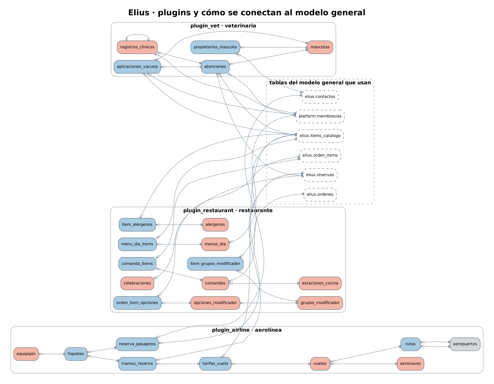

**plugin\_vet: veterinaria**

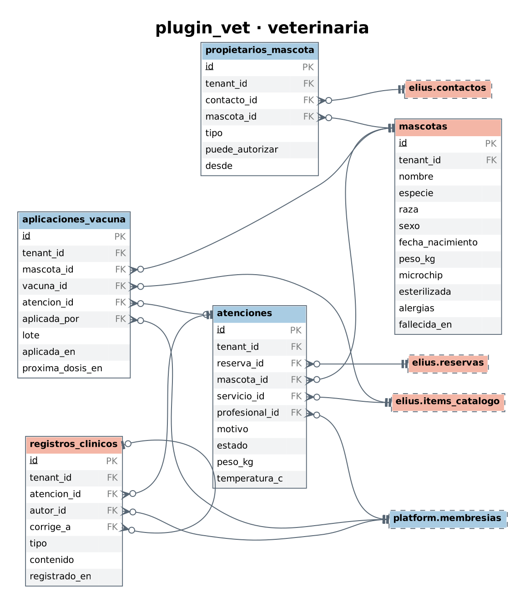

**plugin\_restaurant: restaurante**

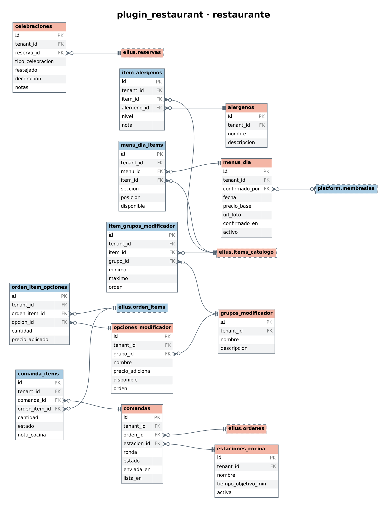

**plugin\_airline: aerolínea**

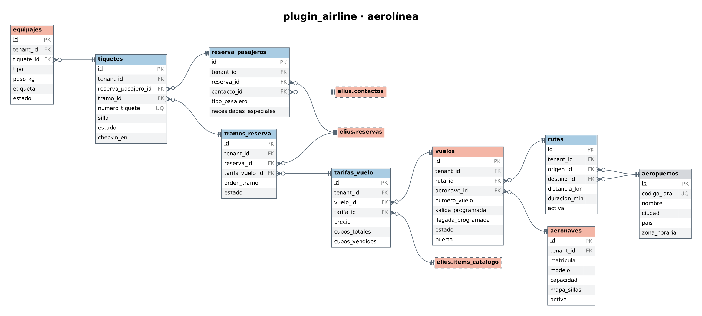

### 14.8 Archivo editable

El modelo completo, con descripciones de tablas y columnas, está en el archivo `elius_modelo.dbml`. Se importa en dbdiagram.io para editarlo o exportarlo (sección 16).

### 14.9 Potrillos Terraza: del esquema actual al modelo Elius

El esquema de Potrillos no se copió: se corrigió. Funciona en producción, pero tiene 16 problemas de diseño: no tiene tenant, no tiene llaves foráneas entre pedidos, domicilios y comprobantes, repite datos en columnas y en JSON, y deja lógica de negocio en el navegador. Esta sección muestra cada problema, cómo lo corrige el modelo y a dónde pasa cada tabla. Las reglas que el negocio ya usa (alertas de comprobantes, pagos parciales, turnos, menú confirmado, tolerancias) se conservan como reglas de negocio en la sección 9.

**Problemas encontrados y cómo se corrigen**

| # | Problema en Potrillos hoy | Corrección en Elius |
| --- | --- | --- |
| 1 | No hay tenant: cada cliente tiene su propia base y su propio despliegue | `tenant_id` en todas las tablas y RLS (DT-01, DT-02) |
| 2 | El panel usa la llave `service_role` en el navegador y un usuario y clave fijos en variables de entorno | Supabase Auth, membresías, roles generales y RLS (DT-04, DT-13) |
| 3 | El cliente es un `user_id` de texto (su número de WhatsApp) repetido en todas las tablas, sin tabla de clientes | `contactos` e `identidades_contacto`: un cliente con varios canales |
| 4 | `comprobantes.pedido_id` apunta a veces a `reservas`, a veces a `pedidos` y a veces a `pedidos_platos_especiales`, sin llave foránea | Todo lo que se cobra es una orden: `comprobantes_pago.orden_id` con llave foránea real |
| 5 | El domicilio no guarda su pedido; el código busca “el único domicilio activo del cliente” | `entregas.orden_id` con llave foránea: un cliente puede tener varios pedidos a la vez |
| 6 | Cuatro tablas para vender: `reservas`, `pedidos`, `pedidos_platos_especiales` y `domicilios` | Una sola `ordenes` con `orden_items` y `entregas`; `reservas` solo maneja fecha, hora y mesa |
| 7 | Las líneas del pedido van en JSON (`lineas`) | `orden_items`, una fila por producto: permite reportes por plato |
| 8 | El historial del chat va en JSON dentro de `user_states` (hasta 500 entradas) | `mensajes`, una fila por mensaje, con RLS y auditoría |
| 9 | El menú del día repite columnas (`entrada1` a `entrada4`, `entrada1_disponible`…, `menu_1_sopa`) y el bot lee por posición | `menus_dia` y `menu_dia_items` con sección, posición y disponibilidad (primera forma normal) |
| 10 | El catálogo está en tres tablas con llaves de texto, y `aplica_a` es un arreglo de texto | `items_catalogo` con llave uuid, `item_adicionales` (transición con precio especial) y `medios_item` |
| 11 | El monto pagado y el saldo se guardan y recalculan desde el navegador con varias actualizaciones separadas; el código tiene parches para no cobrar dos veces | Cada pago es una fila en `pagos`, el saldo se calcula en una vista y aprobar un comprobante es un solo procedimiento atómico |
| 12 | Trabajadores fijos: `asignado_a = 'trabajador1'` o `'trabajador2'`, `responsable` de 1 a 3 letras, turnos por par o impar | Membresías con rol Operador y llave foránea; turnos entre los Operadores activos (RN-C18) |
| 13 | `parametros` es global y guarda en texto plano la URL y el token del servicio | `parametros_negocio` por tenant; los secretos van a Supabase Vault |
| 14 | La bitácora `actividad_panel` guarda el actor como texto que escribe el navegador | `audit.registros_auditoria` llenada por trigger con el usuario real |
| 15 | `push_subscriptions` guarda el rol como texto | `suscripciones_push` ligada a la membresía |
| 16 | Los estados mezclan enum y texto libre, sin validar transiciones | Estados con `CHECK` y transiciones validadas por trigger (RN-C09) |

**A dónde pasa cada tabla de Potrillos**

| Tabla actual | Tablas en Elius |
| --- | --- |
| `user_states` | `conversaciones`, `mensajes` e `identidades_contacto` |
| `pendientes_dueno` | `escalamientos` |
| `comprobantes` | `comprobantes_pago` y, al aprobarse, `pagos` |
| `reservas` | `reservas`, `celebraciones`, `asignaciones_recurso` y la `orden` del paquete |
| `pedidos` y `pedidos_platos_especiales` | `ordenes`, `orden_items` y `orden_item_opciones` |
| `domicilios` | `entregas` y `direcciones` |
| `menu_diario` | `menus_dia`, `menu_dia_items` e `items_catalogo` |
| `catalogo_paquetes` | `items_catalogo` (tipo paquete) |
| `catalogo_adicionales` | `items_catalogo` (tipo adicional) e `item_adicionales` |
| `catalogo_multimedia` | `medios_item` |
| `embudo_eventos` | `eventos_embudo` |
| `consumo_ia` | `consumos_llm` |
| `errores_bot` | `errores_agente` |
| `parametros` | `parametros_negocio`, `agentes` (apagado de Eli) y Supabase Vault (secretos) |
| `actividad_panel` | `audit.registros_auditoria` |
| `push_subscriptions` | `suscripciones_push` |
| Usuarios fijos: dueño, staff, trabajador 1 y 2, domiciliarios, soporte | `membresias` con los roles generales y su cargo |

El script SQL que mueve los datos actuales de Potrillos a estas tablas se entrega junto con el código de la base de datos.

### 14.10 elius-panel: del esquema actual al modelo Elius

`elius-panel` ya generaliza a Potrillos (un solo `pedidos` y un catálogo genérico), pero conserva los mismos límites de fondo. Sirve a un solo negocio por base de datos, guarda datos en JSON y arreglos, y no tiene llaves foráneas entre el catálogo y lo que se vende. También deja secretos en el navegador. Se encontraron 18 problemas.

**Problemas encontrados y cómo se corrigen**

| # | Problema en elius-panel hoy | Corrección en Elius |
| --- | --- | --- |
| 1 | No hay tenant. El prefijo `elius_` solo evita choques de nombres con otra app en la misma base, pero no aísla datos | Esquemas propios, `tenant_id` y RLS en todas las tablas (DT-01, DT-02) |
| 2 | La configuración de Eli es una sola fila (`elius_asistente_eli` con `id = 1`): un negocio por base | `agentes` por tenant, con versión |
| 3 | Ninguna tabla tiene RLS. El panel se conecta con la llave que se ponga en `VITE_SUPABASE_KEY`, que puede ser la `service_role` | RLS en todo y usuarios autenticados con la llave pública (DT-02, DT-13) |
| 4 | El usuario y la clave del panel son variables `VITE_`, que quedan dentro del JavaScript que descarga el navegador; no hay roles | Supabase Auth, membresías y roles generales (DT-04, DT-05) |
| 5 | El token de WhatsApp también es una variable `VITE_` visible en el navegador | Token en Supabase Vault (`canales.referencia_secreto`); los envíos salen del servidor |
| 6 | El cliente es un `user_id` de texto repetido en todas las tablas, sin tabla de clientes | `contactos` e `identidades_contacto` |
| 7 | `elius_pedidos.lineas` es JSON con nombre, cantidad y nota, sin referencia al producto ni al precio cobrado | `orden_items` con llave foránea a `items_catalogo` y el precio al momento de la venta |
| 8 | `elius_pedidos` mezcla en una fila la reserva (fecha y hora), el domicilio (dirección en texto) y el pago (`monto_pagado`, `saldo_efectivo`) | `ordenes`, `reservas`, `entregas`, `direcciones` y `pagos`, cada una con su responsabilidad |
| 9 | La migración 0003 vuelve a declarar `hora` como texto cuando la 0001 la creó como `time` | Fecha y hora en un solo `timestamptz` (`inicio` y `fin`) |
| 10 | `elius_producto_media` se une al producto por el texto `producto_tipo`, sin llave foránea | `medios_item.item_id` con llave foránea |
| 11 | `elius_producto_extras.aplica_a` es un arreglo de texto (viola la primera forma normal) y su llave es texto | `item_adicionales`: transición con precio especial y cantidad máxima |
| 12 | `elius_productos` usa `(tipo, subtipo)` como llave natural; cambiar un nombre rompe las referencias | Llave `uuid` y `categorias_catalogo` |
| 13 | `responsable` y `decidido_por` son texto; el panel siempre escribe `'panel'`, así que no se sabe quién aprobó un pago | Llaves foráneas a `membresias` y auditoría automática |
| 14 | `elius_pendientes.detalle` es JSON con motivo, mensaje y resumen | `escalamientos` con columnas propias y asignación por turnos |
| 15 | El historial del chat va en JSON dentro de `elius_user_states`, y `elius_buffer_mensajes` repite los mensajes en otra tabla | Una sola tabla `mensajes` con la marca `procesado` |
| 16 | `elius_user_locks` tiene una fila por conversación: es una relación 1 a 1 | Columna `bloqueada_en` en `conversaciones` |
| 17 | La vista `elius_v_embudo_ultima_fase` se ejecuta con los permisos de su dueño, y las funciones no fijan `search_path` | Vistas con `security_invoker` y funciones con `search_path` vacío (DT-14) |
| 18 | No hay bitácora de cambios ni registro de consumo de IA | `audit.registros_auditoria` y `consumos_llm` |

**A dónde pasa cada tabla de elius-panel**

| Tabla actual | Tablas en Elius |
| --- | --- |
| `elius_user_states` | `conversaciones`, `mensajes` e `identidades_contacto` |
| `elius_buffer_mensajes` | `mensajes` (marca `procesado`) |
| `elius_user_locks` y sus funciones de bloqueo | `conversaciones.bloqueada_en` |
| `elius_pendientes` | `escalamientos` |
| `elius_pedidos` | `ordenes`, `orden_items`, `reservas`, `entregas`, `direcciones` y `pagos` |
| `elius_comprobantes` y la función de comprobante repetido | `comprobantes_pago` y la misma regla como función (RN-C16) |
| `elius_productos` | `items_catalogo` y `categorias_catalogo` |
| `elius_producto_extras` | `items_catalogo` (tipo adicional) e `item_adicionales` |
| `elius_producto_media` | `medios_item` |
| `elius_embudo_eventos` y su vista | `eventos_embudo` y una vista con `security_invoker` |
| `elius_parametros` | `parametros_negocio` |
| `elius_errores_bot` | `errores_agente` |
| `elius_push_subscriptions` | `suscripciones_push` |
| `elius_asistente_eli` | `agentes` y `horarios_atencion` |
| Usuario único del panel | `membresias` con los roles generales |

Las dos secciones dejan ver el mismo patrón: los paneles nacieron a la medida de un negocio y el modelo nuevo los lleva a un SaaS para muchos negocios, sin perder lo que ya funciona.

## 15. Decisiones técnicas: qué, cómo y por qué

Cada decisión del diseño tiene una razón y una fuente oficial que la respalda. Las 18 decisiones siguen el mismo formato: por qué se tomó, cómo se implementa y dónde verificarlo.

### DT-01. Modelo pool en lugar de silo o bridge

- **Por qué.** AWS define el pool como recursos compartidos que dan economía de escala, facilidad de operación y agilidad. El silo se reserva para aislamiento estricto o exigencias regulatorias, a mayor costo. Elius arranca con pymes y un solo equipo, así que prima el costo y una sola versión del sistema. La misma fuente advierte que el pool exige controles fuertes de aislamiento: eso lo cubren DT-02 y DT-07.
- **Cómo.** Una base de datos, tablas compartidas y `tenant_id` en cada tabla de negocio.
- **Fuente.** [AWS Well-Architected, SaaS Lens: modelos silo, pool y bridge](https://docs.aws.amazon.com/wellarchitected/latest/saas-lens/silo-pool-and-bridge-models.html)

### DT-02. Aislamiento con RLS en la base de datos, no con filtros en la aplicación

- **Por qué.** En el pool, el aislamiento suele depender de que cada consulta tenga el filtro correcto. RLS lleva esa regla al motor, así que un `WHERE` olvidado no expone datos de otro tenant. Además, si una tabla tiene RLS activa y ninguna política, no se ve ninguna fila: el error por omisión es seguro.
- **Cómo.** RLS activa en todas las tablas de negocio. Políticas separadas para select, insert, update y delete, dirigidas al rol `authenticated`, como recomienda Supabase. Políticas restrictivas (se suman con AND) para casos como la extensión de Chrome (RN-E01).
- **Fuente.** [PostgreSQL: Row Security Policies](https://www.postgresql.org/docs/current/ddl-rowsecurity.html) · [AWS: aislamiento multi-tenant con RLS](https://aws.amazon.com/blogs/database/multi-tenant-data-isolation-with-postgresql-row-level-security/) · [Supabase: Row Level Security](https://supabase.com/docs/guides/database/postgres/row-level-security)

### DT-03. PostgreSQL sobre Supabase

- **Por qué.** Una sola plataforma da la base de datos con RLS, la autenticación, la API automática, las Edge Functions y pgvector. Evita integrar cinco servicios distintos.
- **Cómo.** Todo el esquema se crea con migraciones versionadas del Supabase CLI. Nunca se cambia la base remota a mano.
- **Fuente.** [Supabase: migraciones de base de datos](https://supabase.com/docs/guides/deployment/database-migrations)

### DT-04. JWT con el tenant activo, agregado por el Custom Access Token Hook

- **Por qué.** JWT es un estándar abierto (RFC 7519) para transportar claims entre dos partes. Supabase permite modificar esos claims con una función que corre antes de emitir cada token. Supabase advierte que los claims pueden quedar desactualizados hasta que el token se renueva. Por eso la base también verifica la membresía.
- **Cómo.** El hook agrega `tenant_id` y el rol del usuario en ese tenant. El encabezado `X-Tenant-ID` permite cambiar de tenant y solo se acepta si el usuario es miembro activo. Los datos de autorización van en `app_metadata`, nunca en `user_metadata`, que el usuario puede editar.
- **Fuente.** [RFC 7519: JSON Web Token](https://www.rfc-editor.org/rfc/rfc7519) · [Supabase: Custom Access Token Hook](https://supabase.com/docs/guides/auth/auth-hooks/custom-access-token-hook)

### DT-05. Roles generales y fijos; el plugin personaliza

- **Por qué.** Las pymes, público objetivo de Elius, no tienen departamento de TI. Un modelo donde cada negocio diseña sus propios roles les traslada una tarea técnica que no pueden hacer. Seis roles generales con nombres claros cubren a todas las verticales. Lo particular de cada industria se resuelve con los módulos y los accesos especiales del plugin. La base técnica es el patrón de Supabase: roles y permisos en tablas, y una función de autorización que consultan las políticas.
- **Cómo.** `platform.roles` tiene los seis roles fijos y `platform.role_permissions` sus permisos. Cada plugin registra sus permisos y los asigna por defecto a los roles generales. Los accesos especiales se guardan por usuario y el Administrador los activa con un interruptor. La función `has_permission('vet.medical.write')` se usa dentro de las políticas RLS.
- **Fuente.** [Supabase: Custom Claims y RBAC](https://supabase.com/docs/guides/database/postgres/custom-claims-and-role-based-access-control-rbac)

### DT-06. RLS con buen rendimiento

- **Por qué.** El tablero señaló el rendimiento como el riesgo del pool. Supabase recomienda indexar las columnas que filtran las políticas. También recomienda envolver `auth.uid()` y funciones similares en `(select …)`, para que Postgres calcule el resultado una sola vez por consulta.
- **Cómo.** Todo índice de negocio empieza por `tenant_id`. Las políticas usan `(select app.current_tenant_id())`.
- **Fuente.** [Supabase: Row Level Security, sección de rendimiento](https://supabase.com/docs/guides/database/postgres/row-level-security)

### DT-07. Llaves foráneas compuestas (tenant\_id, id)

- **Por qué.** Las verificaciones de integridad (llaves primarias, únicas y foráneas) no pasan por RLS. Por eso RLS sola no impide que una cita de un tenant apunte a la mascota de otro. Una llave foránea compuesta sí lo impide. PostgreSQL permite `ON DELETE SET NULL (columna)`, que limpia solo la referencia y deja `tenant_id` intacto. La documentación usa justamente un ejemplo con `tenant_id`.
- **Cómo.** Cada tabla de negocio tiene `UNIQUE (tenant_id, id)`, y las relaciones usan `FOREIGN KEY (tenant_id, x_id)`.
- **Fuente.** [PostgreSQL: Constraints](https://www.postgresql.org/docs/current/ddl-constraints.html) · [PostgreSQL: Row Security Policies](https://www.postgresql.org/docs/current/ddl-rowsecurity.html)

### DT-08. Restricción de exclusión para que no se crucen reservas

- **Por qué.** Una restricción de exclusión garantiza que dos filas no se solapen según los operadores indicados, y crea su propio índice. Resuelve RN-C07 en el motor, sin código en la aplicación.
- **Cómo.** `EXCLUDE USING gist (tenant_id WITH =, recurso_id WITH =, tstzrange(inicio, fin) WITH &&)` sobre las asignaciones activas de la tabla asignaciones\_recurso, con la extensión `btree_gist`.
- **Fuente.** [PostgreSQL: Constraints](https://www.postgresql.org/docs/current/ddl-constraints.html)

### DT-09. Arquitectura microkernel: núcleo más plugins

- **Por qué.** El microkernel permite agregar funcionalidades como plugins sobre un núcleo, sin afectar ese núcleo. Encaja con el objetivo de sumar verticales sin modificar las tablas comunes.
- **Cómo.** El núcleo vive en el esquema `elius` y cada vertical en su esquema `plugin_*`. `platform.plugins` es el registro de plugins y `platform.tenant_plugins` dice cuáles tiene activos cada tenant. Las tablas del plugin se conectan al núcleo con relaciones de uno a muchos y tablas de transición, nunca 1 a 1 (sección 14).
- **Fuente.** [Mark Richards, Software Architecture Patterns (O’Reilly), cap. Microkernel](https://www.oreilly.com/library/view/software-architecture-patterns/9781098134280/ch04.html)

### DT-10. Patrones de diseño en la capa de aplicación

- **Por qué.** Factory Method deja que una clase base defina cómo se crean los objetos y que las subclases elijan el tipo concreto. Strategy agrupa algoritmos intercambiables en clases separadas. Template Method fija los pasos de un proceso y deja que cada subclase personalice algunos pasos.
- **Cómo.** La Factory crea el manejador del plugin según la vertical. Cada plugin es una Strategy de “agendar” o “vender”. Todos los procesos siguen el mismo Template: validar, registrar, auditar y notificar.
- **Fuente.** [Refactoring.Guru: Factory Method](https://refactoring.guru/design-patterns/factory-method) · [Strategy](https://refactoring.guru/design-patterns/strategy) · [Template Method](https://refactoring.guru/design-patterns/template-method)

### DT-11. El catálogo como estándar común

- **Por qué.** La entrevista con Potrillos Terraza y los hallazgos de la veterinaria muestran que todo lo que se vende sale de un catálogo. Estandarizar en catálogo, orden e ítems hace que el núcleo sirva a las tres verticales.
- **Cómo.** `elius.catalog_items` es la tabla común. El menú, los productos veterinarios y las tarifas la extienden desde su plugin. Toda orden referencia ítems del catálogo (RN-C15).
- **Fuente.** Entrevista a Potrillos Terraza (sección 8).

### DT-12. Auditoría con triggers en una tabla propia

- **Por qué.** La documentación de PostgreSQL trae un trigger de auditoría de referencia: usa `TG_OP`, `OLD`, `NEW`, el usuario y la fecha. También indica que la versión por sentencia, con tablas de transición, puede ser mucho más rápida en cambios masivos. PGAudit, la alternativa en Supabase, escribe en los logs de Postgres y no en una tabla. Por eso no permite consultar la auditoría por tenant.
- **Cómo.** Tabla `audit.logs` con tenant, usuario, operación, valor anterior y nuevo en JSON. PGAudit queda como complemento para seguridad.
- **Fuente.** [PostgreSQL: Trigger Functions, ejemplo 41.4](https://www.postgresql.org/docs/current/plpgsql-trigger.html) · [Supabase: PGAudit](https://supabase.com/docs/guides/database/extensions/pgaudit)

### DT-13. Usuarios de base de datos con mínimo privilegio, sin superusuario

- **Por qué.** Los superusuarios y los roles con `BYPASSRLS` siempre se saltan RLS, y el dueño de una tabla también, salvo que se use `FORCE ROW LEVEL SECURITY`. AWS indica que el usuario de la aplicación no debe ser dueño de las tablas ni tener `BYPASSRLS`. Supabase advierte que `service_role` se salta RLS y nunca debe llegar al navegador.
- **Cómo.** `elius_admin` es dueño del esquema, pero no es superusuario. `elius_app` lee y escribe sin ser dueño, siempre sujeto a RLS. `elius_consulta` solo lee vistas. `service_role` se usa únicamente en Edge Functions.
- **Fuente.** [PostgreSQL: Database Roles](https://www.postgresql.org/docs/current/user-manag.html) · [PostgreSQL: Row Security Policies](https://www.postgresql.org/docs/current/ddl-rowsecurity.html) · [AWS: aislamiento con RLS](https://aws.amazon.com/blogs/database/multi-tenant-data-isolation-with-postgresql-row-level-security/)

### DT-14. Vistas con security\_invoker

- **Por qué.** Por defecto, una vista aplica los permisos y las políticas RLS de su dueño. En un pool eso puede mostrar datos de todos los tenants. Con `security_invoker = true` se aplican las políticas de quien consulta.
- **Cómo.** Todas las vistas de reportes se crean con `WITH (security_invoker = true)`.
- **Fuente.** [PostgreSQL: CREATE VIEW](https://www.postgresql.org/docs/current/sql-createview.html)

### DT-15. Embeddings con pgvector en la misma base

- **Por qué.** pgvector guarda embeddings en columnas `vector(n)` y busca por similitud dentro de Postgres. Es el uso habitual para RAG. Al estar en la misma base, los embeddings quedan bajo el mismo RLS que el resto de los datos (RN-C14).
- **Cómo.** Base de conocimiento de Eli y patrones de la extensión con columnas `vector`. Supabase advierte que los índices HNSW o IVFFlat con filtros pueden devolver menos filas de las pedidas. Por eso se usan escaneos iterativos.
- **Fuente.** [Supabase: pgvector](https://supabase.com/docs/guides/database/extensions/pgvector)

### DT-16. Integraciones con Edge Functions y n8n

- **Por qué.** Las Edge Functions son funciones TypeScript pensadas para recibir webhooks, integrar servicios de terceros y llamar a APIs de modelos de lenguaje. n8n ya trae nodos para WhatsApp Business Cloud (enviar mensajes y plantillas) y Google Calendar (consultar disponibilidad y crear eventos).
- **Cómo.** Eli corre en Edge Functions. Los cambios relevantes, como una reserva creada o un vuelo cancelado, se registran como eventos en una tabla y n8n los envía por WhatsApp o al calendario.
- **Fuente.** [Supabase: Edge Functions](https://supabase.com/docs/guides/functions) · [n8n: WhatsApp Business Cloud](https://docs.n8n.io/integrations/builtin/app-nodes/n8n-nodes-base.whatsapp/) · [n8n: Google Calendar](https://docs.n8n.io/integrations/builtin/app-nodes/n8n-nodes-base.googlecalendar/)

### DT-17. Cumplimiento de la Ley 1581 de 2012

- **Por qué.** La ley define la autorización como el consentimiento previo, expreso e informado del titular. Exige que se obtenga por un medio que se pueda consultar después (art. 9). Los datos de salud son sensibles (art. 5) y su tratamiento está prohibido salvo excepciones, como la autorización explícita del titular (art. 6). La Superintendencia de Industria y Comercio vigila su cumplimiento.
- **Cómo.** Cada contacto guarda fecha, canal y texto de su autorización. El diccionario de datos marca las columnas sensibles: alergias, historia clínica, necesidades de salud del pasajero y documentos. Esas columnas tienen acceso restringido por permiso.
- **Fuente.** [Ley 1581 de 2012, texto en la Relatoría de Colombia Compra Eficiente](https://relatoria.colombiacompra.gov.co/normativa/ley-1581-de-2012/)

### DT-18. Verificación de pagos: Factus Pay con llave Bre-B, y el comprobante como respaldo

- **Por qué.** Hoy una persona revisa cada comprobante a mano, y el código de Potrillos tiene parches para no cobrar dos veces. Factus Pay crea un cobro con llave Bre-B y QR por el monto exacto, y avisa por webhook cuando se paga. Así el pago se confirma solo, sin leer imágenes. Factus tiene límites: no acepta pagos parciales ni montos distintos, cobra entre 1.000 y 12.100.000 COP, no hace reversos y cobra $800 + IVA por recaudo. Por eso el comprobante tradicional sigue como respaldo.
- **Cómo.** Patrón Strategy (DT-10): la función `estrategia_cobro` elige “llave Bre-B” si el negocio tiene Factus activo y el monto cabe en sus límites; si no, elige “comprobante”. Una Edge Function crea el recaudo con `POST /v1/collections` y lo guarda en `recaudos`. El webhook llega a otra Edge Function, que valida la clave `?key=` en tiempo constante, guarda la notificación y la aplica con `procesar_webhook_factus`. Al quedar pagado, un trigger crea el pago y otro confirma la orden. Las credenciales y la clave del webhook van en Supabase Vault.
- **Fuente.** [Factus Pay: autenticación](https://pay-developers.factus.com.co/autenticacion/) · [Crear un recaudo](https://pay-developers.factus.com.co/recaudos/crear/) · [Ver un recaudo](https://pay-developers.factus.com.co/recaudos/ver/) · [Webhooks](https://pay-developers.factus.com.co/webhooks/) · [Preguntas frecuentes](https://pay-developers.factus.com.co/preguntas-frecuentes/)

### DT-19. Avisos al celular: trigger, `pg_net` y un servicio de Web Push

- **Por qué.** Durante la prueba el Administrador debe aprobar o rechazar el pago apenas llega, sin tener el panel abierto. Un correo es lento y WhatsApp no sirve para avisar al dueño de lo que pasa con sus propios clientes. Una notificación push en el celular llega en segundos y abre el panel en Comprobantes.
- **Cómo.** El trigger `t56_aviso_celular_comprobante` (`AFTER INSERT` en `elius.comprobantes_pago`) llama a `app.avisar_comprobante_celular`, que arma el mensaje y usa la extensión `pg_net` para hacer dos llamadas HTTP asíncronas: (1) al servicio `notificaciones/` (Node, desplegado en Easypanel), que cifra el mensaje con Web Push (RFC 8291, `aes128gcm`) y lo firma con VAPID; (2) a ntfy.sh como respaldo con un tema secreto. El servicio no guarda nada: la base le manda en cada llamada las suscripciones activas de los Administradores del negocio (`platform.push_suscripciones`) y un token compartido (`platform.ajustes_globales`). Cada Administrador puede desactivar su dispositivo desde Comprobantes. El panel registra un service worker, pide permiso y guarda la suscripción con `guardar_suscripcion_push`.
- **Por qué así y no desde el panel o n8n.** El evento ocurre en la base (lo escribe Eli o n8n), así que el trigger es el único punto por el que pasan todos los casos. No depende de que alguien tenga el panel abierto y no se puede olvidar en un flujo.
- **Seguridad.** El token del servicio y la llave privada VAPID no están en el repositorio: la privada vive solo en las variables de entorno de Easypanel. `ajustes_globales` y `push_suscripciones` tienen RLS activo y ninguna política, así que el panel no puede leerlas: solo las funciones `SECURITY DEFINER`. Solo un Administrador puede suscribir un dispositivo.
- **Límites.** En iPhone el panel debe agregarse a la pantalla de inicio para recibir push. El aviso es de mejor esfuerzo: la fuente de verdad sigue siendo el comprobante en la tabla.

### DT-20. Permisos por rol aplicados en la base de datos

- **Por qué.** Esconder un botón en el panel no impide que alguien llame a la API con su sesión. La regla “solo el Administrador decide comprobantes” debe cumplirse aunque se llame directo a la base.
- **Cómo.** Los permisos por rol viven en `platform.rol_permisos` con nivel (`lectura` o `escritura`). El Operador tiene `catalogo` en lectura y `pagos` en escritura, pero el trigger `app.solo_admin_decide_comprobantes` rechaza cambiar el veredicto de un comprobante si quien lo hace no es Administrador. La consola SQL permite solo Administrador y Super Admin (`app.es_super_admin()`). El panel además oculta los módulos y protege las rutas, como una segunda capa.
- **Pruebas.** El script de pruebas incluye casos de cada rol: el Operador no aprueba ni edita el catálogo, el Analista lee pero no escribe y el Administrador sí hace ambas cosas.

## 16. Herramientas recomendadas

Con estas herramientas, el modelo E/R, el diccionario de datos y las pruebas se generan desde el código y no se hacen a mano. Así siempre coinciden con la base real.

| Herramienta | Para qué sirve | Entregable que cubre | Enlace |
| --- | --- | --- | --- |
| Supabase CLI | Crea migraciones con fecha, las aplica en local y las sube al proyecto. `db reset` reconstruye la base desde cero | Código de tablas, vistas, procedimientos y triggers | [Guía de migraciones](https://supabase.com/docs/guides/deployment/database-migrations) |
| DBML + dbdiagram.io | Lenguaje abierto para describir el esquema y dibujar el diagrama. Tiene un CLI que convierte SQL a DBML y viceversa | Modelo entidad-relación | [DBML](https://dbml.dbdiagram.io/home) |
| tbls | Lee la base y genera documentación en Markdown por tabla (columnas, índices, restricciones, triggers y relaciones) con diagramas E/R. Soporta PostgreSQL | Diccionario de datos y diagramas | [tbls en GitHub](https://github.com/k1LoW/tbls) |
| pgTAP (`supabase test db`) | Pruebas en SQL dentro de una transacción que se revierte. Sirve para verificar que cada rol puede o no puede hacer cada operación | Pruebas de aislamiento y permisos | [Supabase: Testing](https://supabase.com/docs/guides/database/testing) |
| pgbench | Ejecuta scripts SQL propios con varios clientes simultáneos y mide transacciones por segundo y latencia. `--rate` fija una tasa objetivo | Prueba de rendimiento (RNF-01) | [PostgreSQL: pgbench](https://www.postgresql.org/docs/current/pgbench.html) |
| PGAudit | Registra lecturas, escrituras y cambios de estructura en los logs de Postgres | Auditoría de seguridad (complemento) | [Supabase: PGAudit](https://supabase.com/docs/guides/database/extensions/pgaudit) |
| Supabase Edge Functions | Funciones TypeScript para webhooks, integraciones y llamadas a modelos de lenguaje | Lógica de Eli | [Edge Functions](https://supabase.com/docs/guides/functions) |
| n8n | Flujos con nodos listos para WhatsApp Business Cloud y Google Calendar | Integraciones | [Nodo WhatsApp](https://docs.n8n.io/integrations/builtin/app-nodes/n8n-nodes-base.whatsapp/) |
| IATA Code Search | Buscador oficial de códigos de aeropuertos (3 letras) y aerolíneas (2 letras) | Datos de referencia del plugin de aerolínea (RN-A01) | [IATA](https://www.iata.org/en/publications/directories/code-search/) |

**Orden de uso en el proyecto**

1. Escribir el esquema como migraciones con el Supabase CLI y reconstruirlo con `supabase db reset`.
2. Probar el aislamiento entre tenants y los permisos con pgTAP (`supabase test db`).
3. Generar el diccionario de datos y los diagramas con tbls, y el modelo E/R editable con DBML.
4. Medir la capacidad de referencia del tablero con pgbench. Por ejemplo, 20 clientes durante 60 segundos con tasa objetivo de 220: `pgbench -n -f reservas.sql -c 20 -T 60 --rate=220 elius`. Si la latencia por retraso crece, la base no sostiene esa tasa.

## 17. Supuestos, riesgos y pendientes

**Supuestos**

- Supabase es la plataforma de despliegue y su módulo de autenticación maneja los usuarios.
- Cada tenant pertenece a una sola vertical, aunque puede instalar más de un plugin.
- Los volúmenes de la sección 8 son estimaciones iniciales, no datos medidos.
- Los pagos se registran en Elius, pero los procesa una pasarela externa.

**Riesgos**

| Riesgo | Impacto | Mitigación |
| --- | --- | --- |
| Una tabla queda sin RLS y expone datos de otros tenants | Alto | Procedimiento único que registra cada tabla nueva con su RLS; prueba automática que lo verifica |
| Un tenant grande degrada el rendimiento de los demás | Medio | Índices por `tenant_id`, límites por plan, opción de moverlo a un silo |
| Uso indebido de `service_role` desde el cliente | Alto | Solo en Edge Functions; nunca se publica la llave |
| La extensión de Chrome captura datos personales sin autorización | Alto | Lista de sitios autorizados, consentimiento y acceso restringido al usuario que captura |
| Reglas supuestas que no coinciden con la operación real | Medio | Validación con negocios reales antes de cerrar el modelo |

**Pendientes por validar**

- [ ] Medir las ventas por hora en Potrillos Terraza para dimensionar los picos, y escribir el script de migración de sus datos (sección 14.9).
- [ ] Entrevistar a una aerolínea, o decidir si se reemplaza por otra vertical que sí se pueda entrevistar.
- [ ] Confirmar volúmenes reales de la veterinaria.
- [ ] Confirmar las reglas marcadas “por validar” en la sección 9.
- [ ] Definir los límites de cada plan (usuarios, conversaciones y tokens por mes).
- [ ] Definir el tiempo de retención de la auditoría y de los mensajes.
- [ ] Confirmar con el docente el alcance de “conexión con usuarios”: usuarios de PostgreSQL, roles de aplicación o ambos.

## 18. Glosario

| Término | Significado |
| --- | --- |
| Tenant (inquilino) | Cada negocio cliente de Elius, con sus datos aislados de los demás |
| SaaS | Software como servicio: un solo sistema que usan muchos clientes por suscripción |
| Silo, bridge, pool | Modelos multi-tenant: una base por tenant, un esquema por tenant, o tablas compartidas |
| RLS | Row Level Security: políticas de PostgreSQL que filtran qué filas ve cada usuario |
| JWT | JSON Web Token: token firmado que identifica al usuario y su tenant en cada petición |
| Claim | Dato dentro del JWT, como el `tenant_id` o el rol |
| Microkernel | Arquitectura con un núcleo estable y plugins que lo extienden |
| Plugin | Módulo de una vertical (veterinaria, restaurante, aerolínea) con sus tablas y reglas |
| RPC | Llamada a una función SQL de la base de datos desde la API |
| Edge Function | Función en TypeScript que corre en los servidores de Supabase |
| n8n | Herramienta de automatización de flujos, usada para WhatsApp y Calendar |
| Embedding | Representación numérica de un texto, usada para búsqueda semántica |
| PNR / localizador | Código de 6 caracteres que identifica una reserva aérea |
| IATA | Código de 3 letras de un aeropuerto, por ejemplo BOG |
| E.164 | Formato internacional de teléfono, por ejemplo +573001234567 |

## 19. Fuentes consultadas

Fuentes oficiales consultadas el 20 de noviembre de 2026.

**Fuentes primarias del proyecto**

- Tableros de clase y de diseño del equipo (6 fotografías): multi-tenencia, JWT, esquemas, componentes y entregables.
- Entrevista a Potrillos Terraza (restaurante).
- Hallazgos del equipo sobre veterinarias.
- Repositorios del equipo: `svzapatac/elius-panel` (panel genérico de Elius) y `svzapatac/potrillos-panel` (panel de Potrillos Terraza), con sus migraciones SQL, pantallas y servicio de notificaciones.

**Arquitectura multi-tenant**

- [AWS Well-Architected, SaaS Lens: modelos silo, pool y bridge](https://docs.aws.amazon.com/wellarchitected/latest/saas-lens/silo-pool-and-bridge-models.html)
- [AWS Database Blog: aislamiento de datos multi-tenant con RLS de PostgreSQL](https://aws.amazon.com/blogs/database/multi-tenant-data-isolation-with-postgresql-row-level-security/)
- [Mark Richards, Software Architecture Patterns, 2.ª ed. (O’Reilly): Microkernel](https://www.oreilly.com/library/view/software-architecture-patterns/9781098134280/ch04.html)

**PostgreSQL**

- [Row Security Policies](https://www.postgresql.org/docs/current/ddl-rowsecurity.html)
- [Constraints: exclusión y llaves foráneas compuestas](https://www.postgresql.org/docs/current/ddl-constraints.html)
- [CREATE VIEW: security\_invoker](https://www.postgresql.org/docs/current/sql-createview.html)
- [Trigger Functions: ejemplo de auditoría](https://www.postgresql.org/docs/current/plpgsql-trigger.html)
- [Database Roles](https://www.postgresql.org/docs/current/user-manag.html)
- [pgbench](https://www.postgresql.org/docs/current/pgbench.html)

**Supabase**

- [Row Level Security](https://supabase.com/docs/guides/database/postgres/row-level-security)
- [Custom Access Token Hook](https://supabase.com/docs/guides/auth/auth-hooks/custom-access-token-hook)
- [Custom Claims y RBAC](https://supabase.com/docs/guides/database/postgres/custom-claims-and-role-based-access-control-rbac)
- [Migraciones de base de datos](https://supabase.com/docs/guides/deployment/database-migrations)
- [Testing con pgTAP](https://supabase.com/docs/guides/database/testing)
- [pgvector](https://supabase.com/docs/guides/database/extensions/pgvector)
- [PGAudit](https://supabase.com/docs/guides/database/extensions/pgaudit)
- [Edge Functions](https://supabase.com/docs/guides/functions)

**Estándares y normativa**

- [RFC 7519: JSON Web Token (IETF, mayo de 2015)](https://www.rfc-editor.org/rfc/rfc7519)
- [Ley Estatutaria 1581 de 2012, protección de datos personales](https://relatoria.colombiacompra.gov.co/normativa/ley-1581-de-2012/)
- [IATA Code Search](https://www.iata.org/en/publications/directories/code-search/)

**Pagos**

- [Factus Pay: autenticación](https://pay-developers.factus.com.co/autenticacion/)
- [Factus Pay: crear un recaudo](https://pay-developers.factus.com.co/recaudos/crear/)
- [Factus Pay: ver un recaudo](https://pay-developers.factus.com.co/recaudos/ver/)
- [Factus Pay: webhooks](https://pay-developers.factus.com.co/webhooks/)
- [Factus Pay: preguntas frecuentes](https://pay-developers.factus.com.co/preguntas-frecuentes/)

**Patrones y herramientas**

- [Refactoring.Guru: Factory Method](https://refactoring.guru/design-patterns/factory-method), [Strategy](https://refactoring.guru/design-patterns/strategy), [Template Method](https://refactoring.guru/design-patterns/template-method)
- [DBML y dbdiagram.io](https://dbml.dbdiagram.io/home)
- [tbls](https://github.com/k1LoW/tbls)
- [n8n: WhatsApp Business Cloud](https://docs.n8n.io/integrations/builtin/app-nodes/n8n-nodes-base.whatsapp/) · [n8n: Google Calendar](https://docs.n8n.io/integrations/builtin/app-nodes/n8n-nodes-base.googlecalendar/)
