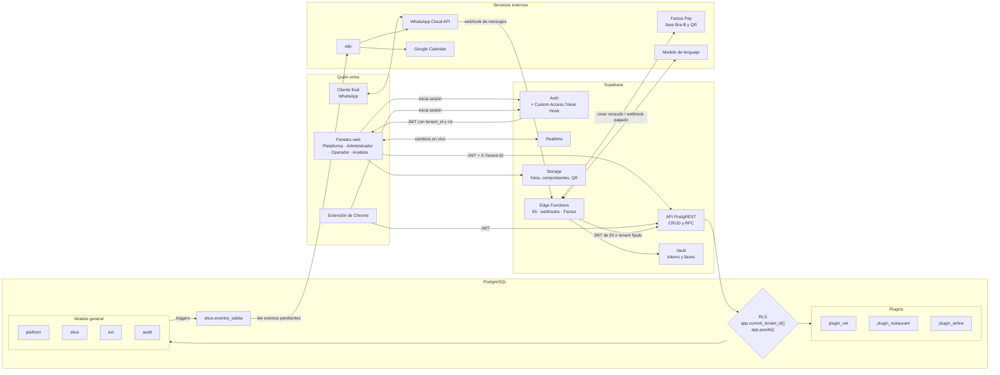
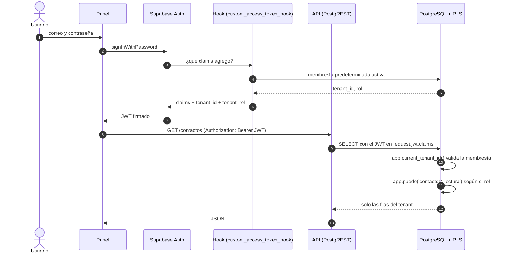

# Arquitectura general de Elius

Elius es un SaaS multi-tenant en modelo **pool**: una sola base PostgreSQL en Supabase, tablas compartidas, `tenant_id` en cada fila y **Row Level Security** para aislar a cada negocio. Todo entra por los mismos canales y pasa por el mismo control antes de llegar a los datos.

## Componentes

## Cómo viaja una petición

## Puntos de entrada

| Punto de entrada | Rol general | Para qué | Arquitectura | Flujo de usuario |
| --- | --- | --- | --- | --- |
| Panel de Plataforma | Super Admin, Soporte | Administrar el SaaS y dar soporte autorizado | [01](01_panel_plataforma.md) | [01](../03_flujos_usuario/01_panel_plataforma.md) |
| Panel del Administrador | Administrador | Configurar el negocio, Eli, usuarios y cobros | [02](02_panel_administrador.md) | [02](../03_flujos_usuario/02_panel_administrador.md) |
| Panel del Operador | Operador (con cargo) | Atender el día a día: conversaciones, pagos, reservas, pedidos, cocina, domicilios | [03](03_panel_operador.md) | [03](../03_flujos_usuario/03_panel_operador.md) |
| Panel del Analista | Analista | Ver y exportar reportes | [04](04_panel_analista.md) | [04](../03_flujos_usuario/04_panel_analista.md) |
| WhatsApp con Eli | Eli (atiende al cliente final) | Vender, reservar y cobrar por chat | [05](05_canal_whatsapp_eli.md) | [05](../03_flujos_usuario/05_cliente_whatsapp.md) |
| Extensión de Chrome | Operador / Administrador | Capturar conversaciones y detectar patrones | [06](06_extension_chrome.md) | [06](../03_flujos_usuario/06_extension_chrome.md) |

## Principios que se repiten en todos los paneles

1. **Ningún panel usa la llave `service_role`.** Todos entran con el JWT del usuario, y RLS decide qué ve cada uno (DT-02, DT-13).
2. **El tenant viaja en el JWT**, y solo se acepta si el usuario es miembro activo. El encabezado `X-Tenant-ID` sirve para cambiar de negocio, con la misma validación (DT-04).
3. **Los permisos dependen del rol general**, no del panel. El panel solo esconde lo que la base ya bloquea (DT-05).
4. **Las operaciones de varias tablas son procedimientos (RPC) atómicos**: aprobar un comprobante, agendar una reserva o procesar un webhook (ver `docs/05_base_de_datos/09_procedimientos.md`).
5. **Los avisos salen por eventos**: los triggers escriben en `elius.eventos_salida` y n8n los envía por WhatsApp, push o Calendar. La base nunca llama servicios externos directamente.
