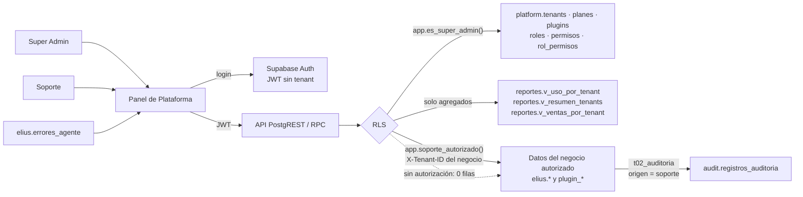

# Arquitectura · Panel de Plataforma (Super Admin y Soporte)

**Quién lo usa:** el equipo de Elius. **Super Admin** administra la plataforma; **Soporte** entra a un negocio solo cuando el Administrador lo autoriza, por tiempo limitado y con todo auditado (RN-P16).

## Qué ve y qué puede hacer

| Acción | Super Admin | Soporte |
| --- | --- | --- |
| Crear planes, plugins y roles | Sí (`app.es_super_admin()`) | No |
| Ver la lista de tenants | Sí | Solo los que lo autorizaron |
| Ver datos de negocio (clientes, pedidos) | **No** | Solo con autorización vigente |
| Configurar WhatsApp, Eli o pasarelas de un negocio | No | Sí, con autorización (`con_autorizacion` = total) |
| Ver errores del bot | Solo agregados | Sí, en el negocio autorizado |
| Métricas de uso y costo por tenant | Sí, agregadas (`reportes`) | No |

## Piezas de la base que usa

- **Tablas:** `platform.asignaciones_plataforma` (quién es Super Admin o Soporte), `platform.accesos_soporte` (autorizaciones con vencimiento).
- **Funciones:** `app.es_super_admin()`, `app.soporte_autorizado(usuario, tenant)`, `app.tiene_acceso_tenant()`.
- **Vistas:** esquema `reportes`, sin datos personales.
- **Regla clave:** el Super Admin no ve datos de negocio. Soporte sí, pero solo con autorización y todo queda en la auditoría con `origen = 'soporte'` (prueba 12 de `database/tests`).
