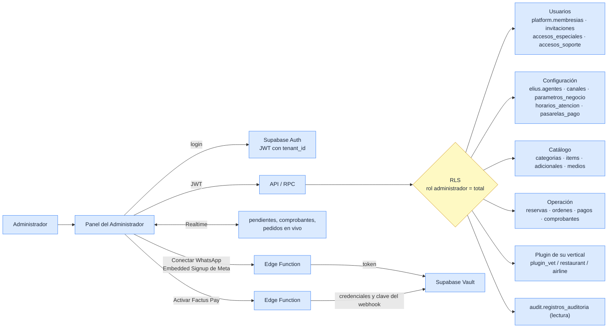

# Arquitectura · Panel del Administrador

**Quién lo usa:** el dueño o gerente de la pyme. Configura su negocio **sin conocimientos técnicos**: usuarios, Eli, catálogo, horarios, canales, plugin y cobros.

## Procedimientos que llama

| Botón del panel | Procedimiento | Regla |
| --- | --- | --- |
| Invitar usuario | `platform.invitar_usuario(email, rol)` | RN-P12 |
| Activar historia clínica a un veterinario | `platform.otorgar_acceso_especial(membresía, 'vet.historia_clinica')` | RN-V03 |
| Autorizar a Soporte | `platform.autorizar_soporte(usuario, motivo, horas)` | RN-P16 |
| Apagar o encender a Eli | `elius.encender_eli(true/false)` | RN-C20 |
| Confirmar el menú del día | `plugin_restaurant.confirmar_menu_dia(menu)` | RN-R11 |
| Cambiar de negocio | `platform.cambiar_tenant(tenant)` y refrescar sesión | DT-04 |

## Protecciones que la base aplica aunque el panel falle

- No puede quitarse a sí mismo si es el último Administrador (RN-P04, trigger `t11_ultimo_admin`).
- No puede pasar el límite de usuarios de su plan (RN-P10, trigger `t12_limite_usuarios`).
- No puede escribir montos de órdenes a mano (RN-C11, trigger `t43_proteger_totales`).
