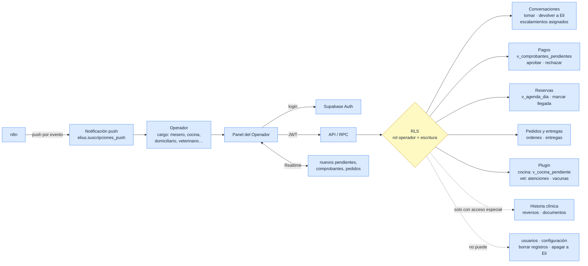

# Arquitectura · Panel del Operador

**Quién lo usa:** quien atiende el día a día. El rol es uno solo (**Operador**); el **cargo** (Recepción, Mesero, Cajero, Cocina, Domiciliario, Veterinario, Agente de counter) solo cambia qué pantallas se muestran. Lo sensible exige un **acceso especial** que activa el Administrador.

## Pantallas según el cargo (mismo rol, mismos permisos)

| Cargo | Pantallas principales | Vistas y procedimientos |
| --- | --- | --- |
| Recepción / Staff | Pendientes, conversaciones, reservas del día | `v_escalamientos_abiertos`, `tomar_conversacion`, `devolver_a_eli`, `v_agenda_dia`, `marcar_llegada` |
| Cajero | Comprobantes y pagos | `v_comprobantes_pendientes`, `aprobar_comprobante`, `rechazar_comprobante`, `v_saldo_ordenes` |
| Cocina | Comandas por estación | `plugin_restaurant.v_cocina_pendiente` |
| Domiciliario | Entregas asignadas y cobro contra entrega | `elius.entregas`, `v_saldo_ordenes` |
| Veterinario | Citas, pacientes, historia clínica (con acceso especial) | `plugin_vet.atenciones`, `v_historia_clinica`, `registrar_vacuna` |
| Agente de counter | Check-in, sillas, equipaje | `plugin_airline.hacer_checkin`, `v_manifiesto` |

## Reglas que el operador ve aplicadas

- Los pendientes le llegan **por turnos** (RN-C18). Al tomar una conversación, Eli deja de responder (RN-C19).
- Aprobar un comprobante es **atómico**: crea el pago, deja el resto contra entrega y confirma la orden; un comprobante repetido no cobra dos veces (RN-C16, RN-C17).
- No puede modificar una orden pagada ni un pago aprobado (RN-C12).
