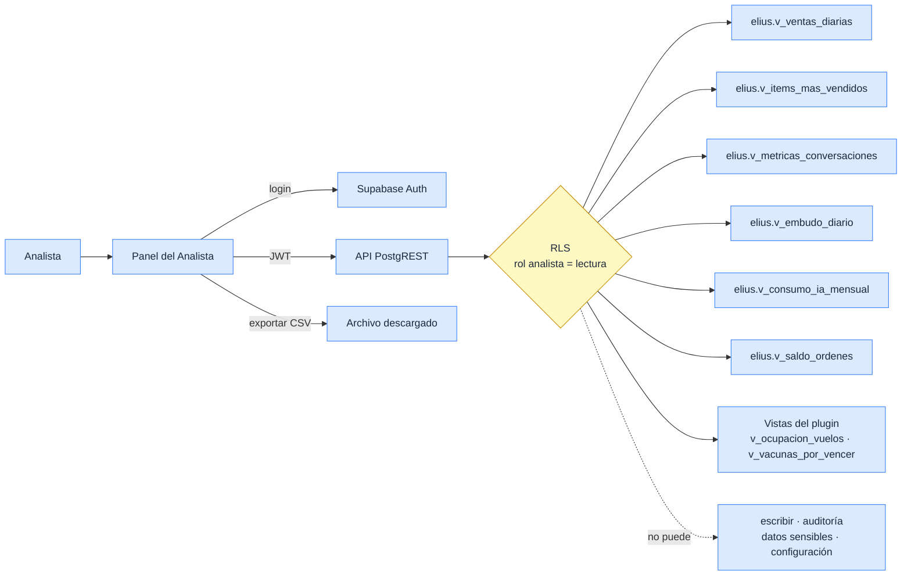

# Arquitectura · Panel del Analista

**Quién lo usa:** el contador, un socio o quien revisa resultados. **Solo lee y exporta**; no modifica nada.

## Por qué las vistas son seguras para este rol

Todas las vistas de negocio se crearon con `security_invoker = true` (DT-14). La vista aplica el RLS **de quien consulta**: el Analista solo ve su tenant y lo que su rol permite. Sin esa opción, una vista correría con los permisos de su dueño y mostraría datos de todos los negocios.

## Diferencia con el usuario de base de datos `elius_consulta`

| | Rol Analista (aplicación) | Usuario `elius_consulta` (PostgreSQL) |
| --- | --- | --- |
| Quién | Una persona del negocio | Consultoría o BI del equipo Elius |
| Alcance | Su tenant | Todos los tenants, **solo agregados** |
| Qué lee | Vistas de `elius` y del plugin | Vistas del esquema `reportes` |
| Datos personales | Ve nombres de sus clientes | No ve ninguno |
