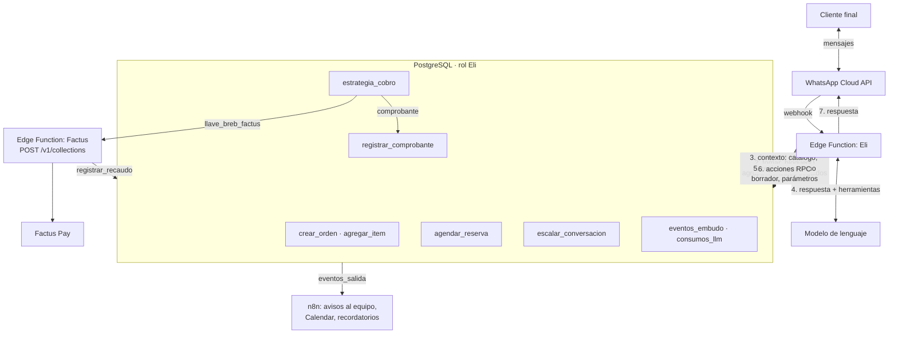

# Arquitectura · Canal WhatsApp con Eli (cliente final)

**Quién lo usa:** el cliente final del negocio. Conversa con **Eli** por WhatsApp. Eli corre en una Edge Function con su propia identidad (rol general **Eli**), así que RLS también la limita: no ve usuarios, auditoría ni datos sensibles.

## Cómo se identifica el tenant sin un usuario conectado

El webhook de WhatsApp no trae sesión. La Edge Function busca el canal por el `phone_number_id` que llega en el webhook (`elius.canales.identificador_externo`) y con eso conoce el tenant. Después actúa con el JWT del usuario Eli de ese negocio. Así Eli queda sujeta a RLS como cualquier otro rol.

## Reglas que Eli no puede saltarse

| Regla | Dónde se hace cumplir |
| --- | --- |
| No responde si un humano tomó la conversación (RN-C19) | Trigger `t20_antes_de_mensaje` |
| No responde si el negocio la apagó (RN-C20) | Trigger `t20_antes_de_mensaje` |
| No vende un plato agotado (RN-R03) | Trigger `t41_antes_de_linea` |
| No reserva fuera de horario ni con más personas que la capacidad (RN-R01, RN-R02) | `elius.agendar_reserva` |
| Un solo proceso por conversación (RN-C21) | `elius.tomar_bloqueo` |
| No ve historia clínica ni datos sensibles | Matriz de permisos: Eli no tiene accesos especiales |
