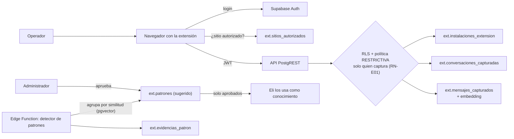

# Arquitectura · Extensión de Chrome

**Quién la usa:** Operadores y Administradores que todavía atienden por WhatsApp Web u otros sitios. La extensión captura las conversaciones (solo en sitios autorizados) para que Elius detecte preguntas frecuentes, objeciones e intenciones y Eli aprenda de ellas.

## Privacidad

- Solo captura en los dominios de `ext.sitios_autorizados` (RN-E03).
- Lo capturado lo ve **quien lo capturó**. Para ver lo de todos hace falta nivel **total** en `ext` (Administrador). Lo hace cumplir una política **RESTRICTIVA**, que se suma con AND a las demás (prueba 15).
- Un patrón no llega a Eli hasta que un Administrador lo aprueba (RN-E02, `CHECK ck_patrones_aprobacion`).
