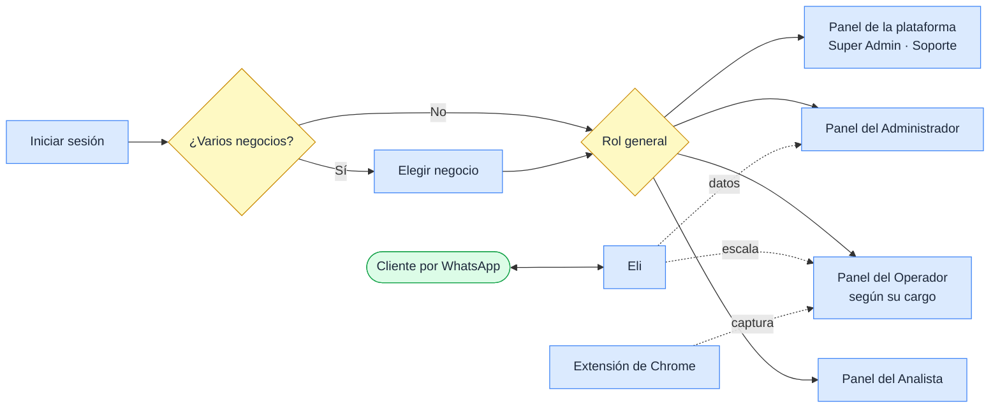

# Flujos de usuario por panel

Cada flujo muestra qué hace la persona paso a paso, qué decide y qué regla de negocio interviene. Los diagramas usan Mermaid y GitHub los dibuja directamente.

**Colores:** azul = paso, amarillo = decisión, verde = inicio o resultado.

## Mapa de navegación

Todos empiezan igual: **iniciar sesión → el JWT trae el negocio predeterminado → si la persona pertenece a varios negocios, elige uno** (`platform.cambiar_tenant`).

## Qué hace cada panel y qué tablas usa

**L** = lee, **E** = escribe. Los nombres están en el [modelo E/R](../05_base_de_datos/modelo_er.md).

| Panel | Rol general | Qué hace la persona | Lee | Escribe | Flujo |
| --- | --- | --- | --- | --- | --- |
| Plataforma | Super Admin, Soporte | Crea y suspende negocios, cambia planes, instala plugins; Soporte entra solo con autorización | tenants, planes, plugins, consumos_periodo, accesos_soporte | tenants, tenant_plugins, planes | [01](01_panel_plataforma.md) |
| Administrador | Administrador | Configura el negocio y a Eli, invita usuarios, da accesos especiales, autoriza a Soporte, revisa todo | todas las del negocio, registros_auditoria | membresias, invitaciones, accesos_especiales, parametros_negocio, agentes, catálogo | [02](02_panel_administrador.md) |
| Operador | Operador (cargo: recepción, cajero, cocina, domiciliario, veterinario, counter) | Atiende pendientes, aprueba comprobantes, marca llegadas, prepara y entrega pedidos | escalamientos, conversaciones, comprobantes_pago, reservas, ordenes | conversaciones, pagos, comprobantes_pago, reservas, entregas, comandas | [03](03_panel_operador.md) |
| Analista | Analista | Consulta ventas, embudo, métricas de conversaciones y consumo de IA | vistas v_ventas_diarias, v_embudo_diario, v_metricas_conversaciones, v_consumo_ia_mensual | — | [04](04_panel_analista.md) |
| WhatsApp con Eli | Cliente final | Pide información, reserva, hace un pedido y paga | items_catalogo, horarios_atencion, recursos | contactos, conversaciones, mensajes, reservas, ordenes, comprobantes_pago, recaudos | [05](05_cliente_whatsapp.md) |
| Extensión de Chrome | Operador, Administrador | Captura conversaciones de otras páginas y propone patrones para Eli | sitios_autorizados | conversaciones_capturadas, mensajes_capturados, patrones | [06](06_extension_chrome.md) |

La arquitectura de cada panel está en [../02_arquitectura](../02_arquitectura/00_arquitectura_general.md).
