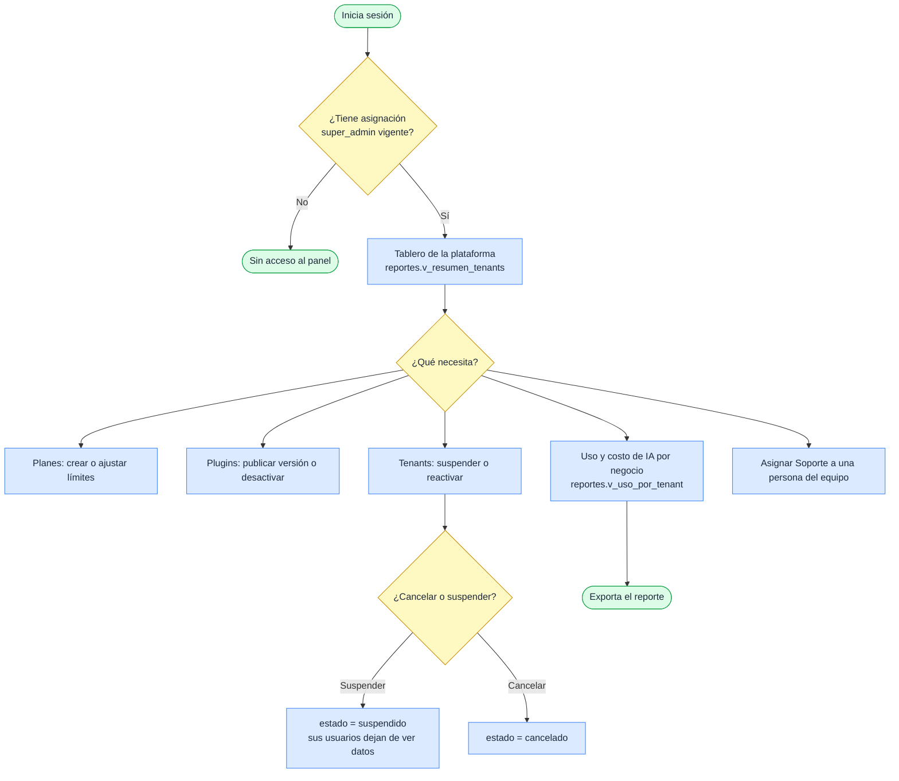
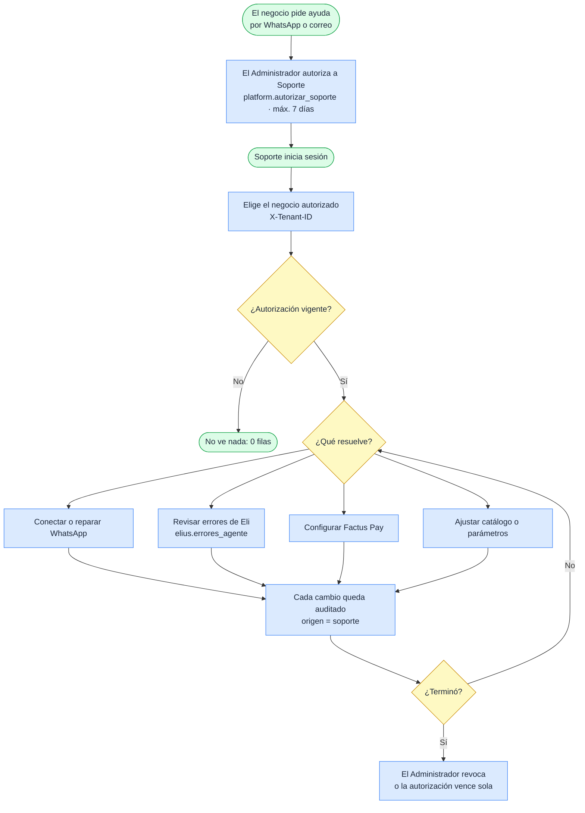

# Flujo de usuario · Panel de Plataforma

## Super Admin

## Soporte

**Reglas que aplican:** RN-P16 (acceso con autorización y vencimiento), RN-P06 (tenant suspendido no opera), RN-P15 (auditoría).
