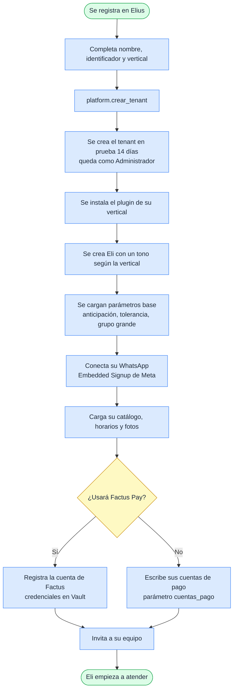
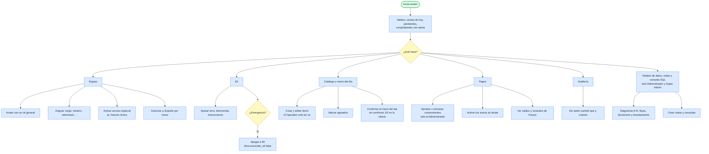
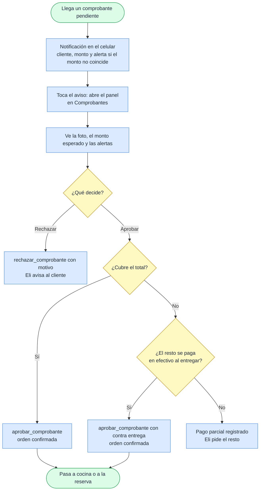
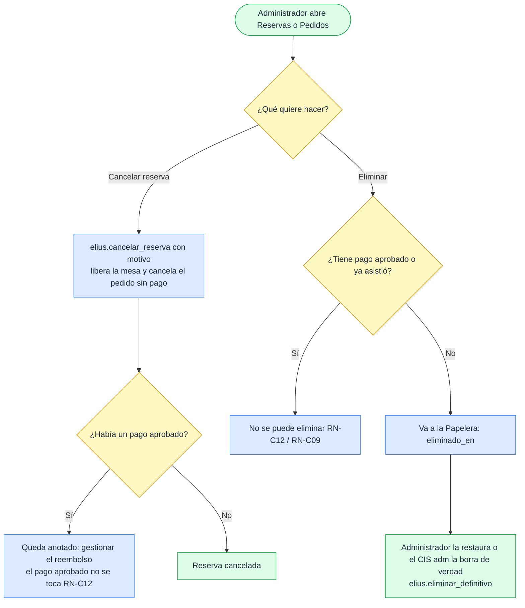
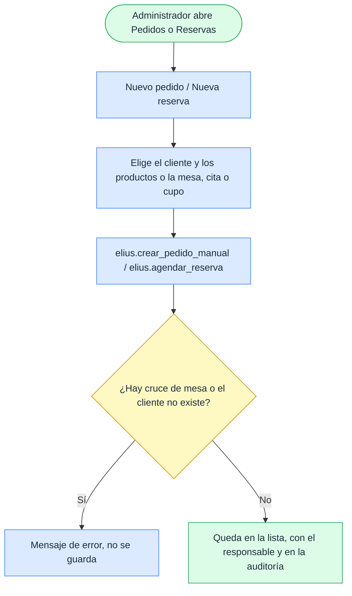
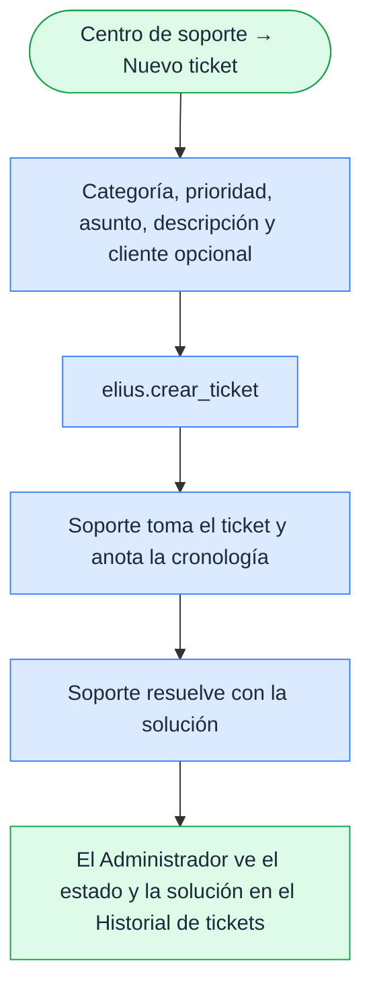

# Flujo de usuario · Panel del Administrador

## Primer uso: crear el negocio

## Día a día del Administrador

## Aprobar o rechazar un pago desde el aviso del celular

**Reglas que aplican:** RN-P04 (último Administrador), RN-P08 (crear tenant), RN-P10 (límite del plan), RN-P12 (invitaciones), RN-C20 (apagar a Eli), RN-R11 (menú confirmado), RN-V03 (acceso especial), RN-C26 (solo el Administrador decide comprobantes), RN-C27 (aviso al celular).

## Cancelar o eliminar una reserva o un pedido (Papelera)

## Crear un pedido o una reserva a mano

## Tickets: el Administrador crea y sigue sus tickets

