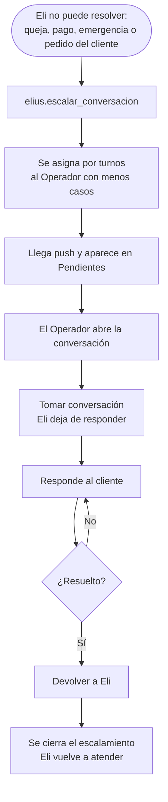
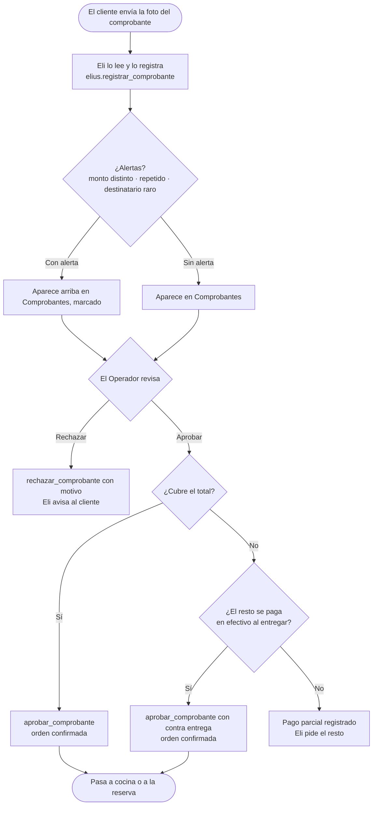
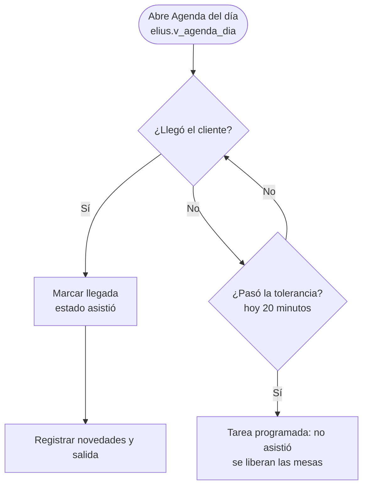
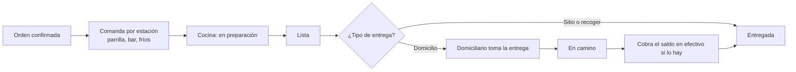

# Flujo de usuario · Panel del Operador

## Atender un pendiente que escaló Eli

## Revisar un comprobante de pago (cobro tradicional)

## Reservas del día

## Cocina y domicilios (restaurante)

**Reglas que aplican:** RN-C16, RN-C17, RN-C18, RN-C19, RN-C21, RN-C12, RN-R07, RN-R09.
