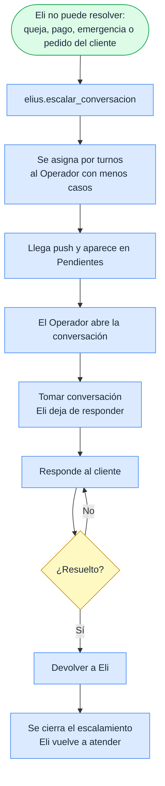
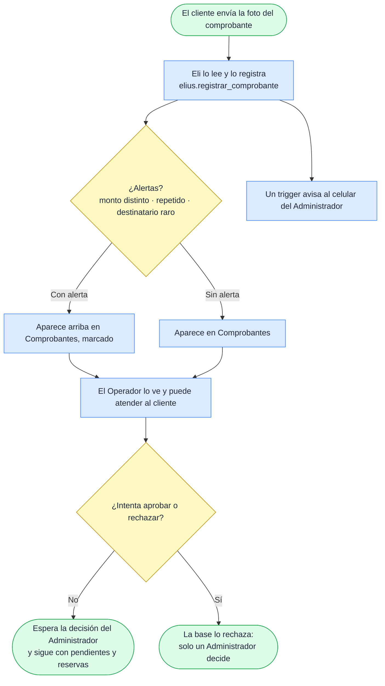
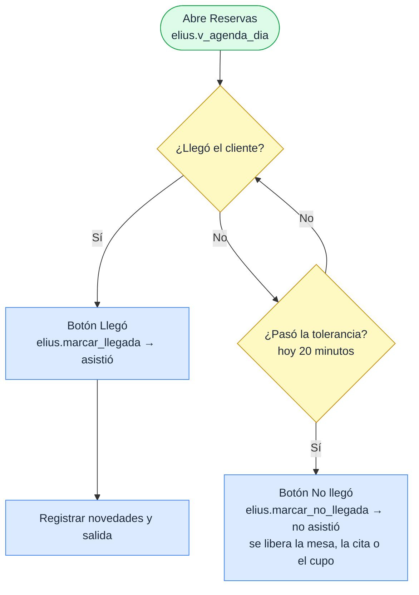
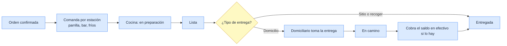

# Flujo de usuario · Panel del Operador

## Atender un pendiente que escaló Eli

## Comprobantes de pago: el Operador consulta, el Administrador decide

## Reservas del día: llegó o no llegó (los tres casos)

Lo mismo en restaurante (mesa), veterinaria (cita) y aerolínea (check-in del pasajero). Lo pueden marcar el Operador y el Administrador.

## Cocina y domicilios (restaurante)

**Reglas que aplican:** RN-C16, RN-C17, RN-C18, RN-C19, RN-C21, RN-C12, RN-R07, RN-R09.
