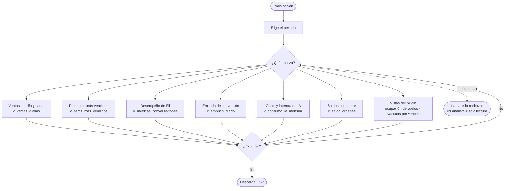

# Flujo de usuario · Panel del Analista

**Qué no puede hacer:** escribir, ver la auditoría, ver datos sensibles ni la configuración. Lo bloquea RLS, no solo el panel (prueba 4 de `database/tests`).
