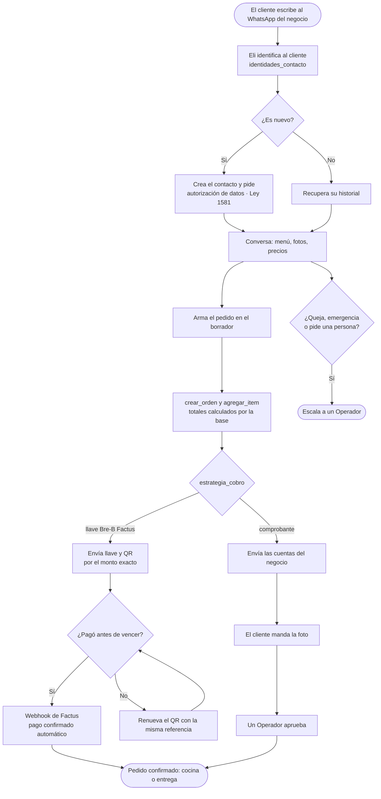
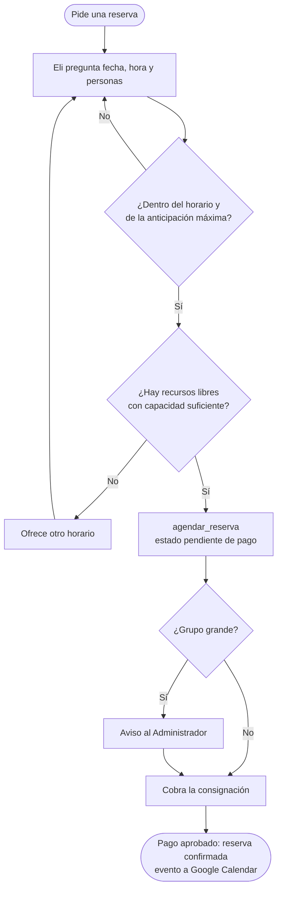

# Flujo de usuario · Cliente final por WhatsApp con Eli

## Comprar y pagar

## Reservar

**Reglas que aplican:** RN-C03 (consentimiento), RN-C22, RN-C23 (cobro), RN-C07, RN-R01, RN-R02, RN-R08, RN-R10 (reservas), RN-C18 (escalamiento).
