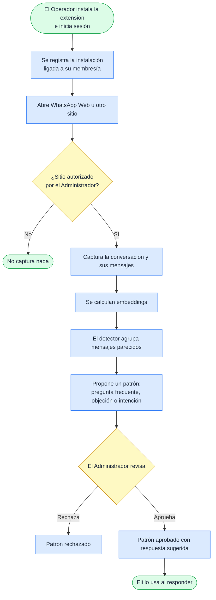

# Flujo de usuario · Extensión de Chrome

**Privacidad:** cada Operador solo ve lo que capturó; el Administrador ve todo (RN-E01). Solo se captura en sitios autorizados (RN-E03). Ningún patrón llega a Eli sin aprobación (RN-E02).
