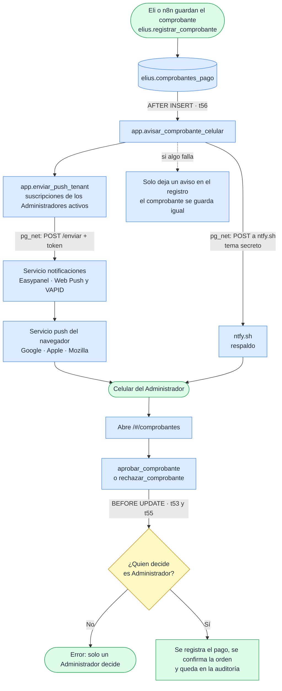
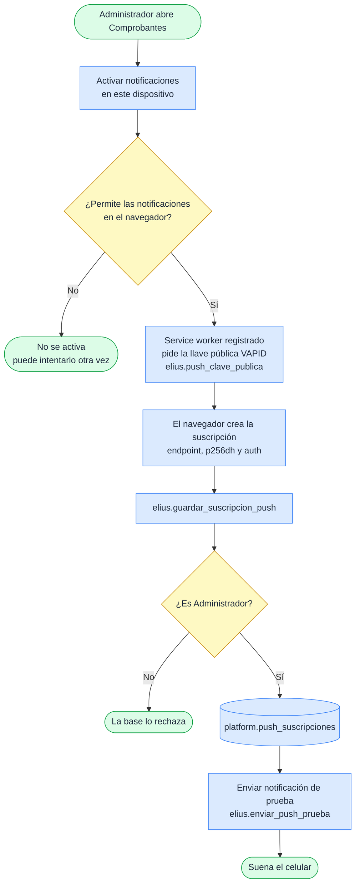

# Flujo de sistema · Avisos al celular, triggers y webhooks

Lo que pasa por dentro cuando llega un comprobante, y cómo activa un Administrador los avisos. Es el complemento técnico del flujo del Administrador ([02](02_panel_administrador.md)). Decisión de diseño: DT-19 y DT-20 del [levantamiento](../01_levantamiento/levantamiento_informacion.md).

## De comprobante a notificación, y de la notificación a la decisión

## Activar los avisos en un dispositivo

En iPhone el panel debe agregarse antes a la pantalla de inicio. Los secretos (token del servicio y llave privada VAPID) no están en el repositorio: viven en las variables de entorno del servicio.

**Reglas que aplican:** RN-C16, RN-C26, RN-C27, RN-C28.
