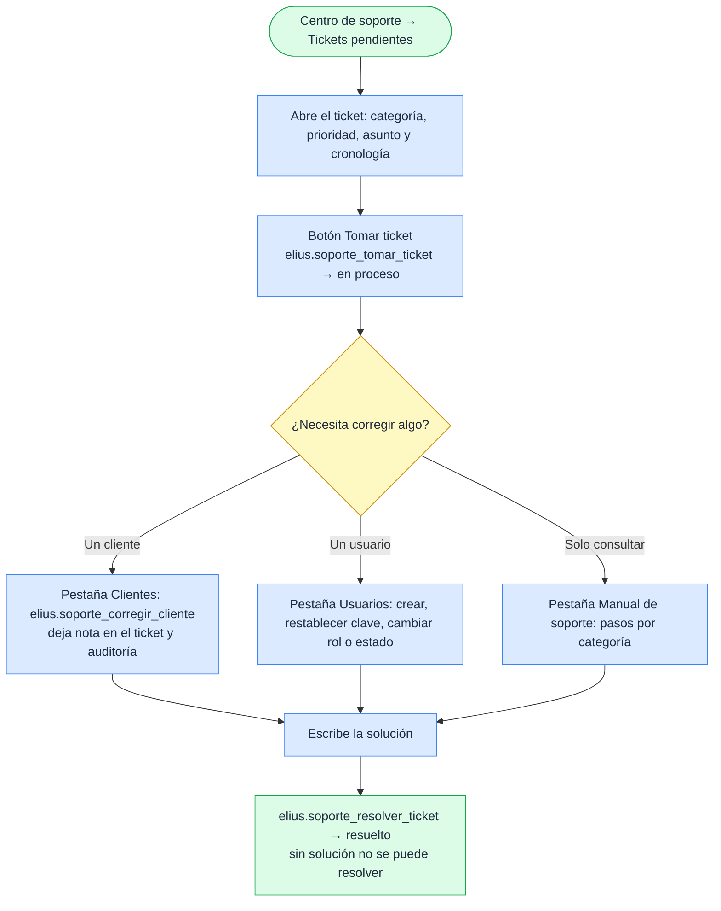
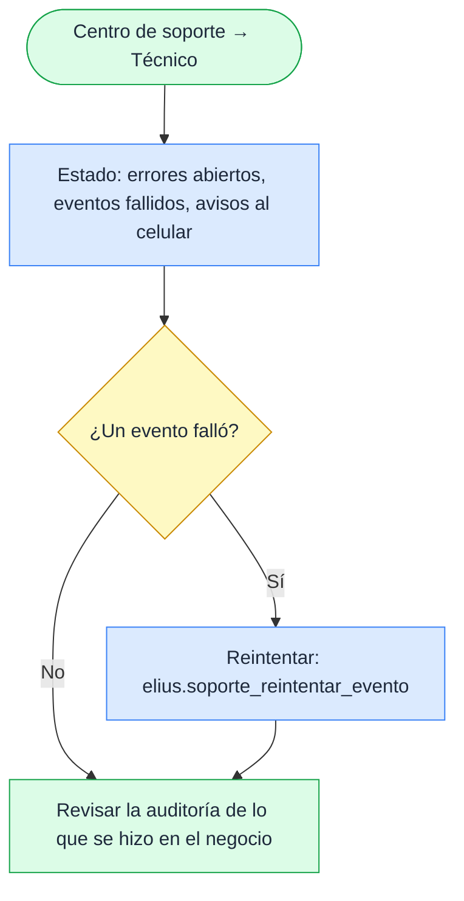

# Flujo de usuario · Soporte al cliente

Soporte trabaja solo con vistas y procedimientos: el panel no le da acceso directo a las tablas. Ve los negocios que el Administrador le autorizó.

## Atender un ticket

## Ver lo técnico (errores, eventos y auditoría)

