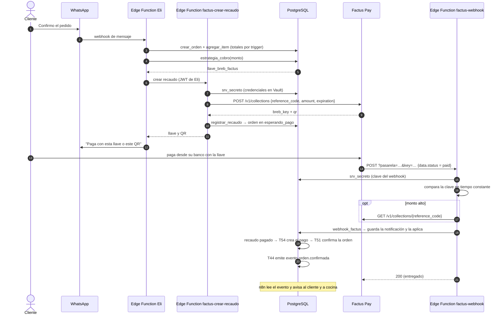
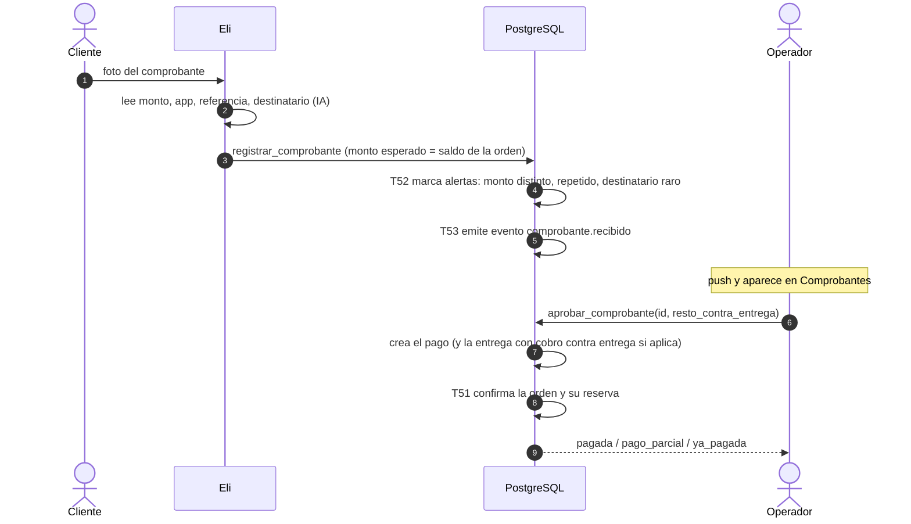
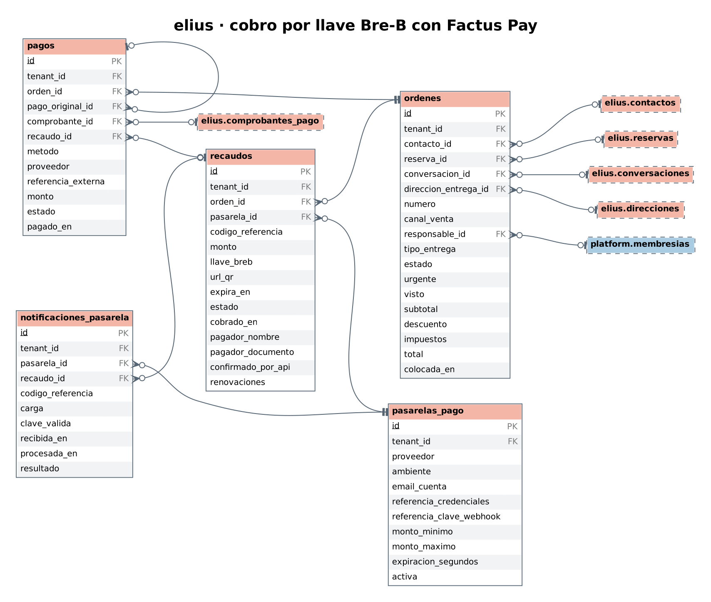

# Verificación de pagos: comprobante revisado por el dueño (Factus Pay queda como extensión)

> **Decisión vigente (23-nov-2026):** el sistema opera solo con el **flujo por comprobante**: el cliente paga por su medio (Nequi, Bre-B, transferencia), envía la foto y el **dueño o el operador revisa en el panel si llegó el monto** y aprueba o rechaza. No hay integración activa con Factus Pay, porque no se contó con credenciales de sandbox.
>
> `elius.estrategia_cobro(monto)` devuelve `comprobante` siempre que el negocio no tenga una fila activa en `elius.pasarelas_pago`, y ninguna instalación la crea. Por eso no hay que cambiar nada en la base. Las tablas `pasarelas_pago`, `recaudos` y `notificaciones_pasarela` quedan como **diseño listo para activar** cuando se tengan las credenciales y se escriban las Edge Functions.
>
> Lo que sigue en este documento describe ese diseño de extensión; el flujo vigente es el de la sección "Flujo tradicional por comprobante".

Elius confirma los pagos de dos maneras y elige una según el negocio y el monto (patrón **Strategy**, DT-10 y DT-18):

| Estrategia | Cuándo se usa | Quién confirma | Riesgo |
| --- | --- | --- | --- |
| **Llave Bre-B con Factus Pay** | El negocio tiene Factus activo y el monto está entre 1.000 y 12.100.000 COP | Factus, por webhook, sin intervención humana | Bajo: el banco confirma el pago |
| **Comprobante tradicional** | El negocio no usa Factus, el monto queda fuera del rango, o el cliente ya pagó por otro medio | Una persona aprueba o rechaza | Medio: depende de revisar la imagen; la base marca alertas |

La función `elius.estrategia_cobro(monto)` toma la decisión: devuelve `llave_breb_factus` o `comprobante`.

## Qué es Factus Pay y qué limita el diseño

Datos tomados de la documentación oficial ([autenticación](https://pay-developers.factus.com.co/autenticacion/), [crear recaudo](https://pay-developers.factus.com.co/recaudos/crear/), [ver recaudo](https://pay-developers.factus.com.co/recaudos/ver/), [webhooks](https://pay-developers.factus.com.co/webhooks/), [preguntas frecuentes](https://pay-developers.factus.com.co/preguntas-frecuentes/)):

| Característica de Factus | Consecuencia en Elius |
| --- | --- |
| Autenticación con email y contraseña en `POST /auth`; un solo token activo por usuario y sin vencimiento | Credenciales y token en **Supabase Vault**; el token se rota solo si la API responde 401 |
| `POST /v1/collections` con `reference_code`, `amount` y `expiration` (segundos); responde `breb_key` y `qr` | Tabla `elius.recaudos`; el QR se guarda en Storage |
| `reference_code` único por empresa; con la misma referencia y monto se renueva un QR vencido | `UNIQUE (pasarela_id, codigo_referencia)`; `registrar_recaudo` hace *upsert* y cuenta renovaciones |
| Monto mínimo 1.000 y máximo 12.100.000 COP | `CHECK` en `recaudos` y `pasarelas_pago` (RN-C23) |
| La llave es de un solo uso y por el **monto exacto**; no hay pagos parciales | Cada abono es un recaudo aparte; un webhook con otro monto se rechaza (RN-C23) |
| Validez por defecto de 24 h | `pasarelas_pago.expiracion_segundos` = 86.400 por defecto |
| Webhook solo para recaudos pagados; valida con `?key=` comparado en tiempo constante | Edge Function `factus-webhook`; bandeja `notificaciones_pasarela` (RN-C24) |
| Reintentos: hasta 6 intentos si no recibe 2xx en 10 s | Se guarda la notificación **antes** de responder 2xx; procesamiento idempotente |
| Sin reversos, reembolsos ni disputas | Una devolución se registra como pago negativo manual (RN-C25) |
| Costo de $800 + IVA por recaudo | Por eso el comprobante sigue disponible para montos pequeños o negocios que no lo contraten |

## Flujo con Factus Pay

## Flujo tradicional por comprobante

## Reglas de negocio de pagos

| Regla | Texto | Dónde se cumple |
| --- | --- | --- |
| RN-C12 | Un pago aprobado no se modifica; se reversa con otro pago negativo | Trigger `t50_proteger_pago`, `CHECK ck_pagos_reverso` |
| RN-C16 | Alertas de comprobante: monto distinto, repetido, destinatario raro | Trigger `t52_revisar_comprobante` |
| RN-C17 | Pagos parciales; el saldo se cobra en efectivo al entregar | `aprobar_comprobante`, trigger `t51_aplicar_pago`, vista `v_saldo_ordenes` |
| RN-C22 | Con Factus activo se cobra por llave y se confirma solo por webhook | `estrategia_cobro`, `procesar_webhook_factus`, trigger `t54_recaudo_pagado` |
| RN-C23 | Monto exacto, sin parciales, entre 1.000 y 12.100.000 COP; si no, comprobante | `CHECK ck_recaudos_monto`, `estrategia_cobro`, `registrar_recaudo` |
| RN-C24 | Webhook validado en tiempo constante, guardado antes de 2xx e idempotente | Edge Function `factus-webhook`, `notificaciones_pasarela`, resultado `duplicado` |
| RN-C25 | Sin reversos en Factus: devoluciones como pago negativo manual | `CHECK ck_pagos_reverso` |

## Tablas que intervienen

- `elius.pasarelas_pago`: configuración por negocio (ambiente, límites, vigencia y referencias a Vault).
- `elius.recaudos`: cada cobro con su llave, QR, estado y pagador.
- `elius.notificaciones_pasarela`: todos los webhooks recibidos, válidos o no, con su resultado.
- `elius.pagos`: el pago aprobado, que apunta al recaudo **o** al comprobante.
- `elius.comprobantes_pago`: el respaldo tradicional.

## Configuración en Supabase

1. Crear el bucket privado `qr-recaudos` en Storage.
2. Guardar en Vault, por cada negocio, un secreto con `{"email": "...", "password": "..."}` y otro con la clave del webhook. Registrar sus `id` en `elius.pasarelas_pago`.
3. Desplegar las funciones de `integraciones/edge-functions/` con `supabase functions deploy`.
4. En Factus, registrar la URL `https://<proyecto>.supabase.co/functions/v1/factus-webhook?pasarela=<id de la pasarela>`.
5. Variables de entorno: `FACTUS_API_URL_PRODUCCION` (cuando Factus entregue la URL de producción) y `FACTUS_MONTO_CONFIRMAR` (desde qué monto se confirma con `GET`).

## Pruebas

La sección 10 de `database/tests/10_pruebas_negocio.sql` verifica la elección de estrategia, la creación del recaudo, el rechazo por clave inválida y por monto distinto, la aplicación del pago, la idempotencia ante un webhook repetido y que un usuario no pueda llamar el webhook. La sección 9 verifica el flujo por comprobante.

> El código de las Edge Functions es una implementación de referencia: sigue la documentación de Factus, pero no se ha ejecutado contra el sandbox. Antes de producción, pruébelo con el [simulador de Factus](https://pay-developers.factus.com.co/sandbox/simulator/).
