# Modelo entidad-relación

> Los diagramas por módulo, más legibles, están en [modelo_er.md](modelo_er.md).

## Las tres reglas obligatorias y cómo se cumplen

| Regla del curso | Cómo se cumple | Cómo se verifica |
| --- | --- | --- |
| No hay relaciones 1 a 1 | Toda llave foránea es de muchos a uno. Ninguna FK es única por sí sola | `generar.py` revisa cada FK: si es `UNIQUE` sola (o con `tenant_id` cuando el padre es del mismo tenant) la marca como error R1 |
| No hay relaciones muchos a muchos directas | Cada M:N se resuelve con una tabla de transición y dos relaciones de uno a muchos | Las 24 transiciones están declaradas con las dos tablas que unen (error R2 si no unen dos tablas) |
| Ninguna tabla es solo de llaves | Toda transición guarda datos propios de la relación | `generar.py` falla si una tabla solo tiene `id`, llaves y fechas de control (error R3) |

Resultado de la última validación (`database/modelo/salida/validacion.json`): **87 tablas, 201 relaciones, 0 errores.**

### Lo que se cambió para cumplirlas

- **Detalles de los plugins 1 a 1** (detalle de cita, de reserva de mesa, de reserva aérea, de plato) → transiciones reales: `atenciones` une cita y mascota (una cita puede atender dos mascotas), `reserva_pasajeros` y `tramos_reserva` unen la reserva con pasajeros y vuelos.
- **Perfil de usuario 1 a 1 con `auth.users`** → eliminado; el tenant predeterminado vive en `membresias.es_predeterminada`.
- **Bloqueo de conversación** (`elius_user_locks` en el código actual, una fila por conversación) → columna `conversaciones.bloqueada_en`.
- **"Un infante por adulto"** como referencia pasajero→pasajero (1 a 1) → regla RN-A06: en cada reserva los infantes no superan a los adultos.
- **Una reserva puede ocupar varios recursos** (mesas unidas) → `asignaciones_recurso`, con su horario y estado.

## Modelo general y plugins

El modelo está separado en dos partes:

- **Modelo general** (55 tablas): `platform` (el SaaS), `elius` (el negocio), `ext` (extensión de Chrome) y `audit`. Por sí solo sirve a cualquier negocio que venda por catálogo y atienda con Eli.
- **Plugins** (26 tablas): `plugin_vet`, `plugin_restaurant`, `plugin_airline`. Cada uno apunta al núcleo con llaves foráneas; **el núcleo nunca apunta a un plugin y los plugins no se referencian entre sí** (verificado en el modelo). Por eso un plugin se instala o se quita sin tocar el núcleo (DT-09).

### Vista general del modelo general

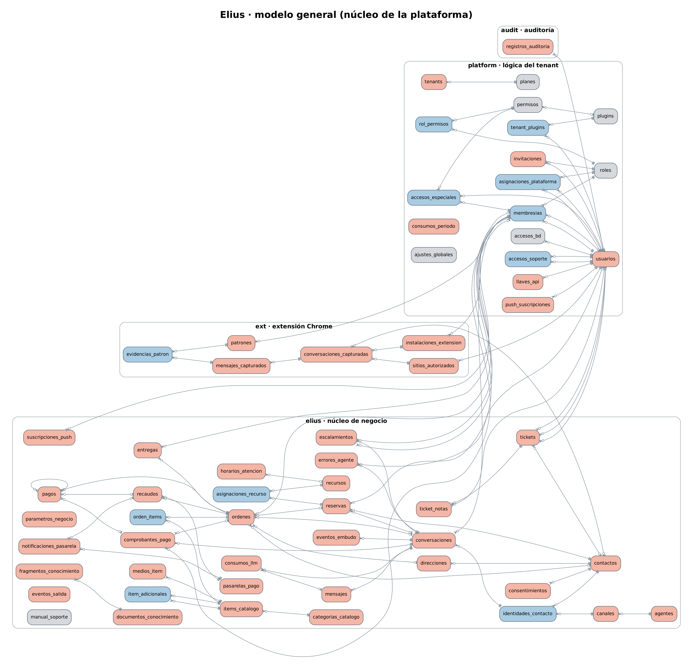

### Vista general de los plugins

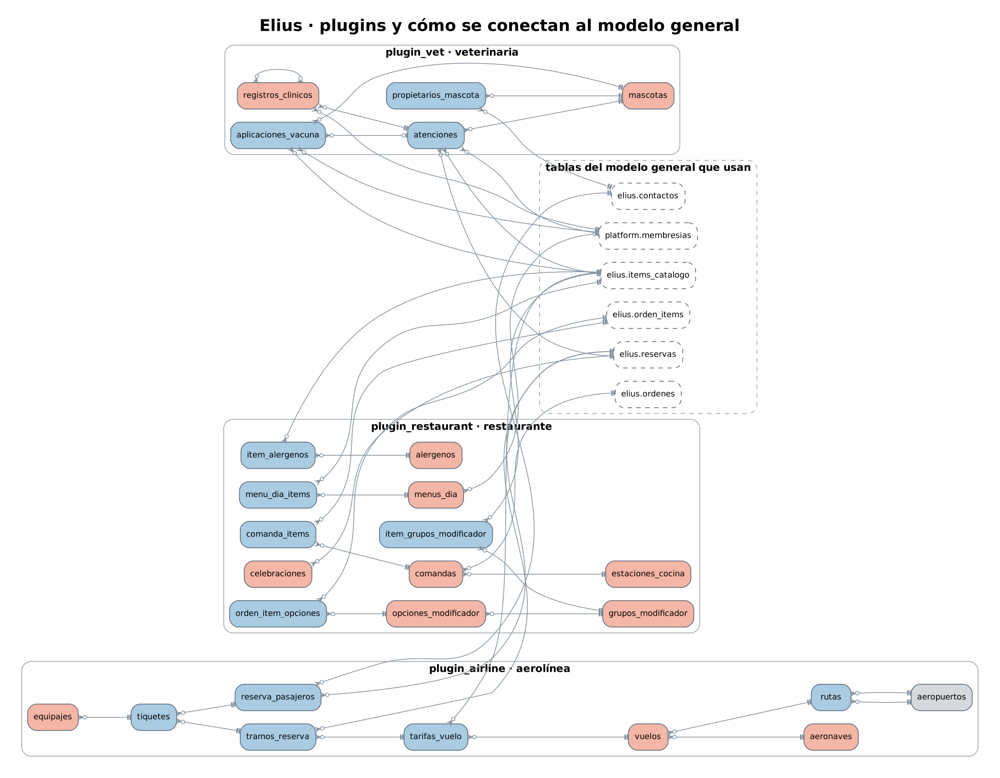

## Notación

Pata de gallo: `||` exactamente uno, `o|` cero o uno, `o<` cero o muchos. Salmón = entidad, azul = transición, gris = catálogo de referencia global. Las tablas punteadas pertenecen a otro esquema. No se dibuja la relación de cada tabla con `tenants` por `tenant_id`, que existe en todas las tablas de negocio, ni las columnas `creado_en` y `actualizado_en`.

## Diagramas detallados

### Modelo general

**platform: lógica del tenant y auditoría**

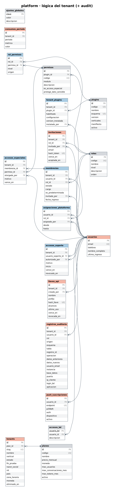

**elius: contactos, canales y conversaciones con Eli**

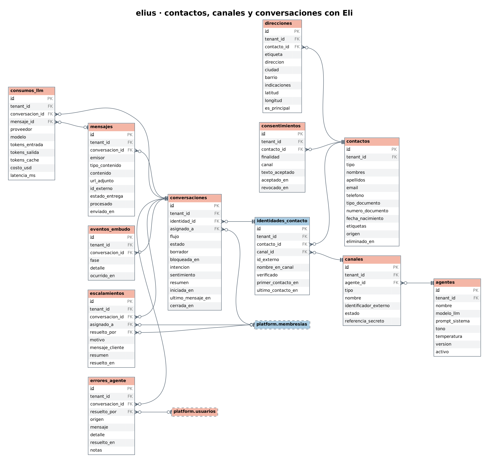

**elius: catálogo y reservas**

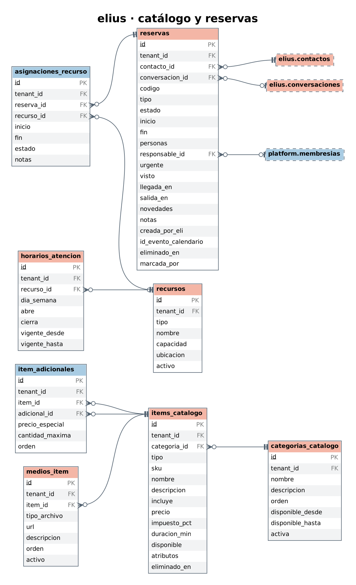

**elius: órdenes, pagos, comprobantes y entregas**

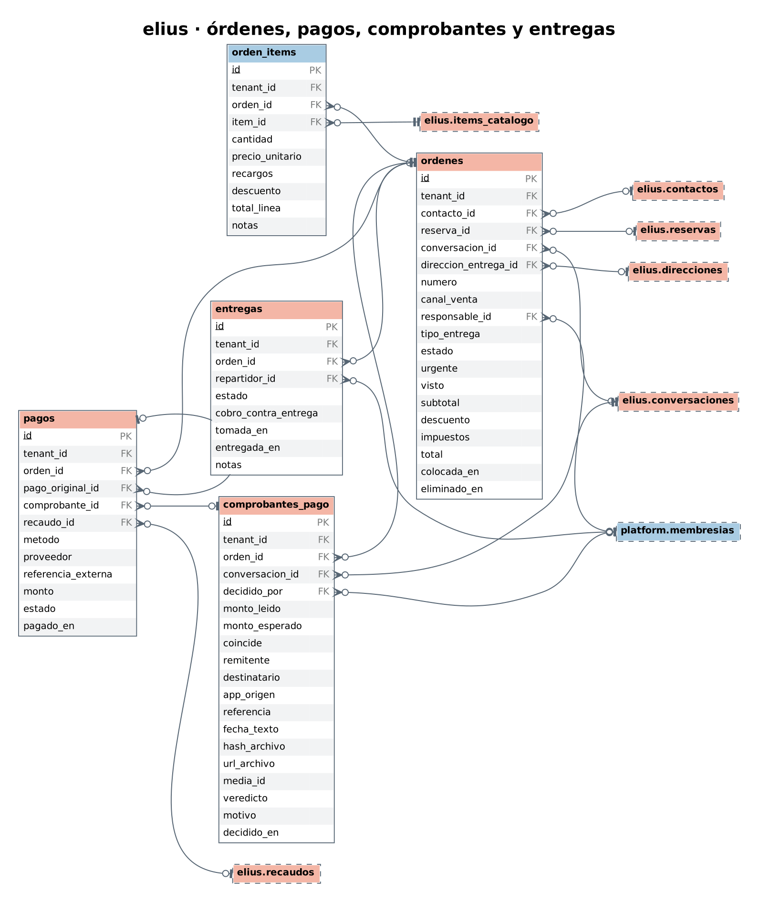

**elius: cobro por llave Bre-B con Factus Pay**

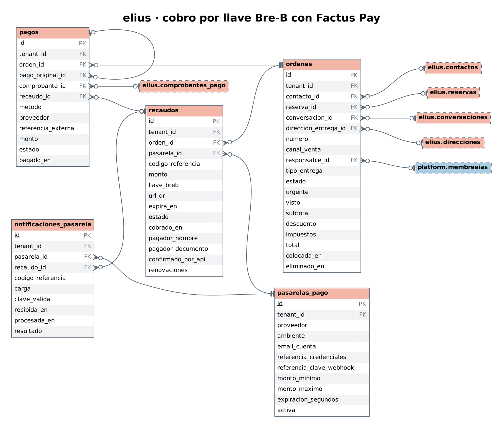

**elius: conocimiento de Eli, configuración y eventos**

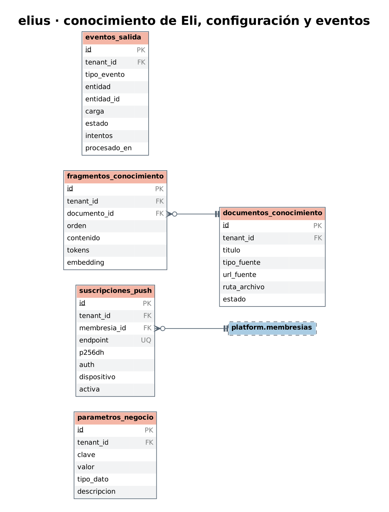

**ext: extensión de Chrome**

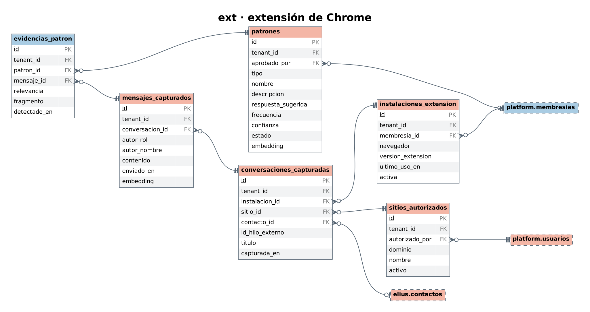

### Plugins

**plugin_vet: veterinaria**

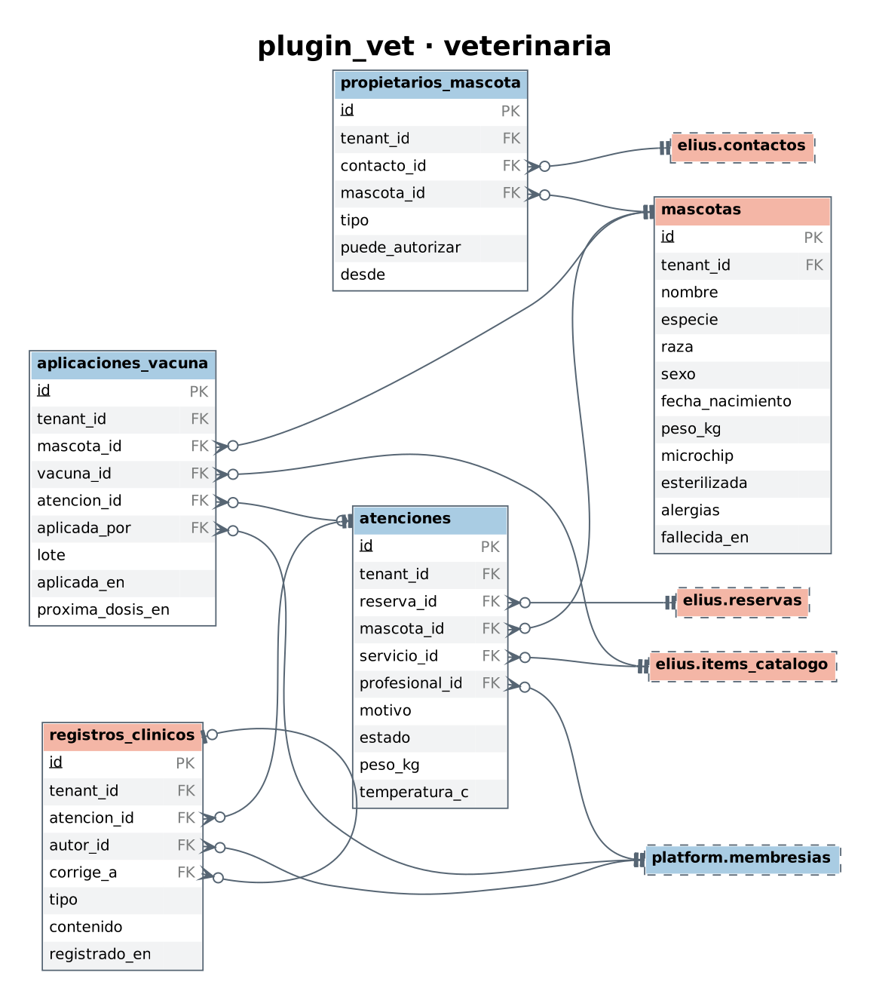

**plugin_restaurant: restaurante**

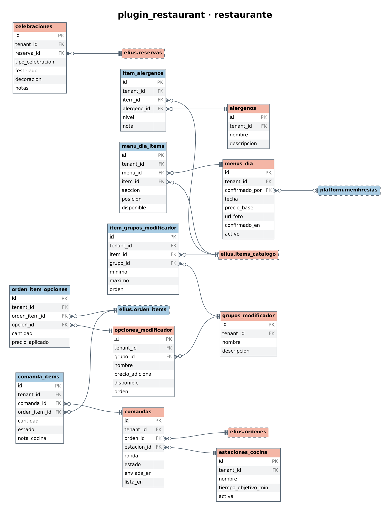

**plugin_airline: aerolínea**

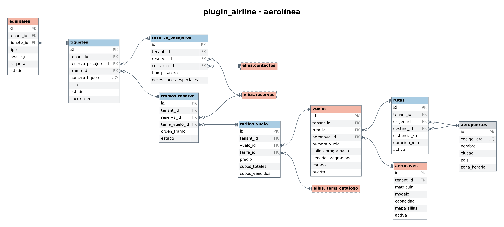

## Resumen por esquema

| Parte | Esquema | Tablas | Entidades | Transiciones | Referencia |
| --- | --- | --- | --- | --- | --- |
| Modelo general | `platform` | 15 | 5 | 6 | 4 |
| Modelo general | `audit` | 1 | 1 | 0 | 0 |
| Modelo general | `elius` | 33 | 29 | 4 | 0 |
| Modelo general | `ext` | 6 | 5 | 1 | 0 |
| Plugin | `plugin_vet` | 5 | 2 | 3 | 0 |
| Plugin | `plugin_restaurant` | 12 | 7 | 5 | 0 |
| Plugin | `plugin_airline` | 9 | 3 | 5 | 1 |
| **Total** | | **81** | **52** | **24** | **5** |

La lista de las 24 transiciones con los datos que guarda cada una está en [03_relaciones.md](03_relaciones.md).

## Archivo editable

`database/modelo/salida/elius_modelo.dbml` se importa en [dbdiagram.io](https://dbdiagram.io) para ver, editar o exportar el modelo. Trae grupos separados para el modelo general y para cada plugin.
