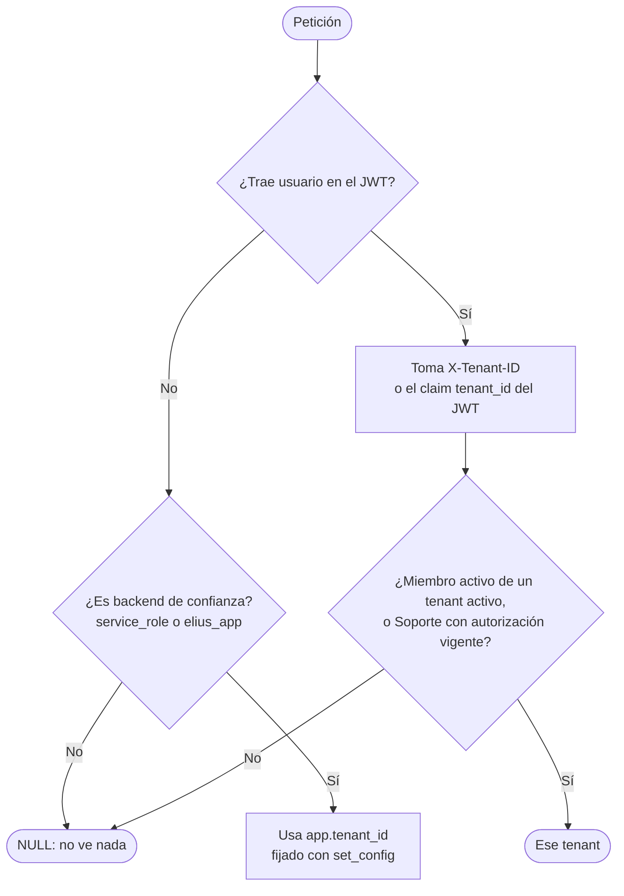

# Seguridad multi-tenant y RLS

Elius usa el modelo **pool**: todos los negocios comparten tablas. El aislamiento no depende de que la aplicación filtre bien. Lo garantiza PostgreSQL con **Row Level Security** en las 80 tablas propias (DT-01, DT-02).

## 1. ¿De qué negocio es la petición? `app.current_tenant_id()`

- El claim `tenant_id` lo agrega el **Custom Access Token Hook** de Supabase (`public.custom_access_token_hook`) al emitir el token, usando la membresía predeterminada (DT-04).
- El encabezado `X-Tenant-ID` permite cambiar de negocio sin volver a iniciar sesión, pero se valida igual: un negocio ajeno devuelve NULL (prueba 3).
- Como los claims pueden quedar viejos hasta que se renueva el token, **la base vuelve a verificar la membresía en cada petición**.

## 2. ¿Qué puede hacer en ese negocio? `app.nivel_permiso()` y `app.puede()`

`app.nivel_permiso('modulo')` devuelve 0 (nada), 1 (lectura), 2 (escritura) o 3 (total), tomando el mayor de:

1. El nivel del **rol general** de su membresía (`platform.rol_permisos`).
2. Los **accesos especiales** que le activó el Administrador (equivalen a escritura).
3. **Soporte autorizado**: `con_autorizacion` equivale a total mientras la autorización esté vigente.

Si el permiso es de un plugin que el negocio no tiene habilitado, devuelve 0 (RN-P09). El backend de confianza, sin usuario y con un tenant fijado, tiene nivel total dentro de ese tenant.

## 3. Las políticas: una plantilla para todas las tablas de negocio

`app.aplicar_rls(tabla, permiso)` crea cuatro políticas iguales en cada tabla:

| Operación | Condición |
| --- | --- |
| `SELECT` | `tenant_id = (select app.current_tenant_id()) and (select app.puede(permiso, 'lectura'))` |
| `INSERT` | mismo tenant y `escritura` |
| `UPDATE` | mismo tenant y `escritura`; la fila no puede cambiar de tenant (`WITH CHECK`) |
| `DELETE` | mismo tenant y `total` |

El mapa tabla → permiso está en la migración `0400`: por ejemplo `elius.ordenes → ordenes`, `plugin_vet.registros_clinicos → vet.historia_clinica`. Usar una plantilla evita el riesgo principal del modelo pool: que una tabla nueva quede sin política.

**Rendimiento (DT-06).** Las funciones van dentro de `(select …)`. Así PostgreSQL las calcula **una vez por consulta** y no una vez por fila. Además, todo índice de negocio empieza por `tenant_id`.

## 4. Políticas especiales

| Tabla | Política | Por qué |
| --- | --- | --- |
| `ext.conversaciones_capturadas`, `ext.mensajes_capturados` | **RESTRICTIVE** `solo_quien_captura` | RN-E01: lo capturado lo ve quien lo capturó, salvo nivel total. Restrictiva = se suma con AND a la general |
| `elius.suscripciones_push` | `push_propias` | Cada usuario administra solo sus dispositivos |
| `platform.tenants` | `tenants_mios` | Cada usuario ve los negocios donde es miembro (para cambiar de negocio) |
| `platform.membresias` | `membresias_propias` + `membresias_tenant` | Un Operador ve solo la suya; quien tiene permiso de usuarios ve las del negocio |
| `platform.accesos_soporte` | `accesos_soporte_gestion` | Solo el Administrador autoriza, y queda su usuario como autor |
| `audit.registros_auditoria` | solo `SELECT` | Nadie escribe la auditoría a mano; la escriben los triggers |
| Catálogos globales (planes, roles, permisos, plugins) | lectura para todos, escritura solo `app.es_super_admin()` | |
| `plugin_airline.aeropuertos` | lectura global | Catálogo IATA común a todos los tenants (RN-A01) |

## 5. Vistas y funciones que no rompen el aislamiento

- **Vistas de negocio con `security_invoker = true` (DT-14).** Aplican el RLS de quien consulta; sin esa opción correrían con los permisos de su dueño y mostrarían todos los negocios.
- **Funciones `SECURITY DEFINER` con `search_path = ''`.** Se usan solo donde hace falta escribir lo que el usuario no puede (auditoría, eventos, consecutivos) o crear filas antes de tener membresía (crear tenant, aceptar invitación). El `search_path` vacío impide que alguien las engañe con objetos de otro esquema.
- **`PUBLIC` no ejecuta las funciones de servidor.** En PostgreSQL toda función nace ejecutable por `PUBLIC`; las del webhook, Vault y tareas programadas se le revocan explícitamente.

## 6. Qué quedó probado

Sección 3 de las pruebas: un negocio no ve ni escribe en otro, `X-Tenant-ID` ajeno no se acepta y una FK no cruza tenants. Secciones 4 a 6: permisos por rol, plugins y accesos especiales. Sección 12: Soporte y Super Admin. Sección 16: vistas y usuarios de PostgreSQL. Detalle en [11_pruebas.md](11_pruebas.md).
