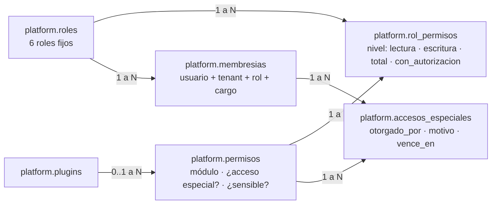

# Roles y permisos

El acceso se controla en **dos niveles independientes**:

1. **Roles de aplicación**: lo que una persona puede hacer dentro de un negocio. Viven en tablas (`platform.roles`, `rol_permisos`, `membresias`) y los aplica RLS.
2. **Usuarios de PostgreSQL**: con qué privilegios se conecta un programa a la base. Viven en el catálogo de PostgreSQL (`CREATE ROLE`, `GRANT`).

## 1. Los 6 roles generales (iguales para todos los negocios)

Las pymes no tienen departamento de TI, así que no diseñan roles: eligen uno de una lista corta. El plugin **personaliza**, pero no crea roles (DT-05).

| Rol | Nivel | Quién es | Qué hace |
| --- | --- | --- | --- |
| Super Admin | Plataforma | Equipo Elius | Administra tenants, planes y plugins. **No ve datos de negocio** |
| Soporte | Plataforma | Equipo Elius | Entra a un negocio solo con autorización del Administrador, por horas y auditado |
| Administrador | Tenant | Dueño o gerente | Todo su negocio, incluidos los datos sensibles |
| Operador | Tenant | Recepción, mesero, cajero, cocina, domiciliario, veterinario | El día a día; lo sensible solo con acceso especial |
| Analista | Tenant | Contador, socio | Solo lectura y reportes |
| Eli | Tenant | El agente de IA | Atiende clientes; no ve usuarios, auditoría ni datos sensibles |

La matriz exacta rol × módulo está en el [anexo E](anexo_e_matriz_permisos.md) (21 permisos, 78 asignaciones).

## 2. Cómo se modela un permiso



- **Niveles:** lectura < escritura < total. `DELETE` exige total, así que solo el Administrador borra (y casi todo usa borrado lógico).
- **Cargo:** "Veterinario" o "Mesero" es una etiqueta en `membresias.cargo`: cambia las pantallas, no los permisos.
- **Acceso especial (★):** un permiso del plugin marcado `es_acceso_especial` que el Administrador activa por persona con `platform.otorgar_acceso_especial`. Ejemplo: un Operador veterinario recibe `vet.historia_clinica`; un Operador de recepción no (prueba 6).

## 3. Cómo personaliza cada plugin

| Plugin | Módulos que agrega | Acceso especial | Cargos sugeridos |
| --- | --- | --- | --- |
| Veterinaria | `vet.pacientes` | `vet.historia_clinica` | Veterinario, Recepción, Auxiliar |
| Restaurante | `restaurant.menu`, `restaurant.cocina` | `restaurant.reversos` | Mesero, Cajero, Cocina, Domiciliario |
| Aerolínea | `airline.vuelos`, `airline.reservas` | `airline.documentos` | Agente de counter, Ventas, Operaciones |

Al instalar el plugin, sus permisos ya vienen asignados a los roles generales (migración `0900`).

> `restaurant.reversos` y `airline.documentos` existen en el catálogo y en la matriz. Todavía no protegen una tabla propia: su control fino (reversar un pago, ver los documentos de los pasajeros) queda como siguiente paso, por medio de un procedimiento o una vista que los exija.

## 4. Usuarios de conexión a PostgreSQL (ninguno es superusuario)

Corresponde a "Conexión con usuarios: Admin, Privilegios, Consulting (non Super Admin)" (DT-13, migraciones `0100` y `0800`).

| Usuario | Atributos | Privilegios | No puede |
| --- | --- | --- | --- |
| `elius_admin` | `NOSUPERUSER NOBYPASSRLS NOCREATEROLE` | `USAGE, CREATE` en los esquemas; todos los privilegios sobre tablas y funciones `WITH GRANT OPTION` | Saltarse RLS ni ver varios negocios a la vez |
| `elius_app` | `NOSUPERUSER NOBYPASSRLS` | `SELECT, INSERT, UPDATE, DELETE` en tablas de negocio; `EXECUTE` en procedimientos | `TRUNCATE`, cambiar la estructura, escribir catálogos globales o la auditoría |
| `elius_consulta` | `NOSUPERUSER NOBYPASSRLS` | `SELECT` solo en las vistas del esquema `reportes` | Leer tablas, escribir, ver datos personales |

Los tres se crean sin `LOGIN`; la contraseña se asigna fuera del repositorio:

```sql
alter role elius_app login password '…';
```

Como **no son dueños de las tablas**, RLS les aplica. Para trabajar fijan un negocio, y solo ven ese:

```sql
select set_config('app.tenant_id', '<uuid del negocio>', false);
```

Además se usan los roles de Supabase: `anon` (sin ningún permiso sobre datos), `authenticated` (personas, sujeto a RLS) y `service_role` (solo en Edge Functions; nunca en el navegador).

## 5. Qué quedó probado

- El Analista lee pero no escribe ni ve la auditoría; el Operador escribe pero no borra ni apaga a Eli (prueba 4).
- Un Operador sin acceso especial no escribe historia clínica; con él, sí (prueba 6).
- Soporte no ve nada sin autorización; el Super Admin no ve datos de negocio (prueba 12).
- `elius_consulta` lee los reportes y nada más; `elius_app` sin negocio fijado no ve nada y no puede cambiar la estructura; ningún usuario de conexión es superusuario ni salta RLS (prueba 16).

## Ajuste del 24-nov-2026

- **Aprobar o rechazar comprobantes: solo el Administrador.** El Operador y el Analista ven la lista. La regla vive en la base (trigger `t55_solo_admin_decide`), no solo en el panel.
- **Catálogo:** solo el Administrador crea o edita; Operador y Analista consultan.
- **Modelo de datos, Vistas, Consola SQL y Auditoría:** Administrador; el Super Admin usa Modelo de datos, Vistas y Consola SQL desde la plataforma.
- **Analista:** solo lectura de resumen, métricas, pedidos, clientes, catálogo, conversaciones, comprobantes y agenda.
- La pantalla de configuración de Eli se retiró del panel.

## Ajuste 24-nov (consola SQL del Operador y auditoría total)

- El **Operador** también usa la Consola SQL, con las mismas reglas que el Administrador (solo SELECT, INSERT, UPDATE y CREATE en `practica`; sin DROP, DELETE, TRUNCATE, ALTER ni bajas lógicas). Además no puede insertar ni actualizar catálogo, menú, precios ni vuelos: la consola lo rechaza y la RLS lo respalda (su permiso `catalogo` es solo lectura).
- **Toda acción de cada rol queda en Auditoría**, que ve el Administrador: cambios en tablas, consultas de la consola, intentos bloqueados y mensajes enviados a clientes por una persona (solo datos de control). El panel permite filtrar por rol y por tipo de movimiento.
- Lo que **no** se audita: lecturas desde las pantallas (abrir una lista no deja huella) y las tablas técnicas de alto volumen (consumo de IA, eventos del embudo, mensajes de Eli y del cliente).
