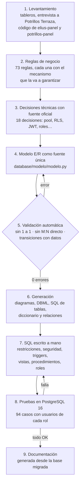

# Cómo lo hicimos

## El método, paso a paso



1. **Levantamiento.** Se partió de los tableros de clase (multi-tenencia, JWT, esquemas, entregables) y de la entrevista a Potrillos Terraza. También se revisó el código que ya está en producción (`elius-panel`, `potrillos-panel`): de ahí salieron 18 funciones que el levantamiento no había recogido.
2. **Reglas de negocio.** Cada regla tiene un código (RN-P plataforma, RN-C núcleo, RN-E extensión, RN-V, RN-R, RN-A plugins) y el mecanismo que la hará cumplir: `CHECK`, trigger, procedimiento, vista o política. Ese código aparece después en el SQL y en las pruebas, así que se puede rastrear de punta a punta.
3. **Decisiones técnicas.** Cada decisión (DT-01 a DT-18) tiene por qué, cómo y fuente oficial: PostgreSQL, Supabase, AWS, RFC 7519, Ley 1581 y Factus Pay.
4. **Modelo como fuente única.** El modelo E/R está escrito una sola vez, en `modelo.py` (tablas, columnas, llaves, únicos, privacidad), con los dominios en `dominios.py`. Todo lo demás sale de ahí. Así el diagrama, el SQL y el diccionario no se desincronizan.
5. **Validación de las reglas del curso.** `generar.py` revisa las tres reglas en cada corrida y falla si alguna se rompe.
6. **Generación.** Diagramas en pata de gallo (Graphviz), DBML para dbdiagram.io, la migración de tablas con llaves compuestas e índices, el diccionario y las relaciones.
7. **SQL escrito a mano.** Lo que no es estructura se escribió y comentó migración por migración, cada objeto con la regla que cumple.
8. **Pruebas.** Un PostgreSQL 16 local que simula Supabase aplica las 50 migraciones desde cero y corre 369 pruebas con usuarios reales de cada rol.
9. **Documentación.** Los inventarios (triggers, políticas, vistas, funciones, matriz de permisos) se consultan en la base ya migrada, para que lo que se sustenta sea lo que corre.

## Cómo reproducirlo

```bash
# Regenerar modelo, diagramas, DBML y SQL de tablas (valida las 3 reglas)
cd database/modelo
python3 generar.py
python3 sql.py ../supabase/migrations/20261123000200_tablas.sql

# Aplicar todas las migraciones en un PostgreSQL 16 limpio y correr las pruebas
bash database/tests/ejecutar_pruebas.sh

# Regenerar la documentación automática desde la base migrada
python3 database/modelo/documentar.py docs/05_base_de_datos psql -h /tmp -p 5433 -U postgres -d elius
```

Para Supabase real: `supabase db push` aplica `database/supabase/migrations/` (el archivo `tests/00_supabase_simulado.sql` no se usa allá). Luego hay que activar el hook en *Authentication → Hooks → Custom Access Token* con `public.custom_access_token_hook`, y exponer los esquemas `platform, elius, ext, plugin_vet, plugin_restaurant, plugin_airline` en *Settings → API*.

## Preguntas típicas de la sustentación

**¿Por qué pool y no una base por cliente?** Las pymes pagan poco y el equipo es pequeño. El pool tiene el menor costo por cliente, una sola versión y una sola migración para todos. El riesgo es la fuga de datos, y se controla con RLS en la base, llaves compuestas y pruebas (DT-01, DT-02).

**Si la aplicación olvida filtrar por `tenant_id`, ¿se filtran datos?** No. RLS filtra en el motor: sin un tenant válido la consulta devuelve 0 filas. Lo prueba la sección 3.

**¿Para qué las llaves compuestas si ya hay RLS?** Porque las verificaciones de llaves foráneas no pasan por RLS. Sin ellas, una reserva podría apuntar al contacto de otro negocio (DT-07, prueba 3).

**¿Dónde se ve que no hay relaciones 1 a 1?** En la validación automática y en la tabla de relaciones: todas son de uno a muchos. Las que lo parecían se rediseñaron (ver [01_modelo_entidad_relacion.md](01_modelo_entidad_relacion.md)).

**¿Por qué roles fijos?** Porque el público son pymes sin TI. Seis roles generales, y el plugin personaliza con módulos, accesos especiales y cargos (DT-05).

**¿Quién puede ver todo?** Ningún usuario de la aplicación ni de conexión. El Super Admin ve tenants pero no datos de negocio; Soporte ve un negocio solo con autorización; `elius_consulta` ve solo agregados.

**¿Cómo se evita cobrar dos veces?** Por comprobante: la base marca los repetidos, y `aprobar_comprobante` no vuelve a cobrar una orden pagada. Por Factus: el webhook es idempotente y un repetido devuelve `duplicado` (pruebas 9 y 10).

**¿Por qué triggers y no lógica en la aplicación?** Porque las reglas tienen que cumplirse sin importar quién escriba: un panel, Eli, n8n o un script. En la base no se pueden saltar.

**¿Qué falta para producción?** Probar las Edge Functions contra el sandbox de Factus, el script que migra los datos de Potrillos Terraza, el control fino de los accesos `restaurant.reversos` y `airline.documentos`, y particionar por mes las tablas de alto volumen (RNF-10).
