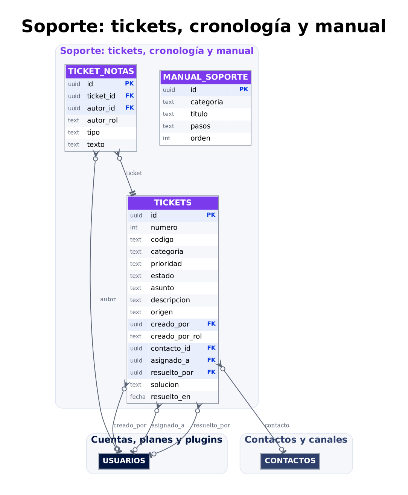
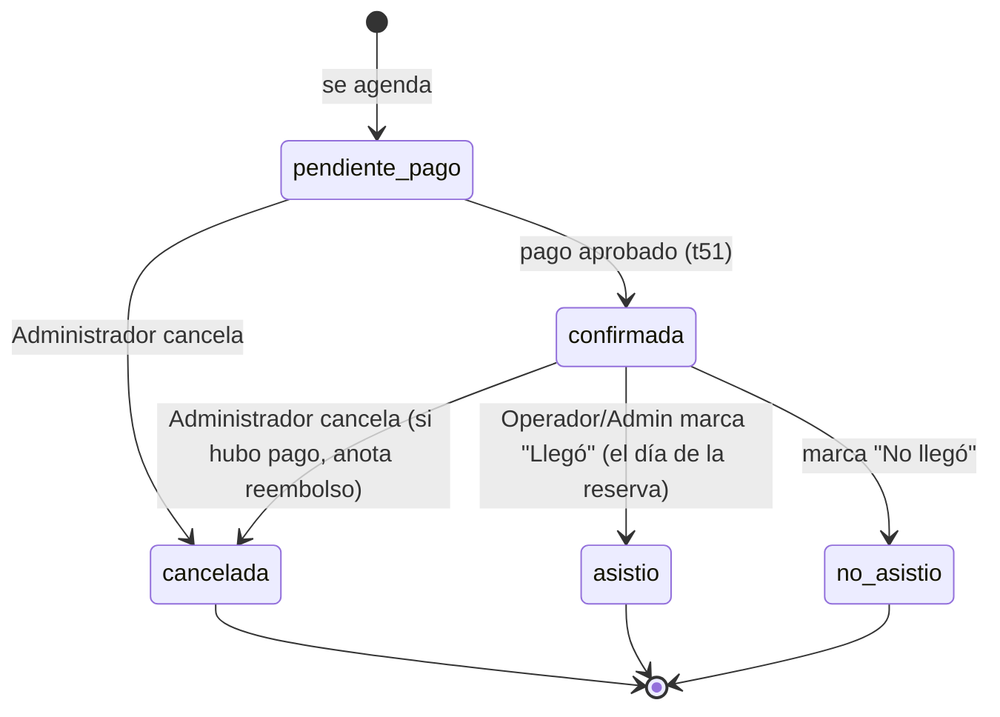

# Cambios del modelo · 26 de noviembre de 2026

Documento para estudiar y sustentar. Reúne todo lo que cambió en la base de datos y en los paneles desde la versión anterior del modelo (83 tablas): qué se agregó, por qué, qué regla de negocio lo exige, quién puede usarlo y cómo se comprueba. Las migraciones son la 43 a la 50 de `supabase/instalacion` (archivos `20261126000100` a `20261126000800`).

**Cifras antes y después**

| Concepto | Antes | Ahora |
| --- | --- | --- |
| Tablas | 83 | **87** (+ `tickets`, `ticket_notas`, `manual_soporte`, `accesos_bd`) |
| Relaciones | 192 | **201** |
| Pruebas automáticas | 94 | **369**, todas aprobadas |
| Migraciones | 42 | **50** |

El modelo (`database/modelo/modelo.py`) sigue siendo la fuente única: de él salen los diagramas, el diccionario y las relaciones. Las columnas que agregó una migración sobre una tabla ya creada se declaran con `columnas_migradas(...)`: salen en los diagramas, pero el generador de SQL no las vuelve a crear.

---

## 1. Resumen de cambios

| # | Cambio | Qué se agregó | Migración |
| --- | --- | --- | --- |
| 1 | Soporte con tickets | Tablas `tickets`, `ticket_notas`, `manual_soporte`; 7 categorías; prioridad; estado; solución obligatoria al resolver | 0100 |
| 2 | Comprobantes de prueba | `generar_comprobante_prueba`: crea un pedido y su comprobante para ver trabajar los triggers de pagos | 0200 |
| 3 | Pedidos y reservas manuales + Papelera | `crear_pedido_manual`, baja lógica (`eliminado_en`), `v_papelera`, restaurar, borrado definitivo solo del CIS adm | 0300 |
| 4 | Coherencia de reservas, pedidos y clientes | Llegó / No llegó, cancelar reserva con su motivo, mesas liberadas, protección de clientes con movimientos | 0400 |
| 5 | El Operador crea tickets y no tiene consola SQL | `v_mis_reportes` ahora incluye los tickets del panel; `consola_sql` solo para Administrador y Super Admin | 0500 |
| 6 | Quién atendió cada reserva | `reservas.marcada_por`, trigger `t06_marcada_por`, correo en las vistas de agenda | 0600 |
| 7 | Tomar reserva sin trabarse | `responsable_id` en las vistas, `liberar_reserva`; el Operador toma, el Administrador libera | 0700 |
| 8 | Regla R1 (sin relaciones 1 a 1) | `accesos_bd.usuario_id` deja de ser único | 0800 |

---

## 2. Modelo de datos: tablas y columnas nuevas

Diagrama del módulo nuevo: [`er/12-soporte-y-tickets.png`](er/12-soporte-y-tickets.png).

### 2.1 Tablas nuevas

| Tabla | Tipo | Para qué sirve | Relaciones |
| --- | --- | --- | --- |
| `elius.tickets` | entidad | Un problema reportado: categoría, prioridad, estado, asunto, quién lo creó, quién lo atiende y la solución | `tenant_id` → `tenants`; `contacto_id` → `contactos` (opcional) |
| `elius.ticket_notas` | entidad | Cronología del ticket: notas, cambios de estado, solución, datos corregidos | `ticket_id` → `tickets` (cascada) |
| `elius.manual_soporte` | referencia (global) | Pasos para resolver cada categoría; igual para todos los negocios | ninguna |
| `platform.accesos_bd` | referencia | Qué usuario de PostgreSQL representa a qué persona de la aplicación (conexiones directas por rol) | `usuario_id` → `auth.users` |

Restricciones que explican el diseño de `tickets`:

- `categoria` solo admite `01` a `07`; `prioridad` solo `baja, media, alta, critica`; `estado` solo `abierto, en_proceso, resuelto`.
- `asunto` mínimo 5 caracteres.
- **Un ticket no se puede resolver sin solución**: `estado <> 'resuelto' or length(solucion) >= 3`.
- `(tenant_id, numero)` único: el consecutivo `TCK-0001` es por negocio.
- `(tenant_id, contacto_id)` es llave foránea compuesta: un ticket nunca apunta a un cliente de otro negocio.
- Tienen RLS activo **y ninguna política**: el panel no las lee directamente, solo a través de vistas y procedimientos controlados.
- Los triggers `t00_sin_baja_directa` y `t00_sin_truncate_directo` impiden borrarlos.

### 2.2 Columnas nuevas en tablas existentes

| Tabla | Columna | Para qué |
| --- | --- | --- |
| `elius.ordenes` | `eliminado_en` | Baja lógica: el pedido va a la Papelera, no se borra |
| `elius.reservas` | `eliminado_en` | Baja lógica de la reserva |
| `elius.reservas` | `marcada_por` | Quién marcó Llegó / No llegó (la pone un trigger) |
| `audit.registros_auditoria` | `usuario_email`, `instancia`, `base_datos`, `puerto`, `ip_cliente`, `login_bd`, `aplicacion` | Auditoría completa: quién, desde dónde y con qué programa |

(`contactos` y `items_catalogo` ya tenían `eliminado_en`.)

### 2.3 Una política restrictiva para esconder lo eliminado

`ordenes` y `reservas` tienen una política **restrictiva** `sin_eliminados` (`for select using (eliminado_en is null)`). Como las restrictivas se combinan con `AND`, todas las vistas y consultas con RLS dejan de ver lo eliminado sin tocar cada vista. Solo `v_papelera` y los procedimientos del Administrador lo ven.

### 2.4 Por qué se quitó el 1 a 1

`platform.accesos_bd.usuario_id` era único: una persona tenía exactamente un usuario de base de datos. Eso es una relación 1 a 1, que la regla R1 del curso prohíbe. Se quitó la unicidad (migración 0800); nada dependía de ella, porque la búsqueda va por `usuario_bd`, que es la llave primaria. Ahora es 1 a muchos.

---

## 3. Reglas de negocio nuevas o ajustadas

| Regla | Qué dice | Dónde se hace cumplir |
| --- | --- | --- |
| RN-C09 | Una reserva no se elimina si ya está en `asistio`; la llegada solo se marca el día de la reserva y si está confirmada | `t07_proteger_baja` (reservas), `marcar_llegada` |
| RN-C11 | Los totales de un pedido no se editan a mano | `t43_proteger_totales` |
| RN-C12 | Un pedido con pago aprobado no se elimina; un pago aprobado no se modifica | `t07_proteger_baja` (ordenes), `t50_proteger_pago` |
| RN-C13 | Un cliente con reservas activas o pedidos abiertos no se elimina | `t07_proteger_baja` (contactos) |
| RN-C16 | Un comprobante que no cuadra (monto distinto, repetido) genera alertas | `t52_revisar_comprobante` |
| RN-C17 | El pedido se confirma solo cuando los pagos cubren el total | `t51_aplicar_pago` |
| RN-C31 | La consola SQL es del Administrador y del Super Admin (**ya no del Operador**) | `consola_sql` |
| Nueva | Solo el Operador toma reservas; el Administrador las libera | `tomar_reserva`, `liberar_reserva` |
| Nueva | Marcar Llegó / No llegó guarda quién lo hizo y, si nadie la tenía, lo deja como responsable | `t06_marcada_por` |
| Nueva | Cancelar una reserva con pago aprobado deja anotado el reembolso; el dinero no desaparece | `cancelar_reserva` |
| Nueva | Cancelar o eliminar una reserva libera la mesa; restaurarla la ocupa de nuevo solo si sigue libre | `cancelar_reserva`, `eliminar_reserva`, `restaurar_reserva` |

---

## 4. Triggers nuevos

| Trigger | Tabla | Momento | Qué hace |
| --- | --- | --- | --- |
| `t07_proteger_baja` | `ordenes`, `reservas` | BEFORE UPDATE OF `eliminado_en` | Impide dar de baja un pedido pagado (RN-C12) o una reserva ya atendida (RN-C09) |
| `t07_proteger_baja` | `contactos` | BEFORE UPDATE OF `eliminado_en` | Impide dar de baja un cliente con movimientos (RN-C13) |
| `t06_marcada_por` | `reservas` | BEFORE UPDATE | Cuando el estado pasa a `asistio` o `no_asistio`, guarda `auth.uid()` en `marcada_por` y, si no había responsable, pone al que marcó |
| `t00_sin_baja_directa` | `tickets`, `ticket_notas` | BEFORE UPDATE/DELETE | Nadie borra tickets; se resuelven |
| `t00_sin_truncate_directo` | `tickets`, `ticket_notas` | BEFORE TRUNCATE | Tampoco se vacían |
| `t01_actualizado_en`, `t02_auditoria` | las tablas nuevas | | Fecha de modificación y bitácora, como en las demás |

**Cadena de triggers de pagos (lo que se destaca en las pruebas de comprobantes)**, en el orden en que actúan sobre un comprobante o un pago: `t52` revisa y alerta → `t53` publica el evento `comprobante.recibido` → `t56` avisa al celular → `t55` solo el Administrador decide → `t51` confirma el pedido si el pago lo cubre → `t50` protege el pago aprobado → `t02` audita.

---

## 5. Procedimientos nuevos (todos por RPC desde el panel)

| Procedimiento | Quién | Qué hace |
| --- | --- | --- |
| `crear_ticket(categoria, prioridad, asunto, descripcion, contacto)` | Administrador, Operador, Soporte | Crea un ticket con su `TCK-000N` |
| `reportar_problema(mensaje)` | Operador, Administrador | Atajo: ticket de categoría General |
| `soporte_tomar_ticket`, `soporte_nota_ticket`, `soporte_resolver_ticket` | Soporte (y Administrador) | Atender un ticket: tomarlo, anotar, resolver con solución |
| `soporte_corregir_cliente`, `soporte_crear_usuario`, `soporte_restablecer_clave`, `soporte_cambiar_rol_usuario`, `soporte_estado_usuario` | Soporte | Acciones del Centro de soporte, cada una deja nota en el ticket y auditoría |
| `generar_ticket_prueba`, `generar_comprobante_prueba` | Administrador / Soporte (solo negocios de prueba) | Datos de demostración para ver los triggers |
| `crear_pedido_manual(contacto, tipo_entrega, items)` | Administrador | Pedido presencial creado a mano |
| `eliminar_pedido`, `restaurar_pedido`, `eliminar_reserva`, `restaurar_reserva` | Administrador | Baja lógica y restaurar desde la Papelera |
| `eliminar_definitivo(tipo, id)` | Solo CIS adm (Super Admin) | Borrado real de producto, cliente, pedido o reserva |
| `cancelar_reserva(id, motivo)` | Administrador | Cancela, libera la mesa, cancela el pedido sin pago y anota el reembolso si había pago |
| `marcar_llegada`, `marcar_no_llegada` | Operador y Administrador | Solo el día de la reserva; guardan quién lo marcó |
| `tomar_reserva(id)` | Operador | Queda como responsable si está libre |
| `liberar_reserva(id)` | Administrador | Quita al responsable para que otro la tome |

Auxiliares internos: `app.codigo_ticket`, `app.estado_ticket`, `app.soporte_o_admin`, `app.dinero_de_reserva`, `app.correo_miembro`, `app.proteger_baja_pedido_reserva`, `app.proteger_baja_cliente`, `app.reserva_marcada_por`.

---

## 6. Vistas nuevas o modificadas

| Vista | Cambio | Quién la lee |
| --- | --- | --- |
| `v_soporte_tickets`, `v_soporte_tickets_pendientes`, `v_soporte_historial_tickets`, `v_soporte_ticket_notas`, `v_soporte_clientes`, `v_soporte_usuarios`, `v_soporte_manual` | Nuevas: el Centro de soporte lee solo vistas | Soporte, Administrador |
| `v_mis_reportes` | Ahora incluye los tickets del panel (`origen in ('reporte','panel')`) con categoría, prioridad, estado y solución | Operador (los suyos), Administrador (todos) |
| `v_papelera` | Nueva: productos, clientes, pedidos y reservas eliminados | Administrador, CIS adm |
| `v_agenda_calendario`, `v_agenda_dia` | Agregan `responsable_id`, `responsable_correo`, `marcada_por_correo` | Operador, Administrador |
| `v_auditoria` | Muestra el rol real de quien consultó y los intentos bloqueados de la consola | Administrador |

---

## 7. Quién puede qué (resumen por rol)

| Acción | Administrador | Operador | Soporte | CIS adm (Super Admin) |
| --- | --- | --- | --- | --- |
| Crear tickets | Sí | Sí | Sí | No aplica |
| Ver tickets | Todos los del negocio | Solo los suyos | Los de los negocios autorizados | Todos |
| Resolver tickets | Sí | No | Sí | Sí |
| Consola SQL | **Sí** | **No** (se quitó) | No | Sí |
| Crear pedidos y reservas a mano | Sí | No | No | No |
| Eliminar pedidos y reservas (Papelera) | Sí | No | No | Sí |
| Borrado definitivo | No | No | No | **Sí** |
| Tomar una reserva | No | **Sí** | No | No |
| Liberar una reserva | **Sí** | No | No | No |
| Marcar Llegó / No llegó | Sí | Sí | No | No |
| Cancelar una reserva | **Sí** | No | No | No |
| Aprobar o rechazar comprobantes | **Sí** (solo él decide) | No | No | No |

---

## 8. Flujo de una reserva con los cambios

Paralelo a esos estados: el Operador **toma** la reserva (queda como responsable), el Administrador puede **liberarla**, y cualquiera de los dos que marque la llegada queda registrado en `marcada_por`. El Administrador la puede **eliminar** (a la Papelera) salvo que ya haya asistido o tenga un pago aprobado.

---

## 9. Cómo se comprueba

| Prueba | Qué verifica |
| --- | --- |
| Sección 28 (`11_conexiones_bd.sql`) | Tickets: crear, tomar, anotar, resolver; Soporte no ve más datos de los autorizados |
| Sección 29 | Comprobantes de prueba (exacto, distinto, repetido) y consola del Administrador |
| Sección 30 | Pedidos y reservas manuales y Papelera |
| Sección 31 | Coherencia: mesas, pedidos, clientes y dinero al cancelar o eliminar |
| Sección 32 | El Operador crea tickets y ve su estado; no tiene consola SQL |
| Sección 33 | Se guarda quién marcó la llegada y el Administrador lo ve |
| Sección 34 | El Administrador no toma reservas, el Operador sí, el Administrador libera |

Para correrlas: `bash database/tests/ejecutar_pruebas.sh` (debe terminar en `TODO OK`).

**En el panel (qué mostrar):**
1. Entrar como `admin.restaurante@elius.local`: Reservas → Nueva reserva, Cancelar, Eliminar (va a la Papelera). Comprobantes → «Generar comprobante de prueba».
2. Entrar como `trabajador.restaurante@elius.local`: Mi trabajo → Tomar reserva → Llegó. Volver como administrador: la reserva muestra «Atiende» y «Marcado por» con su correo.
3. Entrar como trabajador: «Tickets de soporte» (crear uno). Entrar como `soporte.restaurante@elius.local`: Centro de soporte → Tomar ticket → Resolver. El trabajador ve la solución.
4. Comprobar que el trabajador **no** tiene «Consola SQL» en el menú.

---

## 10. Preguntas de sustentación

1. **¿Por qué `tickets` tiene RLS pero ninguna política?** Para que el panel no pueda leerla directamente: solo llega a ella a través de vistas y funciones controladas. Con RLS activo y sin políticas, nadie con rol de panel ve filas.
2. **¿Por qué la baja lógica usa una política restrictiva y no un filtro en cada vista?** Las restrictivas se combinan con AND con las demás políticas, así que lo eliminado desaparece de todas las vistas de una vez; un filtro por vista se olvidaría en alguna.
3. **¿Por qué el Operador ya no tiene consola SQL?** Es una herramienta de revisión de la base; el Operador trabaja con reservas y pedidos desde el panel. Se quitó del menú, de la ruta y de la función en la base: ocultarla solo en el panel no bastaría.
4. **¿Qué pasaba cuando se «pegaba» Tomar reserva?** El panel decidía si la reserva estaba libre mirando el cargo del responsable; si el cargo estaba vacío parecía libre, pero la base ya la daba por tomada. Ahora las vistas traen `responsable_id` y el panel mira eso.
5. **¿Cómo se sabe quién marcó la llegada si el panel no lo envía?** Lo pone un trigger `BEFORE UPDATE` con `auth.uid()`; el panel no puede falsearlo ni olvidarlo.
6. **¿Por qué `accesos_bd.usuario_id` ya no es único?** Porque unicidad sobre una llave foránea es una relación 1 a 1, que el curso prohíbe; la búsqueda real va por `usuario_bd`.
7. **¿Qué pasa con el dinero si se cancela una reserva pagada?** El pedido pagado no se cancela y la reserva queda anotada con «gestionar el reembolso»; el pago aprobado es inmutable (RN-C12).
8. **¿Quién borra de verdad?** Solo el CIS adm con `eliminar_definitivo`, desde la Papelera. El Administrador solo desactiva y puede restaurar.
