# Modelo entidad-relación de Elius

Modelo completo del software: **81 tablas** con sus campos y relaciones. El color agrupa las tablas por módulo; las tablas con solo el nombre son de otro módulo y se muestran para ver cómo se conectan. `PK` es llave primaria, `FK` llave foránea y `UQ` valor único. Cada línea lleva el nombre de la columna que la crea y usa notación pata de gallo: la pata es el lado «muchos» y la rayita el «uno»; el círculo significa que es opcional.

No se dibujan `tenant_id`, `creado_en` ni `actualizado_en`: **todas las tablas de negocio los tienen** (ver [05_seguridad_multitenant_rls.md](05_seguridad_multitenant_rls.md)). Las tablas de transición, que resuelven una relación de muchos a muchos, guardan datos propios y están listadas en [03_relaciones.md](03_relaciones.md).

## Modelo completo

[](er/00-modelo-er-completo.png)

La imagen es grande. Ábrela y acércate, o usa la versión vectorial [`00-modelo-er-completo.svg`](er/00-modelo-er-completo.svg), que se amplía sin perder calidad.

## Modelo general y plugins por separado

Para sustentar: primero el modelo general, que sirve a cualquier negocio, y aparte los plugins, que lo extienden. Los plugins apuntan al núcleo; el núcleo nunca apunta a un plugin.

- Modelo general: [`00a-modelo-general-completo.svg`](er/00a-modelo-general-completo.svg) ([png](er/00a-modelo-general-completo.png))
- Plugins: [`00b-plugins-completo.svg`](er/00b-plugins-completo.svg) ([png](er/00b-plugins-completo.png))

## Por módulos

Los mismos datos, divididos para leerlos con calma.

### Modelo general

**1. Cuentas, planes y plugins**

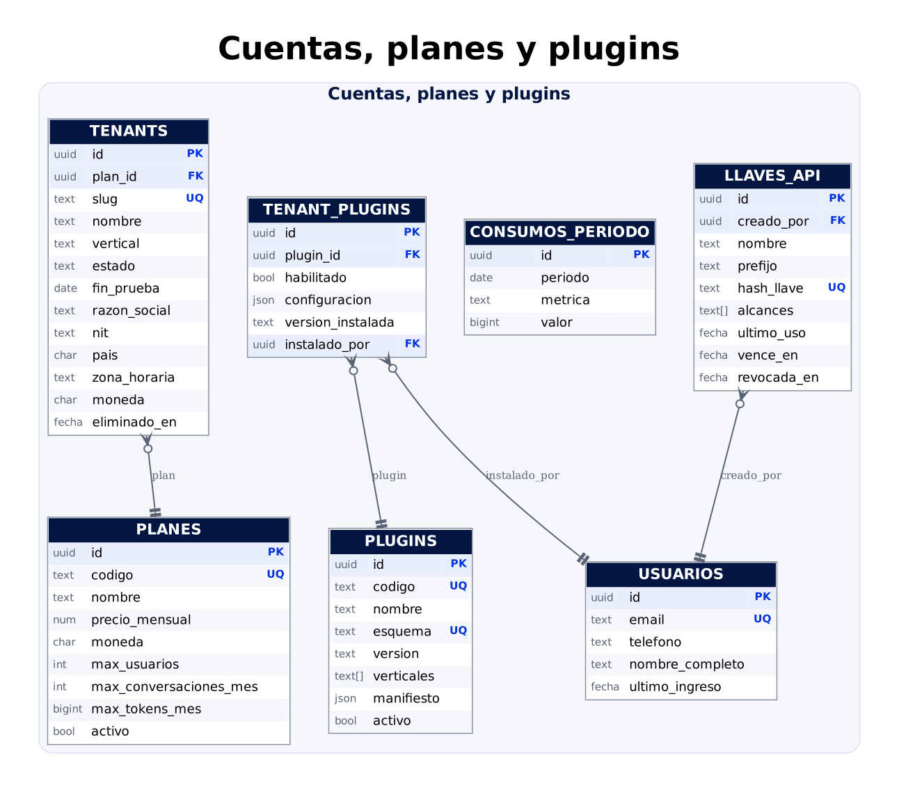

**2. Roles, permisos, accesos y auditoría**

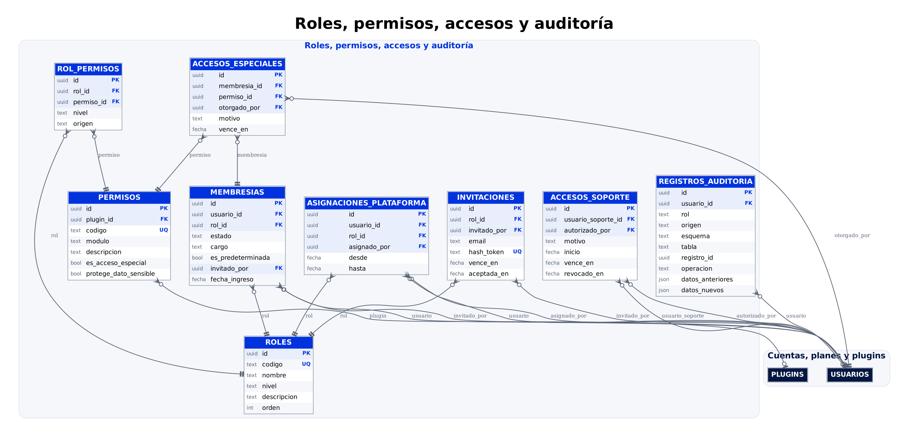

**3. Contactos y canales**

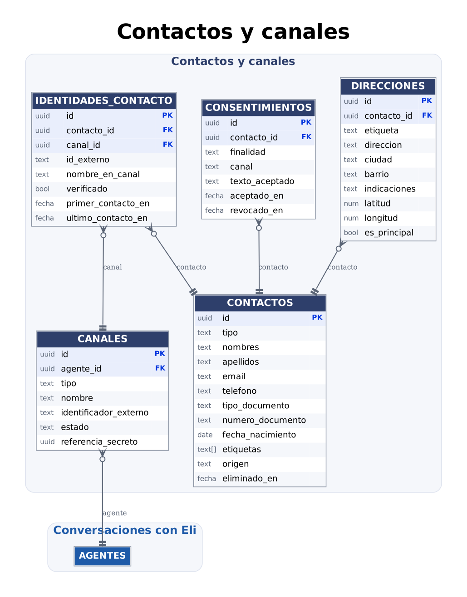

**4. Conversaciones con Eli**

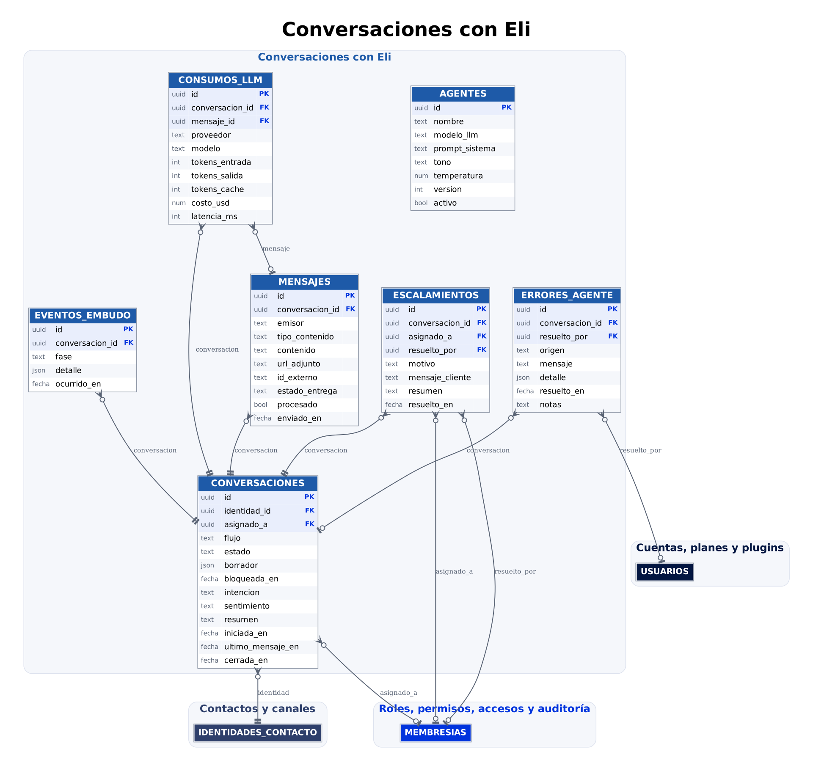

**5. Catálogo y reservas**

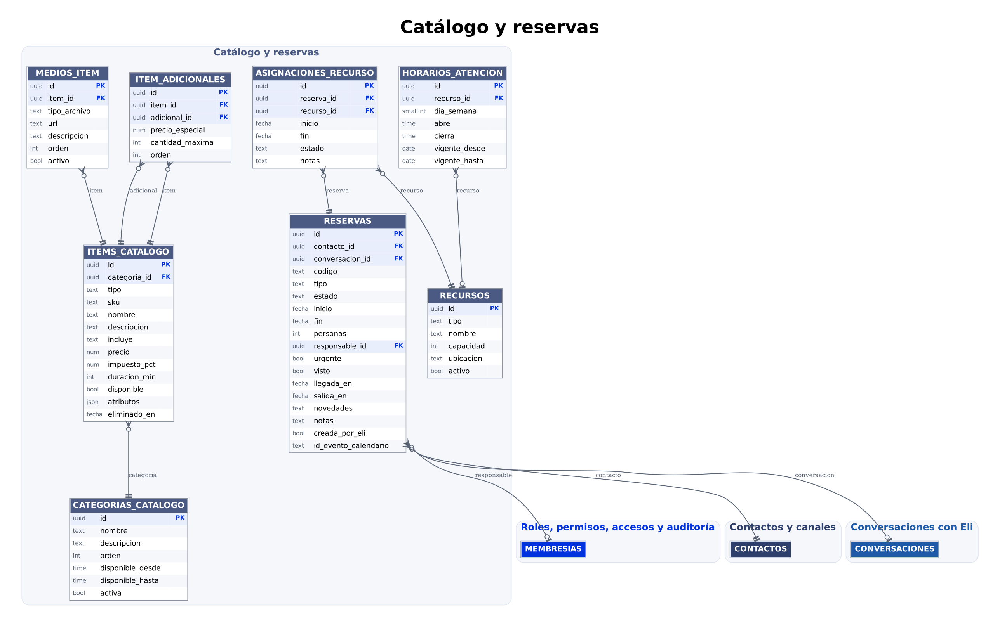

**6. Órdenes, pagos y Factus Pay**

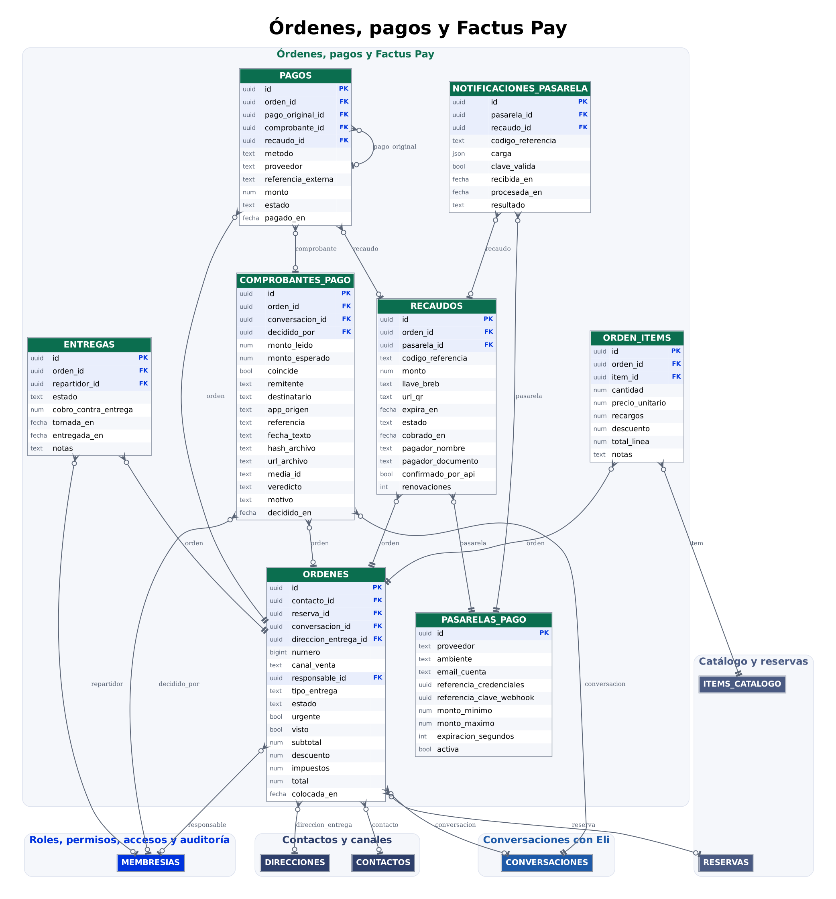

**7. Configuración y conocimiento de Eli**

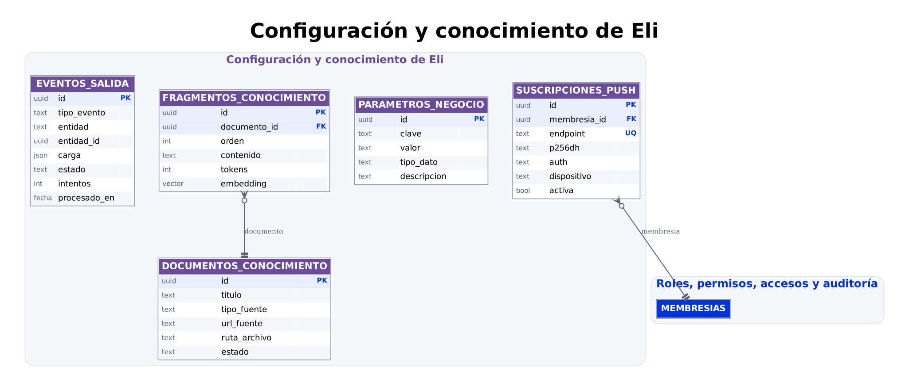

**8. Extensión de Chrome**

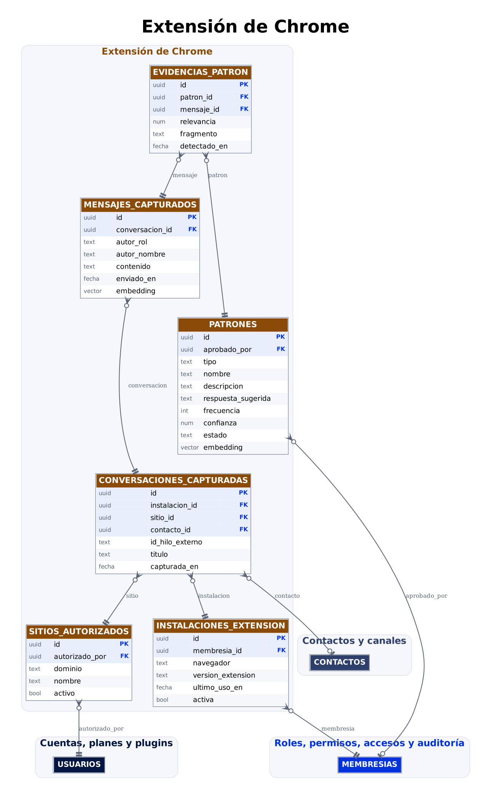

### Plugins

**9. Veterinaria**

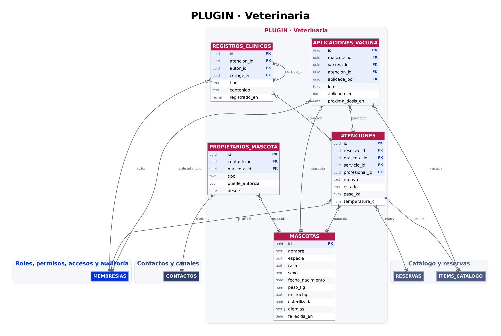

**10. Restaurante**

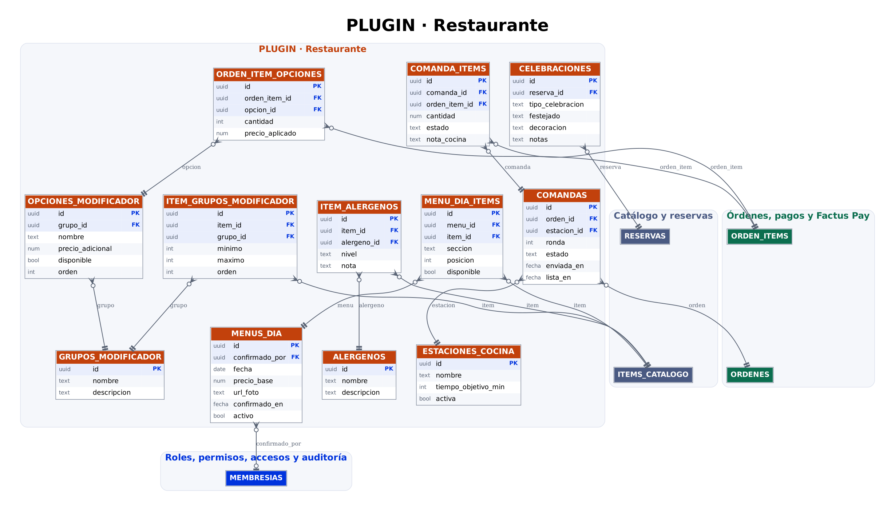

**11. Aerolínea**

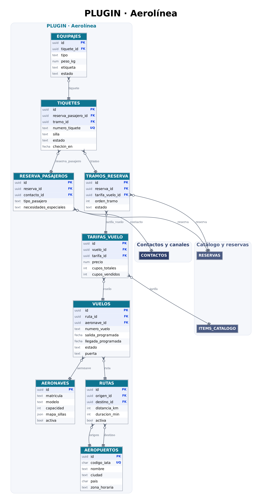

## Regenerar las imágenes

El modelo vive en `database/modelo/modelo.py`. Después de cambiarlo:

```bash
python3 database/modelo/er_estilo.py docs/05_base_de_datos/er   # necesita Graphviz
```
